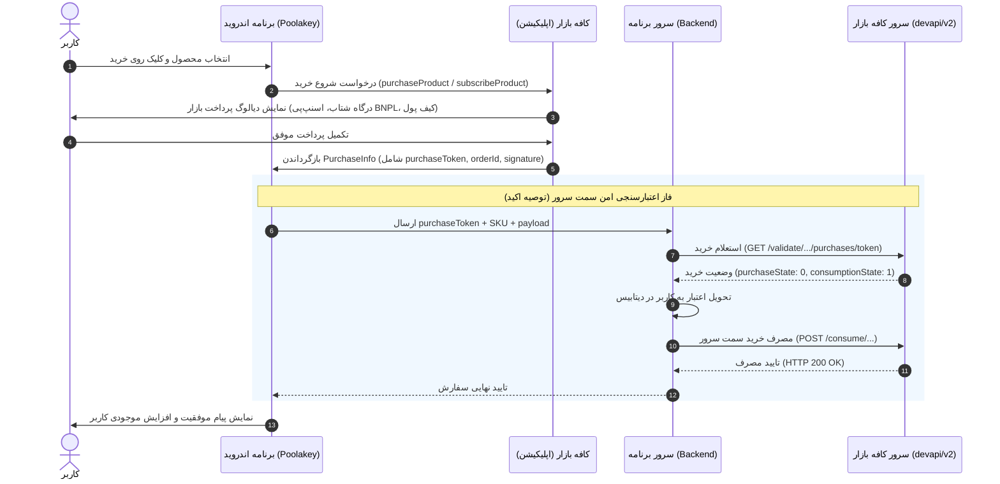

# راهنمای جامع و مرجع عملیاتی پرداخت درون‌برنامه‌ای کافه بازار (In-App Billing)

> **نسخه مستند:** ۱.۰.۰  
> **سازگاری:** کتابخانه رسمی پولکی (Poolakey کاتلین) نسخه ۲.x به بعد، پیاده‌سازی کلاسیک AIDL/Java، کافه بازار نسخه ۱۳.۳.۰ به بعد و API سرور نسخه ۲ (`devapi/v2`).  
> **مرجع:** مستندات رسمی توسعه‌دهندگان کافه بازار (`developers.cafebazaar.ir`).

---

## فهرست مطالب
1. [معرفی و مفاهیم اصلی پرداخت درون‌برنامه‌ای](#۱-معرفی-و-مفاهیم-اصلی-پرداخت-درونبرنامهای)
   - [انواع محصولات درون‌برنامه‌ای](#انواع-محصولات-درونبرنامهای)
   - [مفاهیم و اصطلاحات پایه](#مفاهیم-و-اصطلاحات-پایه)
   - [معماری و چرخه جریان پرداخت](#معماری-و-چرخه-جریان-پرداخت)
2. [پیش‌نیازها و تنظیمات پنل توسعه‌دهندگان بازار (پیشخان)](#۲-پیشنیازها-و-تنظیمات-پنل-توسعادهندگان-بازار-پیشخان)
   - [ثبت برنامه و آپلود بسته اولیه](#ثبت-برنامه-و-آپلود-بسته-اولیه)
   - [تعریف محصولات و قوانین قیمت‌گذاری](#تعریف-محصولات-و-قوانین-قیمتگذاری)
   - [کلید عمومی RSA برنامه](#کلید-عمومی-rsa-برنامه)
   - [تنظیمات محصولات اشتراکی و دوره آزمایشی (Free Trial)](#تنظیمات-محصولات-اشتراکی-و-دوره-آزمایشی-free-trial)
   - [حساب‌های آزمایشی و تست پیش از انتشار](#حسابهای-آزمایشی-و-تست-پیش-از-انتشار)
3. [تنظیمات پروژه اندروید (کلاینت)](#۳-تنظیمات-پروژه-اندروید-کلاینت)
   - [افزودن کتابخانه رسمی Poolakey به گریدل](#افزودن-کتابخانه-رسمی-poolakey-به-گریدل)
   - [تنظیمات AndroidManifest.xml (مجوزها و تگ queries برای اندروید ۱۱+)](#تنظیمات-androidmanifestxml-مجوزها-و-تگ-queries-برای-اندروید-۱۱)
   - [قوانین ProGuard و مبهم‌سازی کلاینت](#قوانین-proguard-و-مبهمسازی-کلاینت)
4. [پیاده‌سازی کلاینت با کتابخانه Poolakey (کاتلین)](#۴-پیادهسازی-کلاینت-با-کتابخانه-poolakey-کاتلین)
   - [مقداردهی اولیه و تنظیم بررسی امنیت (SecurityCheck)](#مقداردهی-اولیه-و-تنظیم-بررسی-امنیت-securitycheck)
   - [اتصال به سرویس پرداخت بازار و مدیریت چرخه حیات](#اتصال-به-سرویس-پرداخت-بازار-و-مدیریت-چرخه-حیات)
   - [دریافت جزئیات محصولات (getInAppSkuDetails و getSubscriptionSkuDetails)](#دریافت-جزئیات-محصولات-getinappskudetails-و-getsubscriptionskudetails)
   - [شروع فرآیند خرید محصول (purchaseProduct)](#شروع-فرآیند-خرید-محصول-purchaseproduct)
   - [شروع فرآیند خرید اشتراک (subscribeProduct)](#شروع-فرآیند-خرید-اشتراک-subscribeproduct)
   - [ساختار داده خروجی خرید (PurchaseInfo و فیلدهای PurchaseEntity)](#ساختار-داده-خروجی-خرید-purchaseinfo-و-فیلدهای-purchaseentity)
   - [مصرف کردن خرید (consumeProduct)](#مصرف-کردن-خرید-consumeproduct)
   - [بازیابی خریدهای مصرف‌نشده و اشتراک‌ها در شروع برنامه](#بازیابی-خریدهای-مصرفنشده-و-اشتراکها-در-شروع-برنامه)
   - [بررسی امکان تعلق اشتراک آزمایشی (checkTrialSubscription)](#بررسی-امکان-تعلق-اشتراک-آزمایشی-checktrialsubscription)
   - [کد کامل و ماژولار کاتلین (کلاس BazaarBillingManager)](#کد-کامل-و-ماژولار-کاتلین-کلاس-bazaarbillingmanager)
5. [روش سنتی Java و ارتباط مستقیم AIDL](#۵-روش-سنتی-java-و-ارتباط-مستقیم-aidl)
   - [فایل اینترفیس IInAppBillingService.aidl](#فایل-اینترفیس-iinappbillingserviceaidl)
   - [اتصال به سرویس بازار با ServiceConnection](#اتصال-به-سرویس-بازار-با-serviceconnection)
   - [متدهای کلیدی اینترفیس AIDL](#متدهای-کلیدی-اینترفیس-aidl)
   - [شروع اینتنت خرید و مدیریت onActivityResult](#شروع-اینتنت-خرید-و-مدیریت-onactivityresult)
6. [اعتبارسنجی سمت سرور (Server-to-Server REST API)](#۶-اعتبارسنجی-سمت-سرور-server-to-server-rest-api)
   - [روش‌های احراز هویت (OAuth 2.0 و توکن پیشخان)](#روشهای-احراز-هویت-oauth-20-و-توکن-پیشخان)
   - [Endpoint استعلام وضعیت خرید درون‌برنامه‌ای](#endpoint-استعلام-وضعیت-خرید-درونبرنامهای)
   - [Endpoint مصرف خرید درون‌برنامه‌ای سمت سرور](#endpoint-مصرف-خرید-درونبرنامهای-سمت-سرور)
   - [Endpoint استعلام وضعیت اشتراک دوره‌ای](#endpoint-استعلام-وضعیت-اشتراک-دورهای)
   - [Endpoint استعلام اشتراک‌های فعال کاربر](#endpoint-استعلام-اشتراکهای-فعال-کاربر)
   - [Endpoint عودت خرید درون‌برنامه‌ای و اشتراک (Refund)](#endpoint-عودت-خرید-درونبرنامهای-و-اشتراک-refund)
   - [Endpoint لغو تمدید خودکار اشتراک](#endpoint-لغو-تمدید-خودکار-اشتراک)
   - [محدودیت نرخ درخواست (Rate Limit) و الزامات امنیتی سرور](#محدودیت-نرخ-درخواست-rate-limit-و-الزامات-امنیتی-سرور)
7. [قابلیت‌های ویژه بازار](#۷-قابلیتهای-ویژه-بازار)
   - [خرید اعتباری اسنپ‌پی (BNPL - الان بخر، بعداً پرداخت کن)](#خرید-اعتباری-اسنپپی-bnpl---الان-بخر-بعدا-پرداخت-کن)
   - [تخفیف پویا (Dynamic Discount با توکن امضاشده JWT)](#تخفیف-پویا-dynamic-discount-با-توکن-امضاشده-jwt)
8. [مرجع کدهای بازگشتی و خطاهای سیستم](#۸-مرجع-کدهای-بازگشتی-و-خطاهای-سیستم)
   - [کدهای پاسخ کلاینت (Bundle RESPONSE_CODE)](#کدهای-پاسخ-کلاینت-bundle-response_code)
   - [کدهای خطای احراز هویت سرور](#کدهای-خطای-احراز-هویت-سرور)
   - [کدهای خطای Endpointهای API سرور](#کدهای-خطای-endpointهای-api-سرور)
   - [کدهای خطای تخفیف پویا (کدهای ۱ تا ۱۶)](#کدهای-خطای-تخفیف-پویا-کدهای-۱-تا-۱۶)
9. [چک‌لیست تست، عیب‌یابی و سناریوهای معمول](#۹-چک‌لیست-تست-عیبیابی-و-سناریوهای-معمول)
   - [چک‌لیست تست گام‌به‌گام](#چک‌لیست-تست-گام‌به‌گام)
   - [عیب‌یابی خطاهای رایج](#عیبیابی-خطاهای-رایج)
   - [راهکارهای مقابله با دور زدن پرداخت و ارتقای امنیت](#راهکارهای-مقابله-با-دور-زدن-پرداخت-و-ارتقای-امنیت)

## ۱. معرفی و مفاهیم اصلی پرداخت درون‌برنامه‌ای

سیستم پرداخت درون‌برنامه‌ای کافه بازار (In-App Billing یا IAB) به برنامه‌ها و بازی‌های اندرویدی این امکان را می‌دهد که محتوای دیجیتال، خدمات و قابلیت‌های ویژه خود را مستقیماً از طریق زیرساخت مالی و امن کافه بازار به فروش برسانند. در این سیستم، کافه بازار به عنوان درگاه واسط امن عمل کرده و فرآیند تسویه حساب، پرداخت بانکی (شاپرک)، خرید اعتباری (اسنپ‌پی) و احراز هویت مالی کاربر را بر عهده می‌گیرد.

### انواع محصولات درون‌برنامه‌ای

کافه بازار از سه نوع محصول کلی در بستر پرداخت درون‌برنامه‌ای پشتیبانی می‌کند:

| نوع محصول | دسته‌بندی در پنل | چرخه عمر و مصرف | مثال‌های کاربردی | رفتار در نصب مجدد |
| :--- | :--- | :--- | :--- | :--- |
| **محصولات مصرف‌شدنی (Consumable)** | خریدنی (inapp) | **باید مصرف شوند.** پس از خرید، کاربر مالک آن می‌شود و تا قبل از فراخوانی `consume` نمی‌تواند دوباره آن را بخرد. | سکه بازی، جم، بنزین، بسته‌های پیامک، شارژ حساب داخل برنامه | پاک می‌شود؛ کاربر پس از نصب مجدد باید دوباره خرید کند (مگر اینکه سرور اختصاصی برنامه آن را نگه داشته باشد). |
| **محصولات غیرمصرفی (Non-Consumable)** | خریدنی (inapp) | **نباید مصرف شوند.** کاربر یک‌بار آن را می‌خرد و اثر آن برای همیشه در حساب کافه بازار کاربر باقی می‌ماند. | حذف تبلیغات، ارتقا به نسخه پریمیوم/VIP دائم، باز کردن مراحل بازی | با حذف و نصب مجدد برنامه یا تغییر دستگاه، با ورود به همان حساب بازار بازیابی می‌شود. |
| **اشتراک دوره‌ای (Subscription)** | اشتراکی (subs) | **غیرقابل مصرف.** به صورت دوره‌ای (ماهانه/سالانه) تعریف می‌شود و قابلیت تمدید خودکار (Auto-Renewing) از کیف پول دارد. | اشتراک ماهانه محتوای آموزشی، اشتراک سالانه سرویس صوتی/تصویری | دائمی تا پایان دوره اشتراک؛ در صورت نصب مجدد با ورود به حساب بازار فعال باقی می‌ماند. |

> [!IMPORTANT]
> **قانون طلایی مصرف (Consumption Rule):**  
> محصولات اشتراکی و محصولات غیرمصرفی **هرگز نباید مصرف شوند**. اگر یک محصول مصرفی را مصرف نکنید، کاربر در تلاش‌های بعدی برای خرید همان آیتم با خطای `BILLING_RESPONSE_RESULT_ITEM_ALREADY_OWNED` (کد ۷) مواجه خواهد شد. درخواست مصرف (`consume`) صرفاً اعلام خروج محصول از مالکیت کاربر به منظور ایجاد امکان خرید مجدد است.

---

### مفاهیم و اصطلاحات پایه

برای کار با پرداخت بازار، تسلط بر اصطلاحات زیر ضروری است:

- **شناسه محصول (SKU - Stock Keeping Unit):**  
  رشته‌ای متنی و یکتا که در پنل پیشخان بازار برای هر محصول تعریف می‌شود (مانند `coin_pack_100` یا `vip_monthly`). این شناسه در کلاینت و سرور برای ارجاع به محصول به کار می‌رود و **پس از ثبت به هیچ عنوان قابل تغییر یا حذف نیست**.
- **توکن خرید (purchaseToken):**  
  رشته‌ای منحصربه‌فرد که پس از انجام موفقیت‌آمیز تراکنش، توسط کافه بازار تولید می‌شود. این توکن کلید اصلی استعلام وضعیت خرید، مصرف محصول سمت سرور یا کلاینت، و لغو یا عودت خرید است.
- **اطلاعات اضافی توسعه‌دهنده (developerPayload):**  
  رشته‌ای دلخواه و اختیاری که توسعه‌دهنده هنگام درخواست خرید به بازار ارسال می‌کند. بازار این رشته را عیناً همراه با اطلاعات رسید خرید برمی‌گرداند. کاربرد امنیتی اصلی آن، اتصال تراکنش به شناسه کاربر در سرور خودتان (`userId` یا `orderId` داخلی) جهت جلوگیری از جعل درخواست است.
- **کلید عمومی پرداخت (RSA Public Key):**  
  یک کلید عمومی رمزنگاری نامتقارن RSA بر پایه فرمت Base64 که کافه بازار برای هر برنامه اختصاص می‌دهد. بازار رسید خرید را با کلید خصوصی خود امضا می‌کند (`INAPP_DATA_SIGNATURE`) و برنامه یا سرور شما با استفاده از این کلید عمومی می‌تواند امضا را راستی‌آزمایی کرده و مطمئن شود که اطلاعات دستکاری نشده‌اند.
- **فرآیند مصرف (Consuming):**  
  فرآیندی که طی آن به بازار اعلام می‌شود محصول مصرفی توسط کاربر مصرف شده است (مثلاً ۱۰۰ سکه به حساب کاربر داخل بازی اضافه شد). با مصرف موفق، بازار رکورد مالکیت این خرید را آزاد می‌کند تا کاربر بتواند مجدداً آن SKU را خریداری کند.

---

### معماری و چرخه جریان پرداخت

جریان تبادل داده بین کلاینت برنامه، اپلیکیشن کافه بازار، سرور اختصاصی برنامه و سرورهای کافه بازار به شرح زیر است:



---

## ۲. پیش‌نیازها و تنظیمات پنل توسعه‌دهندگان بازار (پیشخان)

### ثبت برنامه و آپلود بسته اولیه
1. وارد **پیشخان توسعه‌دهندگان کافه بازار** به نشانی `pishkhan.cafebazaar.ir` شوید.
2. از منوی برنامه‌ها، بر روی **برنامه جدید** کلیک کرده و بسته اولیه‌تان (فایل APK یا AAB) را آپلود کنید.
3. برنامه می‌تواند در وضعیت **پیش‌نویس (Draft)** باقی بماند و نیازی به انتشار عمومی یا تایید نهایی برای تست پرداخت درون‌برنامه‌ای نیست؛ اما نام بسته (`package_name`) باید در پیشخان ثبت شده باشد.

### تعریف محصولات و قوانین قیمت‌گذاری
1. در صفحه مشخصات برنامه در پیشخان، به سربرگ **پرداخت درون‌برنامه‌ای** بروید.
2. بر روی دکمه **محصول جدید** کلیک کنید.
3. فیلدهای الزامی:
   - **شناسه محصول (SKU):** رشته متنی شامل حروف انگلیسی کوچک، اعداد و آندرلاین (مانند `gold_package_50`). **نکته بسیار مهم:** شناسه کالا پس از ثبت به هیچ عنوان قابل تغییر یا حذف نیست. در صورت عدم نیاز، فقط می‌توانید آن را غیرفعال کنید.
   - **عنوان محصول:** نام نمایشی محصول در فاکتور پرداخت بازار.
   - **توضیحات:** شرح خدمات یا کالای مربوطه.
   - **قیمت (ریال):** پیش‌فرض قیمت محصولات باید بین **۱,۰۰۰ ریال تا ۱,۰۰۰,۰۰۰ ریال** باشد (صفحه‌کلید را روی انگلیسی بگذارید).
   - **درخواست افزایش سقف قیمت:** در صورتی که مایل به تعریف محصولات با قیمت‌های بالاتر از سقف پیش‌فرض هستید، باید درخواست کتبی خود را همراه با نام پکیج و توضیحات محصولات به آدرس ایمیل `developers@cafebazaar.ir` ارسال فرمایید تا سقف برنامه شما توسط تیم پشتیبانی بازار افزایش یابد.

### کلید عمومی RSA برنامه
- در همان سربرگ پرداخت درون‌برنامه‌ای، بر روی دکمه **کلید RSA** کلیک کنید.
- این کلید رشته‌ای با فرمت Base64 است که اختصاصی همین برنامه بوده و برای راستی‌آزمایی امضای دیجیتال رسیدهای خرید در کلاینت یا سرور کاربرد دارد.
- با به‌روزرسانی نسخه برنامه یا انتشار APK جدید، کلید عمومی تغییر نمی‌کند.

### تنظیمات محصولات اشتراکی و دوره آزمایشی (Free Trial)
- محصولات اشتراکی در همان پنل پرداخت با انتخاب نوع **اشتراک** تعریف می‌شوند.
- دوره‌های زمانی اشتراک معمولاً به صورت ۱ ماهه، ۳ ماهه، ۶ ماهه یا ۱ ساله تنظیم می‌گردند.
- **اشتراک آزمایشی (Free Trial):** می‌توانید برای محصول اشتراکی یک دوره آزمایشی رایگان (مثلاً ۷ روز) تعیین کنید.
  - **شرط استفاده:** تنها کاربرانی که تا به حال هیچ اشتراکی در برنامه شما خریداری نکرده‌اند واجد شرایط دریافت دوره آزمایشی هستند. هر کاربر تنها ۱ بار مجاز به استفاده از این امکان است.

### حساب‌های آزمایشی و تست پیش از انتشار
- **روش قیمت صفر ریال:** برای تست خریدهای درون‌برنامه‌ای پیش از انتشار رسمی برنامه، بهترین راهکار این است که قیمت SKU مورد نظر را در پنل موقتاً **صفر ریال** تنظیم کنید تا تراکنش‌ها بدون کسر هزینه از حساب تسترها انجام شود.
- **تست محصولات غیرمصرفی:** از آنجا که خرید غیرمصرفی یک‌بار ثبت شده و قابل مصرف نیست، برای تکرار تست باید هر بار از یک حساب کافه بازار مجزا استفاده کنید یا از طریق پشتیبانی/پنل رکورد تست را بررسی نمایید.

---

## ۳. تنظیمات پروژه اندروید (کلاینت)

### افزودن کتابخانه رسمی Poolakey به گریدل

کتابخانه **پولکی (Poolakey)** ابزار رسمی کافه بازار برای زبان برنامه‌نویسی Kotlin است که بر پایه معماری واکنش‌گرا و مدرن اندروید بازنویسی شده است.

۱. مخزن **JitPack** را به فایل `settings.gradle.kts` (یا `build.gradle` سطح ریشه) اضافه کنید:

```kotlin
// settings.gradle.kts
dependencyResolutionManagement {
    repositoriesMode.set(RepositoriesMode.FAIL_ON_PROJECT_REPOS)
    repositories {
        google()
        mavenCentral()
        maven { url = java.net.URI("https://jitpack.io") }
    }
}
```

۲. وابستگی کتابخانه پولکی را در فایل `build.gradle.kts` ماژول برنامه (`app/build.gradle.kts`) اضافه نمایید:

```kotlin
// app/build.gradle.kts
dependencies {
    // کتابخانه رسمی پرداخت درون‌برنامه‌ای کافه بازار (Poolakey)
    implementation("com.github.cafebazaar.Poolakey:poolakey:2.1.0")
}
```

---

### تنظیمات AndroidManifest.xml (مجوزها و تگ queries برای اندروید ۱۱+)

در اندروید ۱۱ (API سطح ۳۰) به بعد، به دلیل اعمال محدودیت مشاهده بسته‌ها (Package Visibility Filtering)، برنامه شما بدون تعریف تگ `<queries>` قادر به شناسایی و اتصال به سرویس پرداخت کافه بازار نخواهد بود و اتصال با خطای `BILLING_UNAVAILABLE` مواجه می‌شود.

فایل `AndroidManifest.xml` برنامه خود را به شکل زیر پیکربندی کنید:

```xml
<?xml version="1.0" encoding="utf-8"?>
<manifest xmlns:android="http://schemas.android.com/apk/res/android">

    <!-- مجوز رسمی برقراری ارتباط با سرویس پرداخت بازار -->
    <uses-permission android:name="com.farsitel.bazaar.permission.PAY_THROUGH_BAZAAR" />

    <!-- الزام اندروید ۱۱+ برای امکان ارتباط IPC با پکیج و سرویس بازار -->
    <queries>
        <package android:name="com.farsitel.bazaar" />
        <intent>
            <action android:name="ir.cafebazaar.pardakht.InAppBillingService.BIND" />
        </intent>
    </queries>

    <application
        ... >
        <!-- سایر اکتیویتی‌ها و کامپوننت‌های برنامه -->
    </application>

</manifest>
```

---

### قوانین ProGuard و مبهم‌سازی کلاینت

اگر در پروژه از ProGuard یا R8 برای کوچک‌سازی و مبهم‌سازی کد استفاده می‌کنید، برای جلوگیری از حذف یا تغییر نام اینترفیس‌های سیستمی پرداخت درون‌برنامه‌ای، قوانین زیر را در `proguard-rules.pro` قرار دهید:

```proguard
# حفظ اینترفیس‌های AIDL پرداخت درون‌برنامه‌ای
-keep class com.android.vending.billing.** { *; }

# حفظ کلاس‌ها و مدل‌های کتابخانه پولکی
-keep class ir.cafebazaar.poolakey.** { *; }
-keepclassmembers class ir.cafebazaar.poolakey.** { *; }
```

---

## ۴. پیاده‌سازی کلاینت با کتابخانه Poolakey (کاتلین)

### مقداردهی اولیه و تنظیم بررسی امنیت (SecurityCheck)

کتابخانه پولکی امکان بررسی امضای دیجیتال رسید خرید با کلید RSA را فراهم می‌کند:

- **حالت بررسی محلی (`SecurityCheck.Enable`):** برنامه در دستگاه کاربر امضای بازگشتی از بازار را با کلید RSA عمومی تطبیق می‌دهد.
- **حالت بررسی سروری (`SecurityCheck.Disable`):** در صورتی که تصمیم دارید کلید عمومی در کلاینت قرار نگیرد و بررسی امضا و استعلام توکن تماماً در سرور اختصاصی خودتان انجام شود، بررسی محلی را غیرفعال می‌کنید.

```kotlin
import ir.cafebazaar.poolakey.Payment
import ir.cafebazaar.poolakey.config.PaymentConfiguration
import ir.cafebazaar.poolakey.config.SecurityCheck

// ۱. تنظیم استراتژی بررسی امضا
val localSecurityCheck = SecurityCheck.Enable(
    rsaPublicKey = "YOUR_BASE64_RSA_PUBLIC_KEY_FROM_BAZAAR_CONSOLE"
)
// یا در صورت واگذاری امنیت به بک‌اند:
// val localSecurityCheck = SecurityCheck.Disable

// ۲. ساخت کانفیگ پرداخت
val paymentConfiguration = PaymentConfiguration(
    localSecurityCheck = localSecurityCheck
)

// ۳. ایجاد نمونه اصلی Payment
val payment = Payment(
    context = context,
    config = paymentConfiguration
)
```

---

### اتصال به سرویس پرداخت بازار و مدیریت چرخه حیات

ارتباط با بازار از طریق فراخوانی متد `connect` برقرار می‌شود. این متد یک شیء `PaymentConnection` برمی‌گرداند که نگه‌داری ارجاع آن برای قطع ارتباط هنگام تخریب اکتیویتی الزامی است.

```kotlin
import ir.cafebazaar.poolakey.PaymentConnection

private var paymentConnection: PaymentConnection? = null

fun connectToBazaar() {
    paymentConnection = payment.connect {
        connectionSucceed {
            // اتصال با موفقیت برقرار شد؛ اکنون می‌توانید وضعیت خریدها را استعلام کنید
            Log.d("Bazaar", "اتصال به سرویس پرداخت بازار برقرار شد")
        }
        connectionFailed { throwable ->
            // عدم موفقیت در اتصال (مثلاً بازار نصب نیست یا نسخه آن قدیمی است)
            Log.e("Bazaar", "خطا در اتصال به بازار", throwable)
        }
        disconnected {
            // ارتباط برنامه با سرویس پرداخت بازار قطع شده است
            Log.w("Bazaar", "ارتباط با سرویس پرداخت قطع گردید")
        }
    }
}

// جلوگیری از نشت حافظه (Memory Leak) در اکتیویتی یا فرگمنت
override fun onDestroy() {
    paymentConnection?.disconnect()
    super.onDestroy()
}
```

---

### دریافت جزئیات محصولات (getInAppSkuDetails و getSubscriptionSkuDetails)

برای نمایش قیمت رسمی همراه با ریال، عنوان و توضیحات کالاها بدون هاردکد کردن در برنامه، از متدهای دریافت جزئیات SKU استفاده می‌شود:

```kotlin
// ۱. دریافت مشخصات محصولات مصرفی یا غیرمصرفی
payment.getInAppSkuDetails(skuIds = listOf("coin_100", "remove_ads")) {
    getSkuDetailsSucceed { skuList ->
        for (sku in skuList) {
            Log.d("Bazaar", "کالا: ${sku.title} | قیمت: ${sku.price} | شناسه: ${sku.sku}")
        }
    }
    getSkuDetailsFailed { throwable ->
        Log.e("Bazaar", "خطا در استعلام مشخصات محصولات", throwable)
    }
}

// ۲. دریافت مشخصات محصولات اشتراکی
payment.getSubscriptionSkuDetails(skuIds = listOf("sub_monthly_vip")) {
    getSkuDetailsSucceed { subList ->
        for (sub in subList) {
            Log.d("Bazaar", "اشتراک: ${sub.title} | قیمت: ${sub.price}")
        }
    }
    getSkuDetailsFailed { throwable ->
        Log.e("Bazaar", "خطا در استعلام اشتراک‌ها", throwable)
    }
}
```

---

### شروع فرآیند خرید محصول (purchaseProduct)

برای هدایت کاربر به درگاه پرداخت کافه بازار:

```kotlin
import ir.cafebazaar.poolakey.request.PurchaseRequest

val purchaseRequest = PurchaseRequest(
    productId = "coin_pack_100",
    payload = "USER_ID_OR_CUSTOM_ORDER_TOKEN", // رشته اختیاری جهت اتصال به کاربر در دیتابیس
    dynamicPriceToken = null // توکن JWT تخفیف پویا (در صورت استفاده)
)

payment.purchaseProduct(
    registry = activityResultRegistry, // یا پاس دادن مستقیم Activity
    request = purchaseRequest
) {
    purchaseFlowBegan {
        // فرآیند انتقال به صفحه پرداخت بازار با موفقیت آغاز شد
    }
    failedToBeginFlow { throwable ->
        // عدم توانایی در شروع پرداخت (مثلاً پکیج‌نیم نامعتبر یا خطای بازار)
        Log.e("Bazaar", "عدم امکان باز کردن صفحه پرداخت", throwable)
    }
    purchaseSucceed { purchaseEntity ->
        // پرداخت با موفقیت کامل انجام شد!
        Log.d("Bazaar", "خرید موفق: ${purchaseEntity.productId}")
        Log.d("Bazaar", "توکن خرید: ${purchaseEntity.purchaseToken}")
        
        // اقدام ضروری: اگر محصول مصرفی است، باید آن را مصرف کنید
        handleSuccessfulPurchase(purchaseEntity)
    }
    purchaseCanceled {
        // کاربر از انجام پرداخت منصرف شد
        Log.d("Bazaar", "کاربر انصراف داد")
    }
    purchaseFailed { throwable ->
        // خطای سیستمی، عدم تطابق امضا یا خطای شبکه
        Log.e("Bazaar", "خرید ناموفق بود", throwable)
    }
}
```

---

### شروع فرآیند خرید اشتراک (subscribeProduct)

فرآیند خرید اشتراک کاملاً شبیه خرید محصول است، با این تفاوت که به جای `purchaseProduct` از متد `subscribeProduct` استفاده می‌گردد:

```kotlin
payment.subscribeProduct(
    registry = activityResultRegistry,
    request = PurchaseRequest(productId = "vip_subscription_1m")
) {
    purchaseFlowBegan { ... }
    failedToBeginFlow { throwable -> ... }
    purchaseSucceed { purchaseEntity ->
        // اشتراک فعال شد
        // توجه: محصولات اشتراکی هرگز نباید consume شوند!
        activateSubscriptionForUser(purchaseEntity)
    }
    purchaseCanceled { ... }
    purchaseFailed { throwable -> ... }
}
```

---

### ساختار داده خروجی خرید (PurchaseInfo و فیلدهای PurchaseEntity)

هنگامی که خرید در کالبک `purchaseSucceed` با موفقیت پایان می‌یابد، یا زمانی که لیست خریدها را استعلام می‌کنید، یک شیء از نوع اطلاعات خرید دریافت می‌نمایید که شامل فیلدهای زیر است:

| نام فیلد در کاتلین | معادل در JSON خام | نوع داده | توضیحات |
| :--- | :--- | :--- | :--- |
| `orderId` | `orderId` | `String` | شناسه یکتای سفارش که توسط کافه بازار صادر می‌شود. |
| `purchaseToken` | `purchaseToken` | `String` | توکن یکتای تراکنش که برای استعلام و مصرف استفاده می‌شود. |
| `payload` | `developerPayload` | `String` | همان رشته اضافی که در زمان شروع خرید به بازار فرستاده‌اید. |
| `packageName` | `packageName` | `String` | پکیج‌نیم اپلیکیشنی که خرید از آن انجام گرفته است. |
| `purchaseState` | `purchaseState` | `PurchaseState` | وضعیت خرید: ۰ (خریداری شده)، ۱ (لغو شده)، ۲ (مرجوع شده/ریفاند). |
| `purchaseTime` | `purchaseTime` | `Long` | زمان ثبت خرید بر حسب میلی‌ثانیه از مبدا Unix Epoch (۱۹۷۰/۰۱/۰۱). |
| `productId` | `productId` | `String` | شناسه محصول (SKU) خریداری شده. |
| `dataSignature` | `INAPP_DATA_SIGNATURE`| `String` | امضای دیجیتال رسید خرید تولیدشده توسط کلید خصوصی بازار. |

---

### مصرف کردن خرید (consumeProduct)

اگر محصول از نوع **مصرف‌شدنی** است، پس از شارژ حساب کاربر داخل برنامه یا ذخیره آن در دیتابیس، باید بلافاصله متد `consumeProduct` فراخوانی شود:

```kotlin
payment.consumeProduct(purchaseEntity.purchaseToken) {
    consumeSucceed {
        // خرید با موفقیت در بازار مصرف شد؛ اکنون کاربر می‌تواند دوباره آن را بخرد
        Log.d("Bazaar", "محصول با موفقیت مصرف شد")
    }
    consumeFailed { throwable ->
        // خطا در ثبت مصرف محصول (مثلاً کاربر آفلاین است یا از حساب بازار خارج شده)
        // نکته: توکن را ذخیره کنید تا در باز شدن بعدی برنامه دوباره تلاش شود
        Log.e("Bazaar", "خطا در مصرف محصول", throwable)
    }
}
```

> [!WARNING]
> **نکات الزامی متد `consumeProduct`:**
> 1. قبل از فراخوانی مطمئن شوید کاربر به حساب کافه بازار خود وارد شده است؛ در غیر این صورت کالبک `consumeFailed` فعال می‌گردد.
> 2. تلاش برای مصرف محصولات اشتراکی با خطای قطعی مواجه می‌شود (اشتراک‌ها غیرقابل مصرف هستند).

---

### بازیابی خریدهای مصرف‌نشده و اشتراک‌ها در شروع برنامه

یک اصل حیاتی در توسعه پرداخت درون‌برنامه‌ای، **جلوگیری از سوختن خرید کاربر** است. اگر کاربر پول را بپردازد ولی قبل از مصرف، برنامه بسته شود یا اینترنت قطع گردد، خرید در بازار «مصرف‌نشده» باقی مانده و پول کاربر هدر می‌رود. همچنین کاربر برای اشتراک‌های تمدیدشده یا خریدهای دائم باید با هر بار ورود به برنامه استعلام شود:

```kotlin
// ۱. استعلام خریدهای تحت مالکیت کاربر (شامل اقلام غیرمصرفی و اقلام مصرفی که هنوز مصرف نشده‌اند)
payment.getPurchasedProducts {
    querySucceed { purchasedList ->
        for (purchase in purchasedList) {
            when (purchase.productId) {
                "remove_ads", "pro_lifetime" -> {
                    // محصول غیرمصرفی است؛ قابلیت را برای کاربر فعال نگه دارید
                    enablePremiumFeature()
                }
                "coin_pack_100", "fuel_bottle" -> {
                    // محصول مصرفی است که قبلاً خریداری شده اما مصرف آن ثبت نشده!
                    deliverItemToUser(purchase)
                    // مصرف مجدد برای آزاد شدن کالا
                    payment.consumeProduct(purchase.purchaseToken) {
                        consumeSucceed { Log.d("Bazaar", "خرید جامانده با موفقیت مصرف شد") }
                        consumeFailed { throwable -> Log.e("Bazaar", "خطا در مصرف خرید جامانده", throwable) }
                    }
                }
            }
        }
    }
    queryFailed { throwable ->
        Log.e("Bazaar", "خطا در دریافت لیست خریدهای پیشین", throwable)
    }
}

// ۲. استعلام اشتراک‌های معتبر کاربر
payment.getSubscribedProducts {
    querySucceed { subscribedList ->
        val isVipActive = subscribedList.any { it.productId == "vip_subscription_1m" }
        updateVipStatus(isVipActive)
    }
    queryFailed { throwable ->
        Log.e("Bazaar", "خطا در استعلام وضعیت اشتراک‌ها", throwable)
    }
}
```

---

### بررسی امکان تعلق اشتراک آزمایشی (checkTrialSubscription)

پیش از نمایش دکمه «۷ روز رایگان» به کاربر، باید استعلام بگیرید که آیا این کاربر قبلاً از اشتراک برنامه استفاده کرده است یا خیر:

```kotlin
payment.checkTrialSubscription {
    checkTrialSubscriptionSucceed { trialInfo ->
        if (trialInfo.isAvailable) {
            // کاربر واجد شرایط اشتراک آزمایشی است
            val days = trialInfo.trialPeriodDays
            showFreeTrialBanner(days)
        } else {
            // کاربر قبلاً از دوره آزمایشی استفاده کرده و فقط می‌تواند اشتراک عادی بخرد
            showRegularSubscriptionButton()
        }
    }
    checkTrialSubscriptionFailed { throwable ->
        Log.e("Bazaar", "خطا در بررسی اشتراک آزمایشی", throwable)
    }
}
```

---

### کد کامل و ماژولار کاتلین (کلاس BazaarBillingManager)

نمونه زیر یک کلاس ایزوله و کامل برای مدیریت تمام وظایف پرداخت درون‌برنامه‌ای در کاتلین است:

```kotlin
package com.example.app.billing

import android.content.Context
import android.util.Log
import androidx.activity.result.ActivityResultRegistry
import ir.cafebazaar.poolakey.Payment
import ir.cafebazaar.poolakey.PaymentConnection
import ir.cafebazaar.poolakey.config.PaymentConfiguration
import ir.cafebazaar.poolakey.config.SecurityCheck
import ir.cafebazaar.poolakey.entity.PurchaseInfo
import ir.cafebazaar.poolakey.request.PurchaseRequest

class BazaarBillingManager(
    private val context: Context,
    private val rsaPublicKey: String
) {
    private val TAG = "BazaarBilling"
    private var paymentConnection: PaymentConnection? = null

    private val paymentConfiguration = PaymentConfiguration(
        localSecurityCheck = SecurityCheck.Enable(rsaPublicKey = rsaPublicKey)
    )

    private val payment = Payment(
        context = context,
        config = paymentConfiguration
    )

    fun startConnection(onConnected: () -> Unit, onError: (Throwable) -> Unit) {
        paymentConnection = payment.connect {
            connectionSucceed {
                Log.d(TAG, "اتصال با سرویس پرداخت کافه بازار برقرار شد")
                onConnected()
            }
            connectionFailed { throwable ->
                Log.e(TAG, "خطا در اتصال به بازار", throwable)
                onError(throwable)
            }
            disconnected {
                Log.w(TAG, "سرویس پرداخت بازار قطع ارتباط شد")
            }
        }
    }

    fun purchase(
        registry: ActivityResultRegistry,
        sku: String,
        payload: String = "",
        onSuccess: (PurchaseInfo) -> Unit,
        onCancel: () -> Unit,
        onError: (Throwable) -> Unit
    ) {
        payment.purchaseProduct(
            registry = registry,
            request = PurchaseRequest(productId = sku, payload = payload)
        ) {
            purchaseFlowBegan { Log.d(TAG, "فرآیند پرداخت آغاز شد") }
            failedToBeginFlow { throwable -> onError(throwable) }
            purchaseSucceed { purchaseInfo -> onSuccess(purchaseInfo) }
            purchaseCanceled { onCancel() }
            purchaseFailed { throwable -> onError(throwable) }
        }
    }

    fun consume(purchaseToken: String, onConsumed: () -> Unit, onError: (Throwable) -> Unit) {
        payment.consumeProduct(purchaseToken) {
            consumeSucceed { onConsumed() }
            consumeFailed { throwable -> onError(throwable) }
        }
    }

    fun syncPurchases(onNonConsumableFound: (String) -> Unit, onUnconsumedFound: (PurchaseInfo) -> Unit) {
        payment.getPurchasedProducts {
            querySucceed { purchases ->
                for (item in purchases) {
                    if (isConsumable(item.productId)) {
                        onUnconsumedFound(item)
                    } else {
                        onNonConsumableFound(item.productId)
                    }
                }
            }
            queryFailed { throwable ->
                Log.e(TAG, "خطا در همگام‌سازی خریدهای قبلی", throwable)
            }
        }
    }

    private fun isConsumable(sku: String): Boolean {
        // منطق تشخیص اقلام مصرفی از غیرمصرفی بر اساس SKU
        return sku.startsWith("coin_") || sku.startsWith("gem_")
    }

    fun destroy() {
        paymentConnection?.disconnect()
        paymentConnection = null
    }
}
```

---

## ۵. روش سنتی Java و ارتباط مستقیم AIDL

> [!NOTE]
> کتابخانه قدیمی TrivialDrive دیگر به‌روزرسانی نمی‌شود و تیم کافه بازار اکیداً توصیه می‌کند پروژه‌ها از کتابخانه **Poolakey** استفاده نمایند. با این حال، اگر پروژه شما بر پایه Java نوشته شده یا قصد دارید مستقیماً بدون کتابخانه جانبی با سرویس IPC بازار صحبت کنید، روش استاندارد استفاده از AIDL در ادامه به طور کامل مستند شده است.

---

### فایل اینترفیس IInAppBillingService.aidl

فایل اینترفیس ارتباط بین‌پروسه‌ای (AIDL) باید دقیقاً در پکیج `com.android.vending.billing` در مسیر `src/main/aidl/com/android/vending/billing/IInAppBillingService.aidl` پروژه شما قرار گیرد:

```java
package com.android.vending.billing;

import android.os.Bundle;

interface IInAppBillingService {
    int isBillingSupported(int apiVersion, String packageName, String type);
    Bundle getSkuDetails(int apiVersion, String packageName, String type, in Bundle skusBundle);
    Bundle getBuyIntent(int apiVersion, String packageName, String sku, String type, String developerPayload);
    Bundle getPurchases(int apiVersion, String packageName, String type, String continuationToken);
    int consumePurchase(int apiVersion, String packageName, String purchaseToken);
}
```

---

### اتصال به سرویس بازار با ServiceConnection

برای برقراری اتصال IPC مستقیم با اپلیکیشن کافه بازار، اینتنت اختصاصی با مشخصات زیر ایجاد و مقید (Bind) می‌شود:

```java
import com.android.vending.billing.IInAppBillingService;
import android.content.ComponentName;
import android.content.Context;
import android.content.Intent;
import android.content.ServiceConnection;
import android.os.IBinder;

private IInAppBillingService mService;

private ServiceConnection mServiceConn = new ServiceConnection() {
    @Override
    public void onServiceConnected(ComponentName name, IBinder service) {
        mService = IInAppBillingService.Stub.asInterface(service);
        // سرویس متصل شد؛ می‌توان وضعیت پشتیبانی یا لیست SKUها را چک کرد
    }

    @Override
    public void onServiceDisconnected(ComponentName name) {
        mService = null;
    }
};

@Override
protected void onCreate(Bundle savedInstanceState) {
    super.onCreate(savedInstanceState);
    setContentView(R.layout.activity_main);

    // اتصال به سرویس پرداخت کافه بازار
    Intent serviceIntent = new Intent("ir.cafebazaar.pardakht.InAppBillingService.BIND");
    serviceIntent.setPackage("com.farsitel.bazaar");
    bindService(serviceIntent, mServiceConn, Context.BIND_AUTO_CREATE);
}

@Override
protected void onDestroy() {
    super.onDestroy();
    if (mServiceConn != null) {
        unbindService(mServiceConn);
    }
}
```

---

### متدهای کلیدی اینترفیس AIDL

#### ۱. بررسی پشتیبانی از پرداخت (`isBillingSupported`)
```java
// بررسی پشتیبانی برای خرید عادی (inapp) یا اشتراک (subs)
int response = mService.isBillingSupported(3, getPackageName(), "inapp");
if (response == 0) {
    // پرداخت درون‌برنامه‌ای پشتیبانی می‌شود
}
```

#### ۲. دریافت اطلاعات و قیمت کالاها (`getSkuDetails`)
> [!WARNING]
> این متد درخواست شبکه ارسال می‌کند و **هرگز نباید در ترد اصلی (UI Thread)** فراخوانی شود؛ در غیر این صورت با خطای NetworkOnMainThread یا فریز برنامه مواجه می‌شوید.

```java
new Thread(() -> {
    try {
        ArrayList<String> skuList = new ArrayList<>();
        skuList.add("coin_100");
        skuList.add("remove_ads");

        Bundle querySkus = new Bundle();
        querySkus.putStringArrayList("ITEM_ID_LIST", skuList);

        Bundle skuDetails = mService.getSkuDetails(3, getPackageName(), "inapp", querySkus);
        int response = skuDetails.getInt("RESPONSE_CODE");
        if (response == 0) {
            ArrayList<String> responseList = skuDetails.getStringArrayList("DETAILS_LIST");
            for (String thisResponse : responseList) {
                JSONObject object = new JSONObject(thisResponse);
                String sku = object.getString("productId");
                String price = object.getString("price");
                Log.d("Bazaar", "SKU: " + sku + " Price: " + price);
            }
        }
    } catch (Exception e) {
        e.printStackTrace();
    }
}).start();
```

#### ۳. مصرف کردن خرید (`consumePurchase`)
```java
new Thread(() -> {
    try {
        // ورودی: نسخه API (3)، نام پکیج، و purchaseToken
        int response = mService.consumePurchase(3, getPackageName(), purchaseToken);
        if (response == 0) {
            // مصرف خرید با موفقیت ثبت شد
        }
    } catch (Exception e) {
        e.printStackTrace();
    }
}).start();
```

---

### شروع اینتنت خرید و مدیریت onActivityResult

برای باز کردن درگاه پرداخت بازار در جاوا:

```java
// ۱. دریافت BuyIntent از سرویس
Bundle buyIntentBundle = mService.getBuyIntent(
    3, 
    getPackageName(), 
    "coin_100", 
    "inapp", 
    "CUSTOM_DEVELOPER_PAYLOAD"
);

int responseCode = buyIntentBundle.getInt("RESPONSE_CODE");
if (responseCode == 0) {
    PendingIntent pendingIntent = buyIntentBundle.getParcelable("BUY_INTENT");
    startIntentSenderForResult(
        pendingIntent.getIntentSender(),
        1001, // Request Code دلخواه
        new Intent(),
        0, 0, 0
    );
}
```

سپس در `onActivityResult` نتیجه تراکنش دریافت و پردازش می‌شود:

```java
@Override
protected void onActivityResult(int requestCode, int resultCode, Intent data) {
    super.onActivityResult(requestCode, resultCode, data);

    if (requestCode == 1001) {
        int responseCode = data.getIntExtra("RESPONSE_CODE", 0);
        String purchaseData = data.getStringExtra("INAPP_PURCHASE_DATA");
        String dataSignature = data.getStringExtra("INAPP_DATA_SIGNATURE");

        if (resultCode == RESULT_OK && responseCode == 0) {
            try {
                // پارس کردن جیسون داده‌های خرید
                JSONObject jo = new JSONObject(purchaseData);
                String sku = jo.getString("productId");
                String token = jo.getString("purchaseToken");
                String payload = jo.optString("developerPayload");

                // بررسی امضای دیجیتال با RSA Public Key
                boolean isSignatureValid = Security.verifyPurchase(
                    BASE64_RSA_PUBLIC_KEY, 
                    purchaseData, 
                    dataSignature
                );

                if (isSignatureValid) {
                    // تحویل کالا و در صورت مصرفی بودن فراخوانی consumePurchase
                }
            } catch (JSONException e) {
                e.printStackTrace();
            }
        }
    }
}
```

---

## ۶. اعتبارسنجی سمت سرور (Server-to-Server REST API)

اعتبارسنجی سمت سرور امن‌ترین و استانداردترین روش برای بررسی اصالت تراکنش‌ها و جلوگیری از هرگونه جعل یا دور زدن پرداخت در دستگاه کاربر (توسط ابزارهایی نظیر Lucky Patcher یا Frida) است.

---

### روش‌های احراز هویت (OAuth 2.0 و توکن پیشخان)

کافه بازار دو سازوکار برای احراز هویت درخواست‌های ارسالی از سرور توسعه‌دهنده به APIهای خود ارائه می‌دهد:

#### ۱. روش جدید (توکن اختصاصی پیشخان بازار - API Key)
در این روش، نیازی به پیاده‌سازی پروتکل پیچیده OAuth2 نیست و توکن به صورت مستقیم از پنل پیشخان دریافت می‌شود:
1. وارد پیشخان توسعه‌دهندگان بازار شده و برنامه مورد نظر خود را انتخاب نمایید.
2. از منوی سمت راست، روی **API پیشخان بازار** کلیک کنید.
3. روی دکمه **دریافت توکن جدید** کلیک کنید (این توکن اختصاصی همان برنامه است).
4. این کلید را در سرور خود ذخیره کنید و در تمامی درخواست‌های ارسالی به بازار در هدر HTTP به صورت زیر ارسال نمایید:

```http
CAFEBAZAAR-PISHKHAN-API-SECRET: YOUR_PISHKHAN_SECRET_TOKEN
```

#### ۲. روش استاندارد OAuth 2.0 (روش کلاینت)
در صورتی که می‌خواهید دسترسی پیوسته و مستقل از اپلیکیشن در سطح حساب توسعه‌دهنده داشته باشید:
1. در پیشخان بازار، به منوی **تنظیمات -> API توسعه‌دهندگان -> کلاینت جدید** بروید.
2. فیلد **Redirect URI** را وارد کنید (آدرسی در سرور شما یا یک آدرس فرضی).
3. مقادیر `client_id` و `client_secret` تولید شده را ذخیره کنید.
4. در مرورگر به آدرس زیر بروید تا کاربر حساب بازار تایید دسترسی را صادر کند:
   ```http
   https://pardakht.cafebazaar.ir/devapi/v2/auth/authorize/?response_type=code&access_type=offline&redirect_uri=YOUR_REDIRECT_URI&client_id=YOUR_CLIENT_ID
   ```
5. پس از تایید، مرورگر به `Redirect URI` ریدایرکت شده و پارامتر `code` در URL برگردانده می‌شود.
6. **دریافت Access Token و Refresh Token:**  
   درخواست POST زیر را به آدرس Token Endpoint بازار بفرستید:
   ```http
   POST https://pardakht.cafebazaar.ir/devapi/v2/auth/token/
   Content-Type: application/x-www-form-urlencoded

   grant_type=authorization_code&code=AUTHORIZATION_CODE&client_id=YOUR_CLIENT_ID&client_secret=YOUR_CLIENT_SECRET&redirect_uri=YOUR_REDIRECT_URI
   ```
   **نمونه پاسخ موفق:**
   ```json
   {
       "access_token": "GWObRK06KHLr8pCQzDXJ9hcDdSC3eV",
       "token_type": "Bearer",
       "expires_in": 3600,
       "refresh_token": "yBC4br1l6OCNWnahJvreOchIZ9B6ze",
       "scope": "androidpublisher"
   }
   ```
7. **تمدید Access Token پس از انقضا (هر ۳۶۰۰ ثانیه):**
   ```http
   POST https://pardakht.cafebazaar.ir/devapi/v2/auth/token/
   Content-Type: application/x-www-form-urlencoded

   grant_type=refresh_token&client_id=YOUR_CLIENT_ID&client_secret=YOUR_CLIENT_SECRET&refresh_token=YOUR_REFRESH_TOKEN
   ```
8. **ارسال توکن در درخواست‌ها:**  
   توکن دریافت شده را می‌توانید در هدر `Authorization: Bearer <access_token>` یا به عنوان پارامتر کوئری `?access_token=<access_token>` ارسال فرمایید.

---

### Endpoint استعلام وضعیت خرید درون‌برنامه‌ای

برای اطمینان از اصالت خرید محصولات یک‌بار خرید (مصرفی یا غیرمصرفی) و دریافت جزئیات آن:

- **متد:** `GET`
- **آدرس دقیق:**
  ```http
  https://pardakht.cafebazaar.ir/devapi/v2/api/validate/<package_name>/inapp/<product_id>/purchases/<purchase_token>
  ```

#### پارامترهای آدرس (Path Variables):
- `<package_name>`: نام پکیج برنامه (مانند `com.example.app`).
- `<product_id>`: شناسه SKU محصول در پنل (مانند `coin_100`).
- `<purchase_token>`: توکن خرید دریافتی از کلاینت پس از پرداخت.

#### نمونه پاسخ JSON:
```json
{
   "consumptionState": 1,
   "purchaseState": 0,
   "kind": "androidpublisher#inappPurchase",
   "developerPayload": "user_id_98234",
   "purchaseTime": 1729181378566
}
```

#### تشریح فیلدهای پاسخ:
| نام فیلد | نوع داده | توضیحات و مقادیر |
| :--- | :--- | :--- |
| `consumptionState` | عدد | وضعیت مصرف کالا:<br>`0`: محصول قبلاً مصرف شده است.<br>`1`: محصول هنوز مصرف نشده است. |
| `purchaseState` | عدد | وضعیت خرید کالا:<br>`0`: خرید عادی و موفق است.<br>`1`: خرید عودت داده شده (ریفاند شده است). |
| `kind` | رشته | نوع منبع داده (همواره `androidpublisher#inappPurchase`). |
| `developerPayload` | رشته | همان payload که در شروع خرید به بازار فرستاده‌اید. |
| `purchaseTime` | عدد | زمان خرید بر حسب میلی‌ثانیه از مبدا Unix Epoch. |

> [!IMPORTANT]
> اگر در پاسخ استعلام، فیلد `error` برابر با `not_found` باشد (وضعیت 404)، خرید مورد نظر در دیتابیس بازار وجود ندارد و تراکنش توسط کاربر جعل شده است.

---

### Endpoint مصرف خرید درون‌برنامه‌ای سمت سرور

پس از استعلام موفق و تحویل محصول به کاربر در دیتابیس، سرور شما می‌تواند مستقیماً درخواست مصرف کالا را ارسال کند تا کاربر در کلاینت نیازی به صدا زدن `consume` نداشته باشد:

- **متد:** `POST`
- **آدرس دقیق:**
  ```http
  https://pardakht.cafebazaar.ir/devapi/v2/api/consume/<package_name>/purchases/
  ```
- **هدرها:**
  ```http
  Content-Type: application/json
  Authorization: Bearer <access_token>
  ```
- **بدنه درخواست (JSON Body):**
  ```json
  {
      "token": "<purchase_token>"
  }
  ```

#### نتیجه درخواست:
- در صورت موفقیت، کد وضعیت **`200 OK`** بازگردانده می‌شود.
- در صورتی که کالا از قبل مصرف شده باشد، خطای ۴۰۰ با پیام `The purchase has already been consumed.` برمی‌گردد.
- در صورتی که محصول اشتراکی باشد، خطای ۴۰۰ با پیام `Can not consume subscription.` برمی‌گردد.

---

### Endpoint استعلام وضعیت اشتراک دوره‌ای

برای بررسی وضعیت، تمدید خودکار و زمان پایان اشتراک یک کاربر:

- **متد:** `GET`
- **آدرس دقیق:**
  ```http
  https://pardakht.cafebazaar.ir/devapi/v2/api/applications/<package_name>/subscriptions/<subscription_id>/purchases/<purchase_token>
  ```

> [!CAUTION]
> در این متد حتماً باید از **توکن اولیه اشتراک** خریداری‌شده استفاده کنید. توکن‌های دوره‌های تمدید شده برای این متد پاسخگو نیستند.

#### نمونه پاسخ JSON:
```json
{
   "kind": "androidpublisher#subscriptionPurchase",
   "initiationTimestampMsec": 1729181378566,
   "validUntilTimestampMsec": 1731859778566,
   "autoRenewing": true,
   "linkedSubscriptionToken": "YYNaa3I0uquyEA8X"
}
```

#### تشریح فیلدهای پاسخ:
| نام فیلد | نوع داده | توضیحات |
| :--- | :--- | :--- |
| `kind` | رشته | همواره `androidpublisher#subscriptionPurchase`. |
| `initiationTimestampMsec` | عدد | زمان شروع اولیه اشتراک بر حسب میلی‌ثانیه. |
| `validUntilTimestampMsec` | عدد | زمان سررسید شارژ بعدی یا پایان اعتبار اشتراک بر حسب میلی‌ثانیه. |
| `autoRenewing` | بولین | `true` نشان‌دهنده فعال بودن تمدید خودکار اشتراک از کیف پول است؛ `false` یعنی کاربر تمدید را لغو کرده است. |
| `linkedSubscriptionToken` | رشته | یک شناسه پیوند یکتا که در تمامی تمدیدهای بعدی ثابت می‌ماند. |

> [!TIP]
> برای اطمینان از معتبر بودن اشتراک، همواره مقدار `validUntilTimestampMsec` را با زمان فعلی سرور مقایسه کنید (`validUntilTimestampMsec > System.currentTimeMillis()`). دریافت پاسخ ۲۰۰ به تنهایی تضمین فعال بودن اشتراک منقضی نشده نیست، زیرا بازار وضعیت خریدهای منقضی‌شده گذشته را نیز برمی‌گرداند.

---

### Endpoint استعلام اشتراک‌های فعال کاربر

برای استعلام تمام اشتراک‌های جاری و فعال یک کاربر بدون محدودیت توکن اولیه (پشتیبانی از توکن‌های تمدید):

- **متد:** `GET`
- **آدرس دقیق:**
  ```http
  https://pardakht.cafebazaar.ir/devapi/v2/api/applications/<package_name>/active-subscriptions/<token>/
  ```

#### نمونه پاسخ JSON:
```json
{
   "subscriptions": [
      {
         "kind": "androidpublisher#subscriptionPurchase",
         "initiationTimestampMsec": 1649788805381,
         "validUntilTimestampMsec": 1649875205381,
         "autoRenewing": true,
         "linkedSubscriptionToken": "subscription_token",
         "sku": "vip_gold_monthly"
      }
   ]
}
```

---

### Endpoint عودت خرید درون‌برنامه‌ای و اشتراک (Refund)

در صورتی که به درخواست کاربر یا تصمیم پشتیبانی قصد عودت وجه (ریفاند) یک تراکنش را داشته باشید:

- **متد:** `POST`
- **آدرس دقیق:**
  ```http
  https://pardakht.cafebazaar.ir/devapi/v2/api/refund/<package_name>/purchases/<purchase_token>/
  ```
- **مهلت زمانی:** حداکثر تا ۷ روز پس از تاریخ خرید امکان عودت وجه برای اشتراک‌ها وجود دارد.
- **نمونه پاسخ:** پاسخی با فیلدهای مشابه استعلام خرید برمی‌گردد که در آن `purchaseState` برابر با `1` است (نشان‌دهنده بازگشت داده شدن خرید).

---

### Endpoint لغو تمدید خودکار اشتراک

برای لغو قابلیت تمدید خودکار اشتراک از سمت سرور:

- **متد:** `POST`
- **آدرس دقیق:**
  ```http
  https://pardakht.cafebazaar.ir/devapi/v2/api/applications/<package_name>/subscriptions/<subscription_id>/purchases/<purchase_token>/cancel/
  ```
- **نتیجه موفق:** یک شیء خالی JSON با کد وضعیت ۲۰۰:
  ```json
  {}
  ```
- کاربر تا پایان زمان دوره فعلی (`validUntilTimestampMsec`) به محتوا دسترسی خواهد داشت، اما در پایان دوره اشتراک تمدید نخواهد شد.

---

### محدودیت نرخ درخواست (Rate Limit) و الزامات امنیتی سرور

1. **سقف درخواست روزانه (Daily Quota):**  
   هر توسعه‌دهنده مجاز به ارسال حداکثر **۵۰,۰۰۰ درخواست در روز** به APIهای بازار است. فراتر رفتن از این سقف با خطای HTTP 403 و پیام `Daily quota exceeded` روبرو می‌شود.
2. **چرخه بهینه‌سازی استعلام:**  
   از استعلام بی‌مورد در حلقه‌های تکرار مداوم خودداری کنید. وضعیت اشتراک کاربر را کش کنید و صرفاً در صورت نزدیکی به زمان انقضا یا ورود مجدد کاربر مجدداً بررسی نمایید.
3. **عدم افشای توکن‌ها:**  
   کلیدهای `client_secret` و `CAFEBAZAAR-PISHKHAN-API-SECRET` باید به عنوان مقادیر محرمانه (Environment Variables) در سرور محافظت شوند و هرگز نباید در کدهای کلاینت اندروید یا لاگ‌های عمومی قرار گیرند.

---

## ۷. قابلیت‌های ویژه بازار

### خرید اعتباری اسنپ‌پی (BNPL - الان بخر، بعداً پرداخت کن)

کافه بازار به منظور افزایش قدرت خرید کاربران و بهبود نرخ تبدیل سبد خرید، سرویس پرداخت اعتباری **اسنپ‌پی (SnappPay)** را با زیرساخت پرداخت درون‌برنامه‌ای خود یکپارچه کرده است.

#### ویژگی‌ها و مزایای سرویس برای توسعه‌دهنده:
1. **بدون نیاز به یک خط کد یا به‌روزرسانی SDK:**  
   این قابلیت به صورت پیش‌فرض بر روی زیرساخت کافه بازار برای تمامی برنامه‌ها و بازی‌ها فعال است. شما نیاز به هیچ تغییر در پروژه اندروید یا انتشار نسخه جدید ندارید.
2. **تسویه مالی تضمین‌شده و بی‌خطر:**  
   کاربر هزینه کالا را در ۴ قسط ماهانه به اسنپ‌پی پرداخت می‌کند؛ اما کافه بازار **کل مبلغ کالا را بلافاصله** در چرخه مالی عادی با توسعه‌دهنده تسویه می‌کند. ریسک عدم پرداخت اقساط توسط کاربر کاملاً بر عهده اسنپ‌پی و بازار است.
3. **افزایش چشم‌گیر نرخ تبدیل (Conversion Rate):**  
   با حذف مانع پرداخت یک‌جای مبالغ سنگین، تمایل کاربران به خرید بسته‌های بزرگ‌تر، محصولات غیرمصرفی گران‌تر و اشتراک‌های طولانی‌مدت به شدت افزایش می‌یابد.

---

### تخفیف پویا (Dynamic Discount با توکن امضاشده JWT)

تخفیف پویا این امکان را به شما می‌دهد که یک محصول (SKU) مشخص را به کاربران مختلف یا در کمپین‌های زمانی گوناگون با قیمت‌های متفاوت بفروشید، بدون اینکه نیازی به تعریف SKUهای تکراری با قیمت‌های مختلف در پنل پیشخان داشته باشید.

#### قوانین و شرایط کلیدی:
- **پشتیبانی:** تخفیف پویا **صرفاً با کتابخانه Poolakey** و بر روی **کافه بازار نسخه ۱۳.۳.۰ به بعد** کار می‌کند.
- **محصولات اشتراکی:** تخفیف پویا روی اشتراک‌ها نیز قابل اعمال است؛ با این تفاوت که تخفیف صرفاً بر روی **خرید دوره اول** اعمال می‌شود و تمدیدهای خودکار بعدی با قیمت پایه ثبت‌شده در پنل انجام خواهد شد.
- **امنیت تولید توکن:** توکن تخفیف باید **حتماً سمت سرور شما** تولید و امضا شود. ذخیره کلید در کلاینت اکیداً ممنوع بوده و منجر به هک قیمت کالاها می‌شود.
- **الگوریتم‌های مجاز:** الگوریتم‌های استاندارد `HS256`، `HS384` و `HS512` برای امضای JWT مجاز هستند. کلید امضا را می‌توانید از صفحه مشخصات برنامه در پیشخان کپی کنید.

#### ساختار Payload توکن تخفیف پویا:
| نام فیلد | نوع داده | الزامی؟ | توضیحات |
| :--- | :--- | :--- | :--- |
| `price` | عددی | **بله** | قیمتی که کاربر باید پرداخت کند (به **ریال**). این مقدار باید **کمتر یا مساوی** قیمت تعریف‌شده در پنل باشد. |
| `package_name` | متنی | **بله** | نام پکیج برنامه (دقیقاً برابر با شناسه بسته برنامه در بازار). |
| `sku` | متنی | **بله** | شناسه کالا (SKU) در پنل بازار. |
| `exp` | عددی | **بله** | زمان انقضای توکن به صورت UTC Unix Timestamp. |
| `account_id` | متنی | خیر | شناسه یکتای حساب کاربر در بازار (در صورتی که سرویس «ورود با بازار» را پیاده‌سازی کرده‌اید). |
| `nonce` | متنی | خیر | رشته تصادفی یکتا جهت جلوگیری از حملات Replay Attack و یکتا کردن توکن‌های با مشخصات یکسان. |

#### نمونه کد تولید توکن JWT در پایتون (Backend):
```python
import time
import jwt

SECRET_KEY = "YOUR_DYNAMIC_DISCOUNT_SECRET_FROM_PISHKHAN"

def generate_dynamic_discount_token(package_name, sku, discounted_price_rials, expire_minutes=15, user_bazaar_id=None):
    payload = {
        "price": int(discounted_price_rials),
        "package_name": package_name,
        "sku": sku,
        "exp": int(time.time()) + (expire_minutes * 60),
        "nonce": os.urandom(16).hex()
    }
    
    if user_bazaar_id:
        payload["account_id"] = user_bazaar_id

    token = jwt.encode(payload, SECRET_KEY, algorithm="HS256")
    return token
```

#### نحوه ارسال توکن به Poolakey در کلاینت:
```kotlin
val purchaseRequest = PurchaseRequest(
    productId = "coin_pack_100",
    payload = "custom_payload_data",
    dynamicPriceToken = "eyJhbGciOiJIUzI1NiIsInR5cCI6IkpXVCJ9..." // توکن JWT دریافتی از سرور شما
)

payment.purchaseProduct(registry, purchaseRequest) {
    // پیاده‌سازی کالبک‌ها مشابه حالت عادی
}
```

---

## ۸. مرجع کدهای بازگشتی و خطاهای سیستم

### کدهای پاسخ کلاینت (Bundle RESPONSE_CODE)

این کدها در متدها و کالبک‌های کلاینت (در قالب متغیر `RESPONSE_CODE`) هنگام خرید یا استعلام برگردانده می‌شوند:

| کد بازگشتی | نام ثابت | مفهوم و علت بروز خطا | راهکار رفع خطا |
| :---: | :--- | :--- | :--- |
| **0** | `BILLING_RESPONSE_RESULT_OK` | عملیات با موفقیت کامل انجام شد. | کالا را تحویل دهید و در صورت مصرفی بودن `consume` کنید. |
| **1** | `BILLING_RESPONSE_RESULT_USER_CANCELED` | کاربر از خرید منصرف شد یا پنجره پرداخت را بست. | نیازی به اقدام فنی نیست؛ رابط کاربری را به حالت عادی برگردانید. |
| **3** | `BILLING_RESPONSE_RESULT_BILLING_UNAVAILABLE` | نسخه API یا پرداخت بازار برای این دستگاه/درخواست پشتیبانی نمی‌شود. | بررسی نصب بودن بازار، به‌روزرسانی نسخه بازار یا افزودن تگ `<queries>`. |
| **4** | `BILLING_RESPONSE_RESULT_ITEM_UNAVAILABLE` | محصول درخواستی برای فروش موجود نیست (یا در پنل تعریف نشده). | تطابق شناسه SKU بین کلاینت و پنل بازار را بررسی کنید. |
| **5** | `BILLING_RESPONSE_RESULT_DEVELOPER_ERROR` | خطای توسعه‌دهنده (پارامترهای ورودی نامعتبر، عدم امضای صحیح برنامه، نامعتبر بودن پکیج). | تطابق پکیج‌نیم برنامه با پنل، بررسی امضای APK و کلیدهای ورودی. |
| **6** | `BILLING_RESPONSE_RESULT_ERROR` | خطای سرور هنگام انجام تراکنش یا خطای درگاه پرداخت. | به کاربر پیام تلاش مجدد نمایش دهید. |
| **7** | `BILLING_RESPONSE_RESULT_ITEM_ALREADY_OWNED` | کاربر در حال حاضر مالک این کالا است و نمی‌تواند مجدداً آن را بخرد. | اگر کالا مصرفی است، خطای مصرف‌نشدن خرید قبلی است. باید `consumeProduct` صدا زده شود. |
| **8** | `BILLING_RESPONSE_RESULT_ITEM_NOT_OWNED` | تلاش برای مصرف کالایی که در مالکیت کاربر قرار ندارد. | کاربر مالک کالا نیست یا قبلاً مصرف شده است. |

---

### کدهای خطای احراز هویت سرور

خطاهایی که در فرآیند دریافت توکن یا ارسال درخواست به سرور بازار رخ می‌دهند:

| کد HTTP | خطای بازگشتی (`error`) | شرح خطا (`error_description`) | علت و رفع مشکل |
| :---: | :--- | :--- | :--- |
| **400** | `invalid_request` | جزئیات در متن خطا آمده است | اطلاعات مورد نیاز (مانند `code` یا `client_id`) ناقص ارسال شده است. |
| **400** | `unsupported_grant_type` | `unsupported grant type` | مقدار `grant_type` اشتباه است (باید `authorization_code` یا `refresh_token` باشد). |
| **400** | `invalid_grant` | `invalid grant` | کد اعتبارسنجی (`code`) نامعتبر است، منقضی شده یا قبلاً استفاده شده است. |
| **401** | `invalid_client` | `invalid client` | مقادیر `client_id` یا `client_secret` مطابقت ندارند. |
| **401** | `invalid_credentials` | `No access token was found in your request` | مقدار `access_token` در هدر یا پارامترهای درخواست ارسال نشده است. |
| **401** | `invalid_credentials` | `Access token is not valid` | توکن ارسالی نامعتبر یا دارای ساختار معیوب است. |
| **401** | `invalid_credentials` | `Access token has expired` | توکن منقضی شده است؛ باید با `refresh_token` توکن جدید بگیرید. |
| **403** | `invalid_credentials` | `You don't have access to this app` | کاربری که توکن را گرفته است به این برنامه دسترسی ندارد. |
| **403** | `invalid_credentials` | `Invalid scopes` | توکن فاقد اسکوپ لازم برای فراخوانی این متد است. |
| **403** | `quota_exceeded` | `Daily quota exceeded` | تعداد درخواست‌های سرور شما از سقف ۵۰,۰۰۰ درخواست در روز بیشتر شده است. |

---

### کدهای خطای Endpointهای API سرور

| متد API | کد HTTP | خطای بازگشتی (`error`) | شرح خطا (`error_description`) | مفهوم |
| :--- | :---: | :--- | :--- | :--- |
| **استعلام خرید** | 404 | `invalid_value` | `Package name is invalid` | نام پکیج برنامه یافت نشد یا نامعتبر است. |
| **استعلام خرید** | 404 | `invalid_value` | `Product is not found` | شناسه محصول (SKU) در پنل وجود ندارد. |
| **استعلام خرید** | 404 | `not_found` | `The requested purchase is not found!` | توکن خرید وجود ندارد (تلاش برای جعل خرید). |
| **مصرف سرور** | 404 | `invalid_value` | `Invalid token!` | توکن خرید ارسال شده نامعتبر است. |
| **مصرف سرور** | 400 | `is_subscription` | `Can not consume subscription.` | نمی‌توان محصول اشتراکی را مصرف کرد. |
| **مصرف سرور** | 400 | `already_consumed` | `The purchase has already been consumed.` | خرید قبلاً یک‌بار مصرف شده است. |
| **مصرف سرور** | 400 | `is_refunded` | `The purchase has been refunded.` | این خرید ریفاند شده و قابل مصرف نیست. |
| **استعلام اشتراک** | 404 | `not_found` | `no subscription found!` / `token not found!` | اشتراک فعالی برای این توکن ثبت نشده است. |
| **لغو اشتراک** | 400 | `invalid_value` | `Subscription has been cancelled before` | اشتراک مورد نظر قبلاً لغو شده است. |
| **لغو اشتراک** | 400 | `invalid_value` | `Subscription has been expired` | اشتراک مورد نظر از قبل منقضی شده است. |
| **عودت خرید** | 400 | `bad_request` | `Previously Refunded` | این خرید قبلاً عودت داده شده است. |

---

### کدهای خطای تخفیف پویا (کدهای ۱ تا ۱۶)

هنگام استفاده از توکن تخفیف پویا (JWT)، در صورت بروز خطا در فرآیند پرداخت، بازار کدهای زیر را برمی‌گرداند:

| کد خطا | مفهوم رسمی در کافه بازار | اقدام اصلاحی توسعه‌دهنده |
| :---: | :--- | :--- |
| **1** | خطایی در سمت کافه‌بازار رخ داده‌است. | جزئیات خرید شامل توکن JWT و مشخصات کاربر را به پشتیبانی بازار اعلام نمایید. |
| **2** | ساختار توکن ارسال شده ایراد دارد. | بررسی صحت فرمت هدر، پی‌لود و امضای JWT. |
| **3** | الگوریتم استفاده شده برای امضای توکن پشتیبانی نمی‌شود. | از الگوریتم‌های مجاز `HS256`، `HS384` یا `HS512` استفاده کنید. |
| **4** | امضای توکن ارسال شده دستکاری شده است. | کلید امضا اشتباه است یا پی‌لود پس از امضا تغییر کرده است. |
| **5** | توکن منقضی شده‌است. | مقدار `exp` گذشته است؛ زمان انقضا را در سرور بررسی کنید. |
| **6** | یکی از فیلدهای اجباری توکن ذکر نشده است. | بررسی وجود فیلدهای `price`، `package_name`، `sku` و `exp`. |
| **7** | `account_id` ذکر شده در توکن، با حساب بازار کاربر همخوانی ندارد. | اطمینان از پیاده‌سازی صحیح «ورود با بازار» و تطابق شناسه کاربر لاگین‌شده. |
| **8** | محصولی با مشخصات ذکر شده در توکن یافت نشد. | شناسه `sku` در توکن با شناسه کالا در پنل مطابقت ندارد. |
| **9** | اپلیکیشنی با این `package_name` یافت نشد. | پکیج‌نیم درون توکن با شناسه برنامه در بازار همخوانی ندارد. |
| **10** | قیمت ذکر شده در توکن، بیش از قیمت محصول است. | فیلد `price` باید کمتر یا مساوی قیمت مصوب محصول در پیشخان باشد. |
| **11** | توکن قبلاً در یک خرید دیگر استفاده شده است. | توکن‌های تخفیف یک‌بار مصرف هستند؛ برای خرید جدید توکن تازه صادر کنید. |
| **12** | قیمت ذکر شده در توکن، نامعتبر است. | مقدار `price` نباید صفر یا منفی باشد. |
| **13** | تایپ `sku` اشتباه است. | فیلد `sku` باید رشته (String) باشد. |
| **14** | تایپ `package_name` اشتباه است. | فیلد `package_name` باید رشته (String) باشد. |
| **15** | تایپ `price` اشتباه است. | فیلد `price` باید عددی (Integer/Long) باشد. |
| **16** | یکی از claim‌های JWT دارای تایپ اشتباهی است. | نوع داده‌های فیلدهای استاندارد JWT را بررسی نمایید. |

---

## ۹. چک‌لیست تست، عیب‌یابی و سناریوهای معمول

### چک‌لیست تست گام‌به‌گام

- [ ] **ثبت بسته و شناسه برنامه:** آیا فایل APK یا AAB در پنل پیشخان بازار آپلود شده و پکیج‌نیم برنامه در بازار رجیستر شده است؟
- [ ] **تگ queries:** آیا تگ `<queries>` با پکیج `com.farsitel.bazaar` در `AndroidManifest.xml` برای اندروید ۱۱ به بالا قرار گرفته است؟
- [ ] **مجوز پرداخت:** آیا مجوز `com.farsitel.bazaar.permission.PAY_THROUGH_BAZAAR` تعریف شده است؟
- [ ] **ورود به حساب کاربری بازار:** آیا تستر با یک حساب معتبر در اپلیکیشن کافه بازار روی دستگاه یا شبیه‌ساز لاگین کرده است؟
- [ ] **تست رایگان پیش از انتشار:** آیا قیمت SKUهای تستی در پنل پیشخان موقتاً برابر **۰ ریال** قرار گرفته تا تست بدون کسر وجه واقعی انجام شود؟
- [ ] **تست قطع اتصال اینترنت حین خرید:** آیا در صورت قطع شبکه پس از پرداخت، خرید جامانده در باز شدن مجدد برنامه توسط `getPurchasedProducts` شناسایی و مصرف می‌شود؟
- [ ] **آزمون بازیابی اشتراک:** آیا وضعیت اشتراک پس از پاک کردن دیتای برنامه و نصب مجدد، با استعلام `getSubscribedProducts` فعال می‌شود؟

---

### عیب‌یابی خطاهای رایج

#### ۱. نمایش خطای ۴۰۴ در کادر بازار هنگام کلیک روی خرید
- **علت:** بازار نمی‌تواند محصول یا برنامه را پیدا کند.
- **راه حل:** 
  1. مطمئن شوید حداقل یک نسخه اولیه از برنامه در پیشخان بارگذاری شده است.
  2. بررسی کنید `productId` فرستاده شده در کد، کاراکتر به کاراکتر با شناسه ثبت شده در پنل یکسان باشد (بدون فاصله یا حروف بزرگ/کوچک متفاوت).
  3. اطمینان حاصل کنید `applicationId` در فایل `build.gradle` دقیقاً همان نام بسته ثبت شده در پنل بازار است.

#### ۲. خطای عدم اتصال به سرویس پرداخت (ConnectionFailed) در اندروید ۱۱ و بالاتر
- **علت:** اعمال محدودیت دسترسی به سایر پکیج‌ها در اندروید ۱۱.
- **راه حل:** حتماً بلوک زیر را در سطح مانیفست اضافه کنید:
  ```xml
  <queries>
      <package android:name="com.farsitel.bazaar" />
      <intent>
          <action android:name="ir.cafebazaar.pardakht.InAppBillingService.BIND" />
      </intent>
  </queries>
  ```

#### ۳. بروز خطای `ITEM_ALREADY_OWNED` (کد ۷) هنگام خرید مجدد سکه/اعتبار
- **علت:** محصول از نوع مصرفی است، اما بعد از خرید قبلی متد `consumeProduct` فراخوانی نشده است.
- **راه حل:** در زمان باز شدن برنامه متد `getPurchasedProducts` را فراخوانی کرده و برای تمامی اقلام مصرفی پیدا شده، متد `consumeProduct` را فراخوانی کنید.

#### ۴. شکست استعلام و مصرف خریدها روی شبیه‌ساز (Emulator)
- **علت:** شبیه‌ساز فاقد نسخه رسمی و به‌روز اپلیکیشن کافه بازار است، یا کاربر در برنامه بازار لاگین نکرده است.
- **راه حل:** آخرین نسخه APK کافه بازار را روی شبیه‌ساز نصب کرده و با یک حساب کاربری وارد شوید. برای تست مطمئن‌تر همواره از دستگاه واقعی (Real Device) استفاده کنید.

---

### راهکارهای مقابله با دور زدن پرداخت و ارتقای امنیت

1. **اعتبارسنجی قطعی سمت سرور:**  
   تحویل هرگونه سکه، آیتم باارزش یا اشتراک پریمیوم را صرفاً پس از تایید توکن از طریق Endpoint استعلام خرید بازار (`validate`) و دریافت `purchaseState: 0` انجام دهید. هرگز به صرف رسیدن به کالبک `purchaseSucceed` در کلاینت، دسترسی دیتابیس را باز نکنید.
2. **یکبار مصرف کردن توکن‌ها در دیتابیس خود:**  
   همیشه `orderId` و `purchaseToken` را در دیتابیس سرور خود به صورت یکتا ذخیره کنید. اگر کاربری یک رسید قدیمی را دوباره به سرور فرستاد، باید از تحویل مجدد اعتبار جلوگیری شود (حمله Replay Attack).
3. **به‌کارگیری developerPayload تصادفی و رمزگذاری‌شده:**  
   هنگام ساخت درخواست خرید، یک رشته تصادفی یکتا متصل به شناسه کاربر تولید کرده و در سرور ذخیره نمایید. پس از خرید، مطابقت `developerPayload` بازگشتی از بازار را در سرور بررسی کنید تا مطمئن شوید خرید متعلق به همین کاربر است.
4. **مبهم‌سازی کدهای کلاینت (Obfuscation):**  
   با فعال‌سازی R8 و Proguard، نام کلاس‌ها و متدهای پرداخت را درهم بریزید تا پچ کردن باینری برنامه با ابزارهای مهندسی معکوس خنثی شود.
