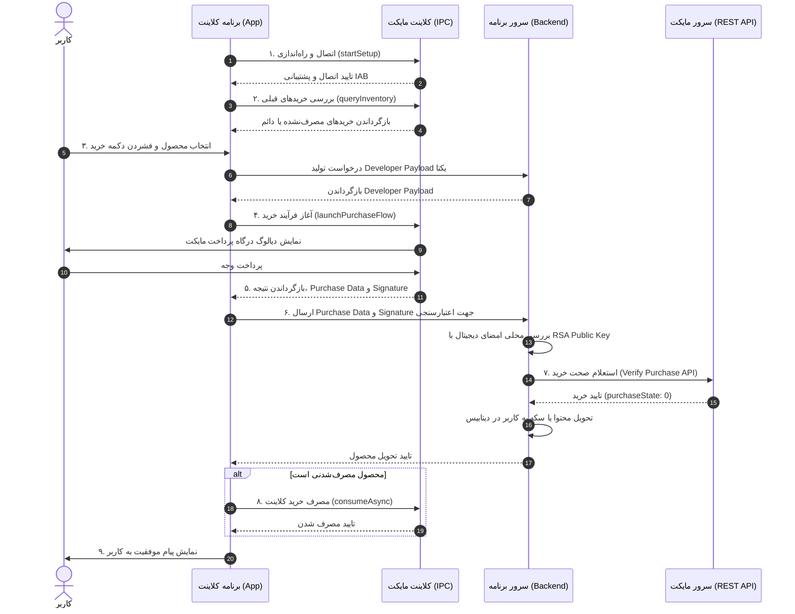

# راهنمای جامع و عملیاتی پیاده‌سازی پرداخت درون‌برنامه‌ای مایکت (Myket In-App Purchase)

این مستند به عنوان یک مرجع فنی و جامع برای توسعه‌دهندگان و عامل‌های هوشمند (AI Agents) تدوین شده است تا بدون نیاز به جستجوی منابع دیگر، بتوانند پرداخت درون‌برنامه‌ای (IAP) مایکت را به صورت امن، استاندارد و بدون خطا در پروژه‌های اندروید (جاوا / کاتلین / Jetpack Compose) و سرور پیاده‌سازی کنند.

---

## فهرست مطالب
1. [معرفی و مفاهیم اصلی پرداخت درون‌برنامه‌ای مایکت](#۱-معرفی-و-مفاهیم-اصلی-پرداخت-درون‌برنامه‌ای-مایکت)
2. [پیش‌نیازها و تنظیمات پنل توسعه‌دهندگان مایکت](#۲-پیش‌نیازها-و-تنظیمات-پنل-توسعه‌دهندگان-مایکت)
3. [پیکربندی پروژه اندروید (کلاینت)](#۳-پیکربندی-پروژه-اندروید-کلاینت)
4. [پیاده‌سازی کلاینت در اندروید (جاوا و کاتلین)](#۴-پیاده‌سازی-کلاینت-در-اندروید-جاوا-و-کاتلین)
5. [اعتبارسنجی و مدیریت پرداخت سمت سرور (Server-to-Server REST API)](#۵-اعتبارسنجی-و-مدیریت-پرداخت-سمت-سرور-server-to-server-rest-api)
6. [مرجع کدهای بازگشتی و خطاهای سیستم](#۶-مرجع-کدهای-بازگشتی-و-خطاهای-سیستم)
7. [ملاحظات امنیتی و روش‌های مقابله با تقلب](#۷-ملاحظات-امنیتی-و-روش‌های-مقابله-با-تقلب)
8. [چک‌لیست تست و راهنمای عیب‌یابی](#۸-چک‌لیست-تست-و-راهنمای-عیب‌یابی)

---

## ۱. معرفی و مفاهیم اصلی پرداخت درون‌برنامه‌ای مایکت

مایکت برای سرویس پرداخت درون‌برنامه‌ای خود از استاندارد **Google Play In-App Billing نسخه ۳** پیروی می‌کند. ارتباط بین برنامه شما و سرویس پرداخت، از طریق پردازش بین‌فرآیندی (IPC / AIDL) با برنامه کلاینت مایکت نصب‌شده روی دستگاه کاربر برقرار می‌شود.

### ۱.۱. انواع محصولات درون‌برنامه‌ای
در مایکت دو مدل محصول درون‌برنامه‌ای پشتیبانی می‌شود:

1. **محصولات مصرف‌شدنی (Consumable):**
   - محصولاتی هستند که کاربر می‌تواند بارها آن‌ها را خریداری کند (مانند سکه، جم، بنزین، جان اضافه در بازی‌ها).
   - این محصولات پس از خرید موفق، باید بلافاصله یا پس از تایید توسط سرور، از طریق متد **Consume** سوزانده (مصرف) شوند تا مایکت اجازه دهد کاربر مجدداً همان شناسه کالا (SKU) را خریداری کند.
   - تا زمانی که محصول مصرف‌شدنی Consume نشود، کاربر مالک آن تلقی شده و تلاش برای خرید مجدد با خطای `ITEM_ALREADY_OWNED` مواجه می‌شود.

2. **محصولات مصرف‌نشدنی (Non-Consumable):**
   - محصولاتی هستند که کاربر تنها یک‌بار برای همیشه هزینه آن‌ها را پرداخت می‌کند (مانند حذف تبلیغات، ارتقا به نسخه پرمیوم، باز کردن مراحل کامل).
   - این محصولات **هرگز نباید Consume شوند**.
   - کاربر برای همیشه مالک این محصولات باقی می‌ماند و حتی با پاک کردن برنامه یا تغییر دستگاه، با ورود به همان حساب کاربری مایکت، مالکیت محصول از طریق کوئری موجودی قابل بازیابی است.

> [!WARNING] وضعیت پشتیبانی از محصولات اشتراکی (Subscriptions):
> طبق مستندات رسمی، مایکت در حال حاضر از **خرید اشتراکی دوره‌ای خودکار (Subscriptions)** پشتیبانی نمی‌کند. در صورت نیاز به محصولات مدت‌دار (مثل اشتراک یک‌ماهه)، توسعه‌دهنده باید محصول را به صورت یک‌باره (مصرف‌شدنی یا مصرف‌نشدنی) تعریف کرده و تاریخ انقضا و مدیریت تمدید آن را در سرور خود پیاده‌سازی کند.

### ۱.۲. مفاهیم و اصطلاحات کلیدی
- **SKU (Stock Keeping Unit):** شناسه متنی یکتا برای هر محصول درون‌برنامه‌ای که در پنل مایکت تعریف می‌شود (مانند `coin_pack_100` یا `premium_upgrade`).
- **Purchase Token:** یک شناسه رشته‌ای منحصربه‌فرد برای هر تراکنش خرید که توسط مایکت تولید می‌شود و برای استعلام یا مصرف کالا از کلاینت یا سرور ضروری است.
- **Developer Payload:** رشته‌ای دلخواه که توسعه‌دهنده همراه با درخواست خرید ارسال می‌کند. مایکت این رشته را بدون تغییر در نتیجه خرید برمی‌گرداند. از این رشته برای جلوگیری از حملات بازپخش (Replay Attack) و اعتبارسنجی هویت کاربر استفاده می‌شود.
- **RSA Public Key:** کلید عمومی رمزنگاری اختصاصی برنامه شما در پنل مایکت برای تایید اصالت امضای دیجیتال خریدها (`Signature Verification`).

### ۱.۳. نمودار توالی فرآیند پرداخت امن مایکت



---

## ۲. پیش‌نیازها و تنظیمات پنل توسعه‌دهندگان مایکت

برای اتصال برنامه به پرداخت مایکت، مراحل زیر در پنل توسعه‌دهندگان مایکت (`developer.myket.ir`) الزامی است:

### ۲.۱. ثبت برنامه در پنل مایکت
1. وارد پنل توسعه‌دهندگان مایکت شوید.
2. از بخش «برنامه‌ها»، بر روی «افزودن برنامه جدید» کلیک کنید.
3. نام بسته (`Package Name`) برنامه خود را دقیقا مطابق با `applicationId` در گریدل وارد نمایید.
> [!NOTE] نکته مهم:
> برای دریافت کلید عمومی و تست پرداخت نیازی به بارگذاری فایل APK یا تایید برنامه توسط مایکت نیست؛ تنها **رزرو نام پکیج (Package Name)** برای شروع توسعه و تست کافی است.

### ۲.۲. دریافت کلید رمز عمومی (RSA Public Key)
1. در پنل توسعه‌دهندگان، برنامه مورد نظر را انتخاب کنید.
2. به تب **«پرداخت درون‌برنامه‌ای»** مراجعه کنید.
3. در این بخش، یک رشته طولانی Base64 با عنوان **«کلید رمز عمومی»** (Public Key) به شما نمایش داده می‌شود.
4. این کلید برای تایید امضای دیجیتال رسیدهای خرید در کلاینت و سرور ضروری است.

### ۲.۳. تعریف محصولات درون‌برنامه‌ای (SKU)
1. در همان صفحه پرداخت درون‌برنامه‌ای، روی **«افزودن محصول جدید»** کلیک کنید.
2. مشخصات محصول را تکمیل کنید:
   - **شناسه محصول (SKU ID):** رشته انگلیسی یکتا (مانند `gem_100` یا `remove_ads`). توجه: پس از ثبت، این شناسه غیرقابل ویرایش است.
   - **عنوان فارسی و انگلیسی:** عنوان کالا برای نمایش به کاربر.
   - **قیمت:** قیمت به ریال (مثلا `10000` ریال معادل ۱,۰۰۰ تومان).
   - **نوع محصول:** مصرف‌شدنی یا مصرف‌نشدنی.
   - **وضعیت:** فعال (Active) یا غیرفعال.

### ۲.۴. دریافت توکن دسترسی سرور (X-Access-Token)
جهت فراخوانی وب‌سرویس‌های سمت سرور (صحت‌سنجی، مصرف یا مدیریت SKU):
1. در پنل مایکت و در بخش محصولات درون‌برنامه‌ای، فیلد **«توکن صحت‌سنجی»** یا **X-Access-Token** را مشاهده و کپی کنید (فرمت UUID مانند `650e0714-a434-475a-a403-f3ec5fcf001`).
2. این توکن یک راز سروری است؛ **اکیداً آن را داخل سورس کلاینت قرار ندهید**.

---

## ۳. پیکربندی پروژه اندروید (کلاینت)

### ۳.۱. افزودن وابستگی کتابخانه مایکت به گریدل

مایکت دو روش برای اضافه کردن کتابخانه پرداخت ارائه داده است:
- **روش اول (توصیه‌شده و مدرن):** استفاده از کتابخانه رسمی مایکت بر روی JitPack (`myket-billing-client`).
- **روش دوم (سنتی):** افزودن مستقیم فایل AIDL و کلاس‌های پکیج `util` برنامه نمونه TrivialDrive.

#### افزودن ریپوزیتوری JitPack
در فایل `settings.gradle.kts` (یا `build.gradle` ریشه):

```kotlin
dependencyResolutionManagement {
    repositories {
        google()
        mavenCentral()
        maven { url = java.net.URI("https://jitpack.io") }
    }
}
```

#### افزودن Dependency به ماژول برنامه (`build.gradle.kts`)
```kotlin
dependencies {
    implementation("com.github.myketstore:myket-billing-client:1.6")
}
```

### ۳.۲. پیکربندی `defaultConfig` و `manifestPlaceholders`

کتابخانه مایکت از متغیرهای `manifestPlaceholders` و `buildConfigField` برای تنظیم پکیج و کلید عمومی استفاده می‌کند:

```kotlin
android {
    defaultConfig {
        val marketApplicationId = "ir.mservices.market"
        val marketBindAddress = "ir.mservices.market.InAppBillingService.BIND"
        
        manifestPlaceholders.apply {
            this["marketApplicationId"] = marketApplicationId
            this["marketBindAddress"] = marketBindAddress
            this["marketPermission"] = "${marketApplicationId}.BILLING"
        }
        
        // کلید رمز عمومی مایکت
        buildConfigField("String", "IAB_PUBLIC_KEY", "\"YOUR_MYKET_PUBLIC_KEY_BASE64\"")
    }
    
    buildFeatures {
        buildConfig = true
    }
}
```

### ۳.۳. پیکربندی چند استور با `productFlavors` (مایکت + کافه بازار + گوگل پلی)
اگر پروژه شما برای چند مارکت خروجی جداگانه تولید می‌کند، می‌توانید از `flavorDimensions` بهره ببرید:

```kotlin
android {
    flavorDimensions += "store"

    productFlavors {
        create("myket") {
            dimension = "store"
            val marketApplicationId = "ir.mservices.market"
            val marketBindAddress = "ir.mservices.market.InAppBillingService.BIND"
            
            manifestPlaceholders["marketApplicationId"] = marketApplicationId
            manifestPlaceholders["marketBindAddress"] = marketBindAddress
            manifestPlaceholders["marketPermission"] = "${marketApplicationId}.BILLING"
            buildConfigField("String", "IAB_PUBLIC_KEY", "\"MIGeMA0GCS...MYKET_KEY...\"")
        }
        
        create("bazaar") {
            dimension = "store"
            val marketApplicationId = "com.farsitel.bazaar"
            val marketBindAddress = "ir.cafebazaar.pardakht.InAppBillingService.BIND"
            
            manifestPlaceholders["marketApplicationId"] = marketApplicationId
            manifestPlaceholders["marketBindAddress"] = marketBindAddress
            manifestPlaceholders["marketPermission"] = "com.farsitel.bazaar.permission.PAY_THROUGH_BAZAAR"
            buildConfigField("String", "IAB_PUBLIC_KEY", "\"MIGeMA0GCS...BAZAAR_KEY...\"")
        }
    }
}
```

### ۳.۴. تنظیمات فایل `AndroidManifest.xml`

برای برقراری ارتباط با مایکت، مجوز پرداخت و تگ `<queries>` (جهت سازگاری با محدودیت Package Visibility در اندروید ۱۱ و بالاتر / API 30+) الزامی است:

```xml
<manifest xmlns:android="http://schemas.android.com/apk/res/android">

    <!-- مجوز پرداخت درون‌برنامه‌ای مایکت -->
    <uses-permission android:name="ir.mservices.market.BILLING" />

    <!-- الزامی برای اندروید 11 به بالا جهت رویت کلاینت مایکت -->
    <queries>
        <package android:name="ir.mservices.market" />
        <intent>
            <action android:name="ir.mservices.market.InAppBillingService.BIND" />
            <data android:mimeType="*/*" />
        </intent>
    </queries>

    <application
        ...>
        <!-- سایر تنظیمات برنامه -->
    </application>
</manifest>
```

> [!IMPORTANT] خطای پنهان در اندروید 11 به بالا:
> اگر تگ `<queries>` بالا در `AndroidManifest.xml` وجود نداشته باشد، روی دستگاه‌های با اندروید ۱۱ به بالا، برنامه شما قادر به شناسایی کلاینت مایکت نخواهد بود و متد `startSetup` با خطای عدم پشتیبانی از پرداخت یا خطای اتصال شکست می‌خورد.


---

## ۴. پیاده‌سازی کلاینت در اندروید (جاوا و کاتلین)

کتابخانه پرداخت مایکت بر پایه کلاس `IabHelper` عمل می‌کند. این کلاس اتصال به کلاینت مایکت، مدیریت رشته‌های ناهمگام (Async)، مدیریت صف درخواست‌ها، اعتبارسنجی امضای دیجیتال محلی و ترجمه پاسخ‌ها را بر عهده دارد.

### ۴.۱. چرخه عمر کلاس `IabHelper`

1. **ایجاد Instance:** در متد `onCreate` اکتیویتی یا کلاس کنترل‌کننده پرداخت ایجاد می‌شود.
2. **اتصال به سرویس (`startSetup`):** قبل از هر درخواستی باید فراخوانی شود.
3. **استعلام خریدها و محصولات (`queryInventoryAsync`):** به محض اتصال موفقیت‌آمیز فراخوانی می‌شود.
4. **آغاز پرداخت (`launchPurchaseFlow`):** با رویداد کاربر برای خرید یک محصول اجرا می‌شود.
5. **مصرف محصول (`consumeAsync`):** پس از انجام خرید یا در هنگام بازیابی، برای محصولات مصرف‌شدنی انجام می‌شود.
6. **قطع اتصال و آزادسازی (`dispose`):** در متد `onDestroy` برای جلوگیری از نشت حافظه (Memory Leak) و باز ماندن سرویس سیستم فراخوانی می‌شود.

### ۴.۲. تشریح فیلدهای شیء `Purchase`

هنگامی که خریدی انجام می‌شود یا از طریق `queryInventory` خریدهای قبلی خوانده می‌شود، یک شیء از جنس `Purchase` بازگردانده می‌شود:

| نام متد / فیلد | نوع داده | توضیحات |
| :--- | :--- | :--- |
| `getItemType()` | `String` | نوع محصول: همیشه `"inapp"` در مایکت |
| `getOrderId()` | `String` | شماره فاکتور تراکنش صادرشده توسط مایکت |
| `getPackageName()` | `String` | نام پکیج برنامه شما |
| `getSku()` | `String` | شناسه محصول (SKU) خریداری‌شده |
| `getPurchaseTime()` | `long` | برچسب زمانی انجام خرید (Unix Epoch Timestamp بر حسب میلی‌ثانیه) |
| `getPurchaseState()` | `int` | وضعیت خرید: `0` نشان‌دهنده خرید موفق و تاییدشده است |
| `getDeveloperPayload()` | `String` | رشته‌ای که همراه درخواست خرید ارسال کرده‌اید |
| `getToken()` | `String` | توکن خرید یکتا (Purchase Token) جهت استعلام و مصرف |
| `getOriginalJson()` | `String` | رشته خام JSON بازگشتی از سرور مایکت |
| `getSignature()` | `String` | امضای دیجیتال رمزنگاری‌شده با RSA برای رشته JSON فوق |

### ۴.۳. نمونه کد کاتلین ماژولار و مدرن (`MyketBillingManager`)

برای پروژه‌های مدرن کاتلین و Jetpack Compose، کلاس کمکی زیر طراحی شده است تا تمام کارهای مایکت را در یک کلاس مستقل کپسوله کند:

```kotlin
package com.example.billing

import android.app.Activity
import android.content.Context
import android.util.Log
import com.example.BuildConfig
import ir.mservices.market.billing.util.IabAsyncInProgressException
import ir.mservices.market.billing.util.IabHelper
import ir.mservices.market.billing.util.IabResult
import ir.mservices.market.billing.util.Inventory
import ir.mservices.market.billing.util.Purchase
import kotlinx.coroutines.flow.MutableStateFlow
import kotlinx.coroutines.flow.StateFlow
import kotlinx.coroutines.flow.asStateFlow

class MyketBillingManager(private val context: Context) {

    companion object {
        private const val TAG = "MyketBillingManager"
        const val RC_REQUEST_PURCHASE = 10001
    }

    private var iabHelper: IabHelper? = null

    // وضعیت اتصال به مارکت
    private val _isConnected = MutableStateFlow(false)
    val isConnected: StateFlow<Boolean> = _isConnected.asStateFlow()

    // شنونده‌های بیرونی
    var onPurchaseCompleted: ((Purchase) -> Unit)? = null
    var onPurchaseFailed: ((String) -> Unit)? = null
    var onInventoryLoaded: ((Inventory) -> Unit)? = null

    /**
     * ۱. راه‌اندازی و اتصال به سرویس پرداخت مایکت
     */
    fun startConnection(itemSkus: List<String> = emptyList()) {
        val publicKey = BuildConfig.IAB_PUBLIC_KEY
        iabHelper = IabHelper(context, publicKey).apply {
            enableDebugLogging(BuildConfig.DEBUG)
        }

        iabHelper?.startSetup { result: IabResult ->
            if (iabHelper == null) return@startSetup

            if (result.isSuccess) {
                Log.d(TAG, "اتصال به سرویس مایکت با موفقیت برقرار شد.")
                _isConnected.value = true
                // استعلام فوری خریدها به محض اتصال (بسیار مهم جهت جلوگیری از سوختن خریدها)
                queryInventory(itemSkus)
            } else {
                Log.e(TAG, "خطا در اتصال به سرویس مایکت: ${result.message}")
                _isConnected.value = false
                onPurchaseFailed?.invoke("خطا در برقراری ارتباط با مایکت: ${result.message}")
            }
        }
    }

    /**
     * ۲. به‌روزرسانی خریدها و دریافت مشخصات کالاها (queryInventoryAsync)
     */
    fun queryInventory(itemSkus: List<String>) {
        if (iabHelper == null || !_isConnected.value) {
            Log.w(TAG, "سرویس مایکت هنوز آماده نیست.")
            return
        }

        try {
            iabHelper?.queryInventoryAsync(
                true, // دریافت جزئیات قیمت و عنوان از سرور مایکت
                itemSkus,
                null, // مایکت از سابسکرایب دوره‌ای پشتیبانی نمی‌کند
                { result: IabResult, inventory: Inventory? ->
                    if (iabHelper == null) return@queryInventoryAsync

                    if (result.isSuccess && inventory != null) {
                        Log.d(TAG, "مشخصات و خریدهای قبلی با موفقیت بازیابی شد.")
                        onInventoryLoaded?.invoke(inventory)

                        // بازیابی و بررسی خریدهای مصرف‌نشده یا دائمی
                        for (purchase in inventory.allPurchases) {
                            Log.i(TAG, "خرید موجود یافت شد: ${purchase.sku}")
                            // اگر کالا مصرف‌شدنی است، باید مصرف شود
                            // consumePurchase(purchase)
                        }
                    } else {
                        Log.e(TAG, "خطا در استعلام محصولات: ${result.message}")
                    }
                }
            )
        } catch (e: IabAsyncInProgressException) {
            Log.w(TAG, "یک عملیات دیگر در حال پردازش است: ${e.message}")
        }
    }

    /**
     * ۳. آغاز جریان خرید یک محصول (launchPurchaseFlow)
     */
    fun launchPurchase(
        activity: Activity,
        sku: String,
        developerPayload: String = generateRandomPayload()
    ) {
        if (iabHelper == null || !_isConnected.value) {
            onPurchaseFailed?.invoke("سرویس پرداخت مایکت آماده نیست.")
            return
        }

        try {
            iabHelper?.launchPurchaseFlow(
                activity,
                sku,
                RC_REQUEST_PURCHASE,
                { result: IabResult, purchase: Purchase? ->
                    if (iabHelper == null) return@launchPurchaseFlow

                    if (result.isSuccess && purchase != null) {
                        Log.d(TAG, "خرید موفق بود: ${purchase.orderId}")
                        // اعتبارسنجی developerPayload
                        if (verifyDeveloperPayload(purchase, developerPayload)) {
                            onPurchaseCompleted?.invoke(purchase)
                        } else {
                            onPurchaseFailed?.invoke("خطای امنیتی: عدم تطابق Developer Payload")
                        }
                    } else {
                        Log.e(TAG, "خرید ناموفق یا لغو شد: ${result.message}")
                        onPurchaseFailed?.invoke(result.message)
                    }
                },
                developerPayload
            )
        } catch (e: IabAsyncInProgressException) {
            Log.e(TAG, "عملیات دیگری در جریان است.", e)
            onPurchaseFailed?.invoke("درخواست دیگری در حال پردازش است. لطفاً کمی صبر کنید.")
        }
    }

    /**
     * ۴. مصرف خرید (Consume) برای محصولات مصرف‌شدنی
     */
    fun consumePurchase(purchase: Purchase, onConsumed: (Boolean) -> Unit) {
        if (iabHelper == null) return

        try {
            iabHelper?.consumeAsync(purchase) { p: Purchase, result: IabResult ->
                if (iabHelper == null) return@consumeAsync

                if (result.isSuccess) {
                    Log.d(TAG, "محصول ${p.sku} با موفقیت مصرف (Consume) شد.")
                    onConsumed(true)
                } else {
                    Log.e(TAG, "خطا در مصرف محصول: ${result.message}")
                    onConsumed(false)
                }
            }
        } catch (e: IabAsyncInProgressException) {
            Log.e(TAG, "خطای عملیات موازی در مصرف کالا", e)
            onConsumed(false)
        }
    }

    /**
     * ۵. قطع سرویس و پاک‌سازی حافظه در onDestroy
     */
    fun dispose() {
        try {
            iabHelper?.disposeWhenFinished()
        } catch (e: Exception) {
            Log.w(TAG, "خطا در هنگام آزادسازی IabHelper", e)
        } finally {
            iabHelper = null
            _isConnected.value = false
        }
    }

    private fun generateRandomPayload(): String {
        return java.util.UUID.randomUUID().toString()
    }

    private fun verifyDeveloperPayload(purchase: Purchase, expectedPayload: String): Boolean {
        val returnedPayload = purchase.developerPayload
        return returnedPayload == expectedPayload
    }
}
```

### ۴.۴. اتصال ActivityResult در کلاینت (روش ActivityResultLauncher)

در اکتیویتی برنامه، در صورتی که کتابخانه از `ProxyBillingActivity` یا `onActivityResult` سنتی استفاده می‌کند، باید متد `handleActivityResult` شیء `iabHelper` فراخوانی شود:

```kotlin
class MainActivity : ComponentActivity() {

    private lateinit var billingManager: MyketBillingManager

    override fun onCreate(savedInstanceState: Bundle?) {
        super.onCreate(savedInstanceState)
        
        billingManager = MyketBillingManager(this)
        billingManager.startConnection(listOf("gold_100", "premium_upgrade"))

        billingManager.onPurchaseCompleted = { purchase ->
            // تحویل محصول یا ارسال به سرور جهت صحت‌سنجی
            if (purchase.sku == "gold_100") {
                billingManager.consumePurchase(purchase) { success ->
                    if (success) {
                        // شارژ حساب کاربر در دیتابیس کلاینت یا سرور
                    }
                }
            } else if (purchase.sku == "premium_upgrade") {
                // فعال‌سازی همیشگی امکانات ویژه (بدون مصرف)
            }
        }
    }

    @Deprecated("Deprecated in Java")
    override fun onActivityResult(requestCode: Int, resultCode: Int, data: Intent?) {
        // هدایت پاسخ خرید به IabHelper در صورت نیاز نسخه
        super.onActivityResult(requestCode, resultCode, data)
    }

    override fun onDestroy() {
        super.onDestroy()
        billingManager.dispose()
    }
}
```


---

## ۵. اعتبارسنجی و مدیریت پرداخت سمت سرور (Server-to-Server REST API)

> [!CAUTION] هشدار جدی امنیتی:
> وب‌سرویس‌های سمت سرور مایکت **صرفاً باید از سرور اختصاصی برنامه (Backend) فراخوانی شوند**.
> هرگز کلید `X-Access-Token` را در سورس کد اندروید، فایل‌های APK یا درخواست‌های مستقیم کلاینت قرار ندهید؛ چرا که استخراج آن از فایل APK بسیار ساده بوده و منجر به امکان تایید خریدهای جعلی توسط مهاجمان خواهد شد.

### ۵.۱. احراز هویت سرور با `X-Access-Token`
برای احراز هویت در تمامی فراخوانی‌های REST API مایکت، باید هدر زیر ارسال شود:
```http
X-Access-Token: YOUR_DEV_ACCESS_TOKEN
```
این مقدار همان کلید یکتایی است که در پنل توسعه‌دهندگان مایکت در بخش «محصولات درون‌برنامه‌ای» برنامه مورد نظر با عنوان «توکن صحت‌سنجی» قرار دارد.

---

### ۵.۲. وب‌سرویس ۱: استعلام و صحت‌سنجی خرید (Verify Purchase)

این سرویس برای تایید نهایی پرداخت، اطمینان از اصالت توکن خرید و جلوگیری از استفاده از برنامه‌های هک خرید (مانند Lucky Patcher یا کلاینت‌های دستکاری‌شده) استفاده می‌شود.

- **متد:** `POST`
- **آدرس:**
  ```http
  POST https://developer.myket.ir/api/partners/applications/{PACKAGE_NAME}/purchases/products/{SKU_ID}/verify
  ```
- **هدرها:**
  ```http
  X-Access-Token: {ACCESS_TOKEN}
  Content-Type: application/json
  ```
- **پارامترهای مسیر (Path Variables):**
  - `{PACKAGE_NAME}`: نام پکیج برنامه (مانند `com.example.app`).
  - `{SKU_ID}`: شناسه محصول درون‌برنامه‌ای خریداری‌شده (مانند `gem_100`).
- **بدنه درخواست (Request Body - JSON):**
  ```json
  {
    "tokenId": "{TOKEN_ID}"
  }
  ```
  *(مقدار `tokenId` همان توکن خریدی است که کلاینت با متد `purchase.getToken()` دریافت کرده است).*

#### پاسخ موفق (HTTP 200 OK):
```json
{
  "kind": "androidpublisher#productPurchase",
  "purchaseTime": 1492839267000,
  "developerPayload": "FC002E51C0000058970ED045924F233",
  "purchaseState": 0,
  "consumptionState": 1
}
```

#### جدول تشریح فیلدهای پاسخ:
| فیلد | نوع داده | توضیحات |
| :--- | :--- | :--- |
| `purchaseState` | `int` | وضعیت پرداخت: **`0` به معنی خرید موفق** و `1` به معنی خرید ناموفق / معلق است. |
| `consumptionState` | `int` | وضعیت مصرف محصول: `0` به معنی مصرف‌نشده (یا محصول غیرمصرفی) و **`1` به معنی مصرف‌شده** (Consumed) است. |
| `purchaseTime` | `long` | برچسب زمانی خرید بر اساس Unix Epoch Timestamp (میلی‌ثانیه). |
| `developerPayload` | `String` | همان رشته‌ای که در زمان شروع خرید از کلاینت ارسال شده است. |
| `kind` | `String` | نوع خرید در استاندارد گوگل/مایکت (`androidpublisher#productPurchase`). |

#### پاسخ ناموفق / خطا:
```json
HttpStatusCode: 500
{
  "code": 500,
  "messageCode": "InternalError",
  "translatedMessage": "خطایی رخ داده است."
}
```
یا در صورت ارسال کلید اشتباه یا نام پکیج نامعتبر:
```json
HttpStatusCode: 401
{
  "code": 401,
  "messageCode": "UnAuthorized",
  "translatedMessage": "دسترسی غیرمجاز"
}
```

---

### ۵.۳. وب‌سرویس ۲: مصرف خرید درون‌برنامه‌ای سمت سرور (Consume Purchase)

در سناریوهایی که برنامه نمی‌تواند در کلاینت کالا را مصرف کند، یا در سناریوهای پشتیبانی و حل مشکل کاربران که کاربر هزینه پرداخت کرده اما کالایی نگرفته است، سرور برنامه می‌تواند مستقیماً کالای مصرف‌نشده را بسوزاند (Consume کند):

- **متد:** `PUT`
- **آدرس:**
  ```http
  PUT https://developer.myket.ir/api/partners/applications/{PACKAGE_NAME}/purchases/products/{SKU_ID}/tokens/{TOKEN}/consume
  ```
- **هدرها:**
  ```http
  X-Access-Token: {ACCESS_TOKEN}
  ```
- **پارامترهای مسیر:**
  - `{PACKAGE_NAME}`: شناسه بسته برنامه
  - `{SKU_ID}`: شناسه محصول
  - `{TOKEN}`: توکن خرید کالا

#### پاسخ موفق (HTTP 200 OK):
```json
{
  "code": 200,
  "messageCode": "Successful",
  "translatedMessage": "عملیات با موفقیت انجام شد"
}
```

#### پاسخ‌های خطا در سرویس مصرف:
- **کد ۴۰۰ (قبلاً مصرف شده):**
  ```json
  {
    "code": 400,
    "messageCode": "SkuAlreadyConsumed",
    "translatedMessage": "محصول قبلا مصرف شده است"
  }
  ```
- **کد ۴۰۴ (توکن یافت نشد):**
  ```json
  {
    "code": 404,
    "messageCode": "PurchasedSkuNotFound",
    "translatedMessage": "خرید مورد نظر پیدا نشد"
  }
  ```
- **کد ۴۰۴ (محصول یافت نشد):**
  ```json
  {
    "code": 404,
    "messageCode": "SkuIdNotFound",
    "translatedMessage": "محصول درون برنامه ای یافت نشد"
  }
  ```

---

### ۵.۴. وب‌سرویس ۳: مدیریت محصولات درون‌برنامه‌ای (SKU Management API)

مایکت امکان مدیریت، مشاهده و تعریف محصولات درون‌برنامه‌ای را از طریق REST API سرور فراهم کرده است:

#### ۱. دریافت لیست محصولات ثبت‌شده (GET):
```http
GET https://developer.myket.ir/api/partners/applications/{PACKAGE_NAME}/products?limit=100&offset=0
Header: X-Access-Token: {ACCESS_TOKEN}
```
- پارامتر `limit`: تعداد آیتم‌های بازگشتی (پیش‌فرض ۱۰۰، حداکثر ۱۰۰۰).
- پارامتر `offset`: شماره صفحه یا آفست شروع (پیش‌فرض ۰).

**نمونه پاسخ موفق:**
```json
{
  "skus": [
    {
      "skuId": "GEM100",
      "englishTitle": "100 Gems Pack",
      "farsiTitle": "بسته ۱۰۰ عددی الماس",
      "price": 50000,
      "creationDate": "2024-07-27T10:15:00.00",
      "isActive": true
    }
  ],
  "totalCount": 1
}
```

#### ۲. ایجاد محصول جدید (POST):
```http
POST https://developer.myket.ir/api/partners/applications/{PACKAGE_NAME}/products
Header: X-Access-Token: {ACCESS_TOKEN}
Content-Type: application/json

{
  "skuId": "COIN500",
  "farsiTitle": "۵۰۰ سکه طلایی",
  "englishTitle": "500 Gold Coins",
  "price": 20000,
  "isActive": true
}
```
- پارامتر `skuId`: شناسه کالا (حداکثر ۱۰۰ کاراکتر، اجباری و غیرقابل تغییر).
- پارامتر `price`: قیمت به ریال.

---

## ۶. مرجع کدهای بازگشتی و خطاهای سیستم

### ۶.۱. کدهای پاسخ کلاینت (Bundle RESPONSE_CODE در مایکت و استاندارد IAB v3)

این کدها در متد `result.getResponse()` از شیء `IabResult` یا Bundleهای سیستمی اینتنت گزارش می‌شوند:

| مقدار کد | نام ثابت | مفهوم و علت وقوع |
| :---: | :--- | :--- |
| **0** | `BILLING_RESPONSE_RESULT_OK` | عملیات با موفقیت کامل انجام شد. |
| **1** | `BILLING_RESPONSE_RESULT_USER_CANCELED` | کاربر در صفحه پرداخت دکمه بازگشت یا انصراف را فشرده است. |
| **2** | `BILLING_RESPONSE_RESULT_SERVICE_UNAVAILABLE` | شبکه قطع است یا سرویس مایکت در دسترس نیست. |
| **3** | `BILLING_RESPONSE_RESULT_BILLING_UNAVAILABLE` | نسخه مایکت نصب‌شده روی دستگاه از پرداخت درون‌برنامه‌ای پشتیبانی نمی‌کند یا دسترسی مسدود است. |
| **4** | `BILLING_RESPONSE_RESULT_ITEM_UNAVAILABLE` | شناسه کالا (SKU) در پنل مایکت وجود ندارد یا غیرفعال است. |
| **5** | `BILLING_RESPONSE_RESULT_DEVELOPER_ERROR` | پارامترهای نامعتبر به متدها ارسال شده است (مثلاً پکیج‌نیم نامعتبر یا امضای خالی). |
| **6** | `BILLING_RESPONSE_RESULT_ERROR` | خطای عمومی و ناشناخته در فرآیند تراکنش مایکت. |
| **7** | `BILLING_RESPONSE_RESULT_ITEM_ALREADY_OWNED` | کاربر پیش‌تر این محصول را خریده و هنوز مصرف نشده است (امکان خرید مجدد نیست مگر بعد از Consume). |
| **8** | `BILLING_RESPONSE_RESULT_ITEM_NOT_OWNED` | کاربر مالک این کالا نیست (مثلاً تلاش برای مصرف کالایی که خریداری نشده). |

### ۶.۲. خطاهای داخلی کلاینت (`IabHelper`)
- **`IABHELPER_BAD_RESPONSE` (-1002):** پاسخ دریافتی از مایکت ساختار نامعتبری داشته است.
- **`IABHELPER_VERIFICATION_FAILED` (-1003):** امضای دیجیتال خرید با کلید رمز عمومی تطابق ندارد (احتمال تلاش برای تقلب یا اشتباه بودن کلید عمومی در گریدل).
- **`IABHELPER_SEND_INTENT_FAILED` (-1004):** خطا در ارسال Intent باز کردن درگاه مایکت.
- **`IABHELPER_UNKNOWN_PURCHASE_RESPONSE` (-1006):** پاسخ نامفهوم در وضعیت خرید.
- **`IABHELPER_MISSING_TOKEN` (-1007):** توکن خرید در داده‌های دریافتی وجود ندارد.
- **`IabAsyncInProgressException`:** تلاش برای اجرای یک متد در حالی که درخواست ناهمگام قبلی در حال اجراست.

---

## ۷. ملاحظات امنیتی و روش‌های مقابله با تقلب

### ۷.۱. اعتبارسنجی امضای دیجیتال (Signature Verification) روی سرور
کلاینت مایکت به همراه اطلاعات خرید یک امضای دیجیتال بر مبنای الگوریتم `SHA1withRSA` برمی‌گرداند. سرور باید قبل از هر اقدامی اصالت رشته JSON را بررسی کند:

#### نمونه کد بررسی امضا در جاوا/کاتلین سمت سرور:
```java
import java.security.KeyFactory;
import java.security.PublicKey;
import java.security.Signature;
import java.security.spec.X509EncodedKeySpec;
import java.util.Base64;

public class SecurityVerifier {

    public static boolean verify(String base64PublicKey, String signedData, String signature) {
        if (signedData == null || base64PublicKey == null || signature == null) {
            return false;
        }
        try {
            byte[] decodedKey = Base64.getDecoder().decode(base64PublicKey);
            KeyFactory keyFactory = KeyFactory.getInstance("RSA");
            PublicKey publicKey = keyFactory.generatePublic(new X509EncodedKeySpec(decodedKey));

            Signature sig = Signature.getInstance("SHA1withRSA");
            sig.initVerify(publicKey);
            sig.update(signedData.getBytes("UTF-8"));
            return sig.verify(Base64.getDecoder().decode(signature));
        } catch (Exception e) {
            return false;
        }
    }
}
```

### ۷.۲. استفاده امن از `Developer Payload`
- برای هر تراکنش یک رشته تصادفی یکتا (مثلاً UUID یا توکن هش‌شده شامل UserID و زمان) ایجاد کنید.
- این رشته را هم در دیتابیس خود ذخیره کرده و هم به `launchPurchaseFlow` ارسال کنید.
- پس از دریافت پاسخ خرید در سرور، بررسی کنید که `developerPayload` عینا با توکن صادرشده برای همان کاربر مطابقت داشته باشد.

### ۷.۳. جلوگیری از حملات بازپخش (Replay Attacks)
- توکن خرید (`token`) و شناسه سفارش (`orderId`) را به صورت کلید یکتا (Unique Index) در دیتابیس سرور ذخیره کنید.
- اگر درخواستی با توکن تکراری به سرور رسید، آن را رد کرده و به عنوان تلاش برای تقلب ثبت کنید.

### ۷.۴. مبهم‌سازی کد با ProGuard / R8
تنظیمات زیر را در فایل `proguard-rules.pro` قرار دهید تا نام متدها و کلاس‌های کتابخانه مایکت دچار خرابی نشوند:
```proguard
# حفظ اینترفیس‌های ارتباطی پرداخت مایکت
-keep class ir.mservices.market.billing.** { *; }
-keep interface ir.mservices.market.billing.** { *; }
-keep class com.android.vending.billing.** { *; }
-keep interface com.android.vending.billing.** { *; }
```

---

## ۸. چک‌لیست تست و راهنمای عیب‌یابی

### ۸.۱. مراحل تست سریع پیش از انتشار
1. **رزرو نام بسته (Package Name):** برنامه را در پنل مایکت با پکیج نام واقعی بسازید. نیازی به آپلود فایل APK اولیه یا انتشار برنامه نیست.
2. **محصول تست ارزان:** یک محصول تستی از نوع مصرف‌شدنی با حداقل قیمت (مثلاً ۱۰۰۰ ریال) تعریف کنید.
3. **نصب برنامه مایکت روی گوشی یا شبیه‌ساز:** کلاینت مایکت باید نصب بوده و یک حساب کاربری واقعی در آن لاگین باشد.
4. **تست خرید و مصرف:** یک تراکنش انجام دهید؛ مطمئن شوید محصول با موفقیت خریداری و بلافاصله Consume می‌شود و در خرید دوم خطای `ITEM_ALREADY_OWNED` رخ نمی‌دهد.

### ۸.۲. راهنمای حل خطاهای رایج

| خطا | علت اصلی | راه‌حل قطعی |
| :--- | :--- | :--- |
| **شکست `startSetup` در اندروید ۱۱ به بالا** | عدم تعریف Package Visibility در مانیفست | اضافه کردن تگ `<queries>` با پکیج `ir.mservices.market` و اکشن `ir.mservices.market.InAppBillingService.BIND` به `AndroidManifest.xml`. |
| **خطای `IabAsyncInProgressException`** | ارسال درخواست جدید قبل از اتمام درخواست قبلی | صف‌بندی درخواست‌ها و قفل کردن دکمه‌های UI تا زمان دریافت پاسخ کالبک قبلی. |
| **خطای `ITEM_ALREADY_OWNED` هنگام خرید** | محصول قبلی مصرف (Consume) نشده است | اجرای متد `queryInventoryAsync` در هنگام شروع برنامه و مصرف کردن تمام آیتم‌های مصرف‌نشده. |
| **خطای `Signature verification failed`** | ناهماهنگی در کلید عمومی RSA | اطمینان از قرار دادن کلید عمومی بدون فاصله و خط جدید در `build.gradle` و Rebuild پروژه. |
| **نشت حافظه یا خطای ServiceConnection Leaked** | عدم آزادسازی `IabHelper` | فراخوانی حتمی `mHelper.disposeWhenFinished()` یا `dispose()` در متد `onDestroy` اکتیویتی. |
| **خطای ۴۰۱ در وب‌سرویس سرور** | کلید `X-Access-Token` اشتباه است | کپی مجدد توکن صحت‌سنجی از تب پرداخت درون‌برنامه‌ای پنل مایکت. |
