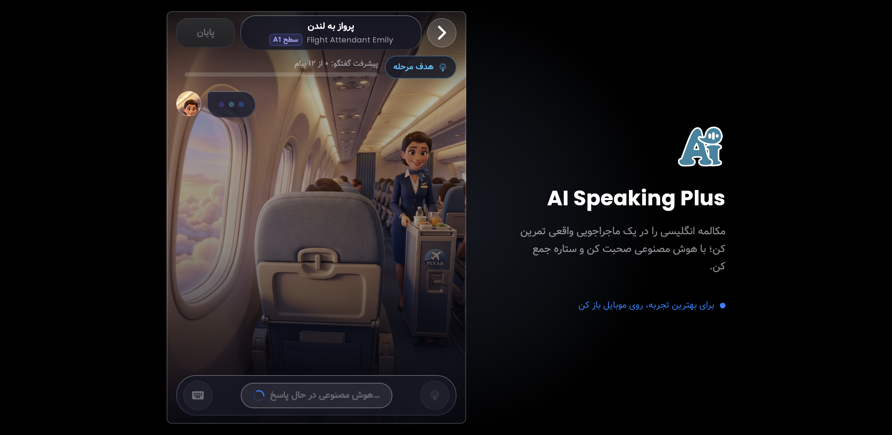
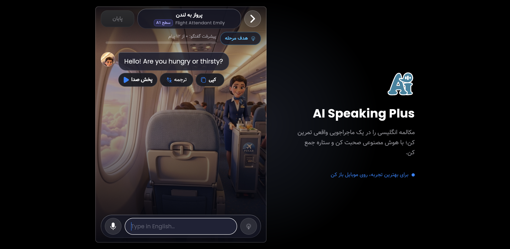

# سند جامع ریفکتورینگ و انطباق رابط کاربری React با Compose Multiplatform
## پروژه AI Speaking Plus (نسخه Apple Liquid Glass & Frosted Glass)

این مستند به عنوان **نقشه راه و پرامپت‌های اجرایی آماده برای ایجنت‌های توسعه** تدوین شده است تا صفحات و کامپوننت‌های فرانت‌اند وب React (`client-web`) را از لحاظ چیدمان، ساختار، سلسله‌مراتب المان‌ها، ابعاد و رفتار دقیقا منطبق بر پیاده‌سازی مرجع Compose Multiplatform (`feature/*` و `webApp`) بازنویسی و بازطراحی نمایند.

---

## ۱. اصل طراحی و فرمول انحصاری شیشه‌ای (Apple Liquid Glass)

> [!IMPORTANT]
> **میزان بلور (Blur) نباید بیش از حد مات باشد.**
> پس‌زمینه داستانی مراحل (تصاویر هواپیما، کابین، لندن و کاراکترها) باید از پشت المان‌ها و کارت‌های شیشه‌ای به شکل ظریف و چشم‌نواز دیده شوند.

### ۱.۱. فرمول طلایی افکت شیشه‌ای در Tailwind / CSS
در فایل `client-web/src/styles/globals.css` استانداردهای زیر جایگزین بلورهای سنگین قبلی (`blur(28px)`) می‌شوند:

```css
/* کارت‌های معلق شیشه‌ای با شفافیت مناسب جهت دیده شدن پس‌زمینه */
.apple-glass {
  position: relative;
  background: linear-gradient(135deg, rgba(255, 255, 255, 0.10) 0%, rgba(255, 255, 255, 0.03) 100%), rgba(15, 23, 42, 0.50);
  backdrop-filter: blur(14px) saturate(180%);
  -webkit-backdrop-filter: blur(14px) saturate(180%);
  border: 1px solid rgba(255, 255, 255, 0.18);
  box-shadow: 
    0 8px 32px 0 rgba(0, 0, 0, 0.35),
    inset 0 1px 0 0 rgba(255, 255, 255, 0.40);
  transform: translateZ(0); /* شتاب‌دهی سخت‌افزاری GPU */
}

/* کارت‌های عمیق‌تر و کانتینرهای اصلی */
.apple-glass-card {
  position: relative;
  background: linear-gradient(145deg, rgba(255, 255, 255, 0.12) 0%, rgba(255, 255, 255, 0.02) 100%), rgba(15, 23, 42, 0.55);
  backdrop-filter: blur(16px) saturate(190%);
  -webkit-backdrop-filter: blur(16px) saturate(190%);
  border: 1px solid rgba(255, 255, 255, 0.20);
  box-shadow: 
    0 16px 40px -8px rgba(0, 0, 0, 0.45),
    inset 0 1.5px 0 0 rgba(255, 255, 255, 0.45),
    inset 0 -1px 0 0 rgba(255, 255, 255, 0.10);
  transform: translateZ(0);
}

/* پیل‌ها، دکمه‌ها و فلوتینگ بار پایینی (Floating visionOS Capsule Dock) */
.apple-glass-dock {
  position: relative;
  background: linear-gradient(180deg, rgba(30, 41, 59, 0.70) 0%, rgba(15, 23, 42, 0.75) 100%);
  backdrop-filter: blur(16px) saturate(200%);
  -webkit-backdrop-filter: blur(16px) saturate(200%);
  border: 1px solid rgba(255, 255, 255, 0.22);
  box-shadow:
    0 20px 48px rgba(0, 0, 0, 0.50),
    inset 0 1.5px 0.5px rgba(255, 255, 255, 0.50);
}
```

### ۱.۲. استفاده از کتابخانه‌های نصب‌شده
- **`liquid-glass-react`**: برای کارت‌های واکنش‌گرا با لایه‌های انکسار نور داینامیک.
- **`@react-cupertino-ui/button`** و **`@react-cupertino-ui/card`**: برای رفتارهای لمسی فنری نِیتیو iOS (`scale: 0.95` در فاز tap) و هماهنگی کامل بصری.

---

## ۲. گالری اسکرین‌شات‌های مرجع لایو (Live Staging)

تمامی اسکرین‌شات‌های ثبت‌شده در مسیر `screenshots/` روت پروژه قرار گرفته‌اند:

| شماره | نام صفحه / وضعیت | فایل اسکرین‌شات | آدرس لایو (Staging) |
|:---:|:---|:---|:---|
| **01** | صفحه اصلی / هیرو مرحله | `screenshots/01_main_page.png` | `https://staging.aispeaking.ir/app/main` |
| **02** | لیست مراحل و پیشرفت | `screenshots/02_stages_page.png` | `https://staging.aispeaking.ir/app/stages` |
| **03** | صفحه چت (حالت صوتی و کاراکتر) | `screenshots/03_chat_page.png` | `https://staging.aispeaking.ir/app/chat?stageId=...` |
| **04** | صفحه چت (ورودی متن و حباب‌ها) | `screenshots/04_chat_with_input.png` | `https://staging.aispeaking.ir/app/chat?stageId=...` |
| **05** | مودال تایید دریافت راهنما | `screenshots/05_chat_hint_modal.png` | مودال درون چت |
| **06** | باتم‌شیت اهداف مرحله | `screenshots/06_chat_stage_goal_sheet.png` | دراور درون چت |
| **07** | صفحه پروفایل کاربری | `screenshots/07_profile_page.png` | `https://staging.aispeaking.ir/app/profile` |
| **08** | صفحه خرید اشتراک ویژه | `screenshots/08_subscription_page.png` | `https://staging.aispeaking.ir/app/subscription` |
| **09** | صفحه ورود و احراز هویت | `screenshots/09_login_page.png` | `https://staging.aispeaking.ir/app/login` |

---

## ۳. بازطراحی تخصصی صفحه چت (Chat Screen) — فوق حیاتی 🚨

صفحه گفتگو در Compose مرجع (`feature/chat`) دارای یک معماری بی‌نظیر بصری بر پایه visionOS Floating Glass است. در React کنونی چیدمان نوار بالا، نحوه تعویض کیبورد/صدا و فوتر نیاز به یکسان‌سازی دقیق دارد.




### ۳.۱. آناتومی نوار بالا (`ChatToolbar`) در دو ردیف متقارن RTL:
1. **ردیف اول (Toolbar Top Row)**:
   - **راست (Start anchor)**: دکمه بازگشت (`AppBackButton`) با آیکون `ic_back` که در RTL حتماً به سمت راست (`>`) اشاره دارد.
   - **مرکز (Center)**: کپسول شیشه‌ای شناور شامل نام مرحله ("پرواز به لندن")، نام کاراکتر انگلیسی ("Flight Attendant Emily") و بج سطح دشواری ("سطح A1").
   - **چپ (End anchor)**: دکمه «پایان» به صورت کپسول قرمز ملایم شیشه‌ای جهت اتمام و تسویه‌حساب مکالمه.
2. **ردیف دوم (HUD Sub-bar)**:
   - **راست**: چیپ شیشه‌ای «هدف مرحله» با آیکون نشانه‌گیری (`Target` / `ic_lamp`) که با کلیک، باتم‌شیت اهداف و داستان را باز می‌کند.
   - **چپ / کشیده**: نوار پیشرفت کریستالی و شمارنده پیام‌ها به صورت متن فارسی («پیشرفت گفتگو: X از ۱۲ پیام») همراه با پروگرس‌بار لومینسانس.

### ۳.۲. آناتومی بدنه چت (Message Stream & Avatar):
- آواتار سه‌بعدی کاراکتر با انیمیشن ملایم نبض هنگام پاسخ‌دهی هوش مصنوعی.
- پیام‌های هوش مصنوعی (چپ‌چین با آیکون بلندگوی پخش صدا، دکمه کشویی ترجمه فارسی، و دکمه کپی).
- پیام‌های کاربر (راست‌چین با کپسول شیشه‌ای بلورین آبی‌آسمانی، همراه با نشانگر بررسی گرامر در صورت وجود خطا).

### ۳.۳. آناتومی فوتر شیشه‌ای معلق (`ChatBottomBar` Dock):
- کپسول شیشه‌ای معلق visionOS با فرم گرد `rounded-[32px]` و سایه نرم عمیق.
- **سمت راست در RTL**: دکمه تاگل حالت صوتی / متنی (آیکون کیبورد یا میکروفون).
- **مرکز**:
  - *در حالت صوتی*: پیل عریض با گرادیان پرانرژی «برای صحبت لمس کنید» (یا در هنگام ضبط: اندیکاتور ضبط با پالس موجی قرمز/آبی).
  - *در حالت متنی*: اینپوت متنی نرم با فونت انگلیسی، متن راهنما ("پیام انگلیسی شما")، و دکمه دایره‌ای ارسال پیام آبی لاجوردی (`Royal Azure`).
- **سمت چپ در RTL**: دکمه دایره‌ای طلایی شامپاینی راهنما («راهنما» با آیکون چراغ مطالعه/لامپ) که در صورت استفاده، بج قرمز/طلایی مصرف راهنما می‌گیرد.

---

## ۴. پرامپت‌های اجرایی برای ایجنت‌های توسعه (Actionable Subagent Prompts)

هر یک از بخش‌های زیر یک پرامپت کامل، مستقل و مهندسی‌شده است که می‌توانید مستقیماً به یک ایجنت بدهید تا فایل مربوطه را ریفکتور کند.

---

### 📋 پرامپت شماره ۱: ریفکتور اساسی نوار ابزار و فوتر صفحه چت (Chat Toolbar & Bottom Bar)

```markdown
Role: Senior React & Apple Design System Specialist
Target Files:
- `client-web/src/components/chat/ChatToolbar.tsx`
- `client-web/src/components/chat/ChatBottomBar.tsx`
- `client-web/src/pages/ChatPage.tsx`
Reference Compose Code:
- `feature/chat/src/commonMain/kotlin/ir/aispeaking/chat/component/ChatToolbar.kt`
- `feature/chat/src/commonMain/kotlin/ir/aispeaking/chat/component/ChatBottomBar.kt`
Reference Screenshots:
- `screenshots/03_chat_page.png`
- `screenshots/04_chat_with_input.png`

Task Description:
Refactor `ChatToolbar.tsx` and `ChatBottomBar.tsx` to 100% replicate the layout, structure, and visual ergonomics of Compose Multiplatform:

1. ChatToolbar Layout:
   - Row 1: Right: RTL Back button (arrow pointing RIGHT '>'), Center: stage title ("پرواز به لندن") + character name ("Flight Attendant Emily") + CEFR level chip ("سطح A1"), Left: Finish button ("پایان").
   - Row 2: Right: "هدف مرحله" glass pill button with Target icon, Left: Progress bar with text "پیشرفت گفتگو: X از Y پیام".
   - Use subtle apple-glass with blur(14px) and 50% opacity so the cabin/stage wallpaper remains visible beneath.

2. ChatBottomBar Floating Dock:
   - Recreate the visionOS Floating Capsule Dock:
   - RTL Layout Order inside dock:
     - [Start / Right]: Toggle Mode button (switch between Keyboard and Mic).
     - [Center / Flexible]:
       - Voice Mode: Big rounded pill button with text "برای صحبت لمس کنید" (when idle) or animated audio wave state.
       - Text Mode: Text input with English LTR text alignment, placeholder "پیام انگلیسی شما", and circular Send button.
     - [End / Left]: Circular Champagne Gold Hint button with lamp icon.
   - When Siri visualizer or recording preview is active, show the floating companion card directly above the dock without disrupting the dock height.

3. Glassmorphism Constraint:
   - Background opacity must be around 0.55-0.70 with `backdrop-filter: blur(14px)`. Avoid heavy blur over 18px.
   - Implement specular top edge rim (`inset 0 1px 0 rgba(255, 255, 255, 0.4)`).
   - Ensure complete responsiveness across mobile screen sizes (360px to 430px).
```

---

### 📋 پرامپت شماره ۲: ریفکتور حباب‌های چت و مودال‌ها (Messages, Hint & Goal Sheet)

```markdown
Role: Frontend React Motion & UI Engineer
Target Files:
- `client-web/src/components/chat/AiMessageItem.tsx`
- `client-web/src/components/chat/UserMessageItem.tsx`
- `client-web/src/components/chat/HintModal.tsx`
- `client-web/src/components/chat/ObjectiveModal.tsx`
Reference Compose Code:
- `feature/chat/src/commonMain/kotlin/ir/aispeaking/chat/component/AiChatItem.kt`
- `feature/chat/src/commonMain/kotlin/ir/aispeaking/chat/component/UserChatItem.kt`
- `feature/chat/src/commonMain/kotlin/ir/aispeaking/chat/HintConfirmDialog.kt`
- `feature/chat/src/commonMain/kotlin/ir/aispeaking/chat/ObjectiveSheet.kt`
Reference Screenshots:
- `screenshots/04_chat_with_input.png`
- `screenshots/05_chat_hint_modal.png`
- `screenshots/06_chat_stage_goal_sheet.png`

Task Description:
Refactor chat message items, the hint confirmation modal, and the stage goal bottom sheet:

1. AI Message Item:
   - Position: Left-aligned in RTL layout.
   - Character avatar at top-left of bubble with initial badge ("E" for Emily).
   - English message text with clear typography and sound wave animation when TTS is playing.
   - Action bar beneath text: Speaker button ("پخش صدا"), Translation expandable button ("ترجمه"), and Copy button ("کپی").
   - Frosted glass background: translucent dark slate (`rgba(15, 23, 42, 0.6)`) with `backdrop-blur(12px)` and light border.

2. User Message Item:
   - Position: Right-aligned in RTL layout.
   - Translucent Royal Azure glass tint (`rgba(20, 80, 180, 0.45)`) with crisp specular rim.
   - Grammar analysis badge indicator if mistakes were detected.

3. Hint Modal (`HintConfirmDialog`):
   - Title: "راهنما می‌خوای؟"
   - Body: "یک جمله مناسب برای ادامه گفتگو بهت پیشنهاد می‌دهیم تا گیر نکنی."
   - Penalty warning card with amber border: "نکته مهم: هر بار گرفتن راهنما از ستاره‌های این مرحله کم می‌کند..."
   - Action buttons: "بله، راهنما بده" (Golden amber primary) and "فعلاً نه" (Glass secondary).

4. Objective Bottom Sheet (`ObjectiveSheet`):
   - Apple Cupertino sheet sliding smoothly from the bottom with top grabber pill.
   - Title, Mission objective, English scenario description, and story narrative context ("ماجرا چیست؟").
   - Confirm CTA button: "متوجه شدم".
```

---

### 📋 پرامپت شماره ۳: ریفکتور صفحه اصلی و هیرو مرحله (Home & Active Stage)

```markdown
Role: Senior UI/UX Engineer
Target Files:
- `client-web/src/pages/HomePage.tsx`
- `client-web/src/components/home/HomeHeaderStats.tsx`
- `client-web/src/components/home/ActiveStageHero.tsx`
Reference Compose Code:
- `feature/main/src/commonMain/kotlin/ir/aispeaking/main/JourneyMapScreen.kt`
Reference Screenshots:
- `screenshots/01_main_page.png`

Task Description:
Match `HomePage.tsx` to Compose Multiplatform's `JourneyMapScreen`:

1. Header Bar:
   - Right: Circular user profile button with avatar.
   - Center: Floating star counter pill ("۰ ستاره") with gold star icon.
   - Left: Crown VIP button ("اشتراک ویژه") with gold gradient.

2. Stage Hero Card:
   - Floating centered card showing:
     - Badge: "مرحله ۱ از ۳۰"
     - Title: "پرواز به لندن"
     - 3D Character portrait of "Flight Attendant Emily"
     - Primary button: "شروع مرحله" with tactile spring animation.
     - Secondary button: "همه مرحله‌ها و پیشرفت" linking to `/app/stages`.
   - Subtle background blur (`blur(14px)`) so the London flight scenery shines through.
```

---

### 📋 پرامپت شماره ۴: ریفکتور نقشه مراحل و پیشرفت (Stages Roadmap Screen)

```markdown
Role: Senior React Developer
Target Files:
- `client-web/src/components/home/StagesTimeline.tsx`
- `client-web/src/pages/HomePage.tsx`
Reference Compose Code:
- `feature/stages_list/src/commonMain/kotlin/ir/aispeaking/stageslist/StagesListScreen.kt`
Reference Screenshots:
- `screenshots/02_stages_page.png`

Task Description:
Rebuild the stages roadmap screen to match Compose's `StagesListScreen`:

1. Top Bar:
   - Right: RTL Back button (`ic_back` >).
   - Center: Title "مرحله‌های ماجراجویی" and subtitle "مسیر مکالمه زبان انگلیسی".
   - Left: Star counter badge.

2. Chapter & Phase Cards:
   - Overall chapter card: "فصل اول: روزهای آغازین در لندن" with "۰ / ۹۰" stars and percentage progress bar.
   - Phase section card: "فاز ۱: ورود و استقرار اولیه (۰ از ۶ مرحله تکمیل شده)".

3. Stage Items:
   - Unlocked active stage: "پرواز به لندن" with vibrant glowing border and character icon.
   - Locked stages: "کنترل مرزی فرودگاه" with lock icon.
   - VIP locked stages: "چمدان تأخیرخورده" with VIP crown badge.
   - Glassmorphism: Clear frosted cards with 12px blur so stage background patterns remain visible.
```

---

### 📋 پرامپت شماره ۵: ریفکتور صفحه پروفایل کاربری (User Profile Screen)

```markdown
Role: Frontend React Engineer
Target Files:
- `client-web/src/pages/ProfilePage.tsx`
- `client-web/src/components/profile/*`
Reference Compose Code:
- `feature/profile/src/commonMain/kotlin/ir/aispeaking/profile/ProfileScreen.kt`
Reference Screenshots:
- `screenshots/07_profile_page.png`

Task Description:
Align `ProfilePage.tsx` with Compose's `ProfileScreen`:

1. Header: Back button (RTL >), title "پروفایل کاربری".
2. Profile Header Card: Avatar with edit photo button, user nickname ("زبان‌آموز مهمان") with edit icon, guest status tag, and CEFR level ("سطح A1").
3. Guest Banner Card: Prompt to register phone number to save progress in cloud.
4. Subscription Tier Card: "طرح رایگان" with "خرید اشتراک" action button.
5. Statistics Grid (2x2):
   - ستاره‌های دریافتی (Star count)
   - امتیاز کل (Total XP score)
   - سطح زبان انگلیسی (English Level with change button)
   - مراحل تمام‌شده (Completed stages count)
6. Appearance & Actions:
   - Theme toggle: سیستم، تاریک، روشن.
   - Button: "داستان بازی (ویدیوی افتتاحیه)"
   - Button: "پشتیبانی و ارتباط با ما" (Telegram & Rubika).
```

---

### 📋 پرامپت شماره ۶: ریفکتور صفحه اشتراک و طرح‌های VIP (Subscription Screen)

```markdown
Role: Frontend React Engineer
Target Files:
- `client-web/src/pages/SubscriptionPage.tsx`
- `client-web/src/components/home/SubscriptionModal.tsx`
Reference Compose Code:
- `feature/subscription/src/commonMain/kotlin/ir/aispeaking/subscription/SubscriptionScreen.kt`
Reference Screenshots:
- `screenshots/08_subscription_page.png`

Task Description:
Align `SubscriptionPage.tsx` with Compose's `SubscriptionScreen`:

1. Header: Back button (RTL >), title "اشتراک ویژه".
2. Headline & Features List: Unlimited stories, uninterrupted AI conversations, instant pronunciation feedback.
3. Subscription Plans (3 Cards):
   - 1 Month: 199,000 Tomans
   - 3 Months (محبوب‌ترین - 15% discount): 499,000 Tomans
   - 6 Months (بهترین ارزش - 25% discount): 899,000 Tomans
4. Discount Code Field: Promo input with "اعمال" button.
5. Fixed Checkout Footer: Total payable amount display and "خرید اشتراک و شروع یادگیری" CTA button.
```

---

### 📋 پرامپت شماره ۷: ریفکتور صفحه ورود و ثبت‌نام (Login & SMS Auth Screen)

```markdown
Role: Frontend React Engineer
Target Files:
- `client-web/src/pages/LoginPage.tsx`
- `client-web/src/components/auth/LoginDialog.tsx`
Reference Compose Code:
- `feature/auth/src/commonMain/kotlin/ir/aispeaking/auth/LoginScreen.kt`
Reference Screenshots:
- `screenshots/09_login_page.png`

Task Description:
Align `LoginPage.tsx` with Compose's `LoginScreen`:

1. Illustration & Welcome Header: "سلام دوست من! شماره موبایلت رو بنویس تا با هم شروع کنیم."
2. Glass Card Form:
   - Mobile input field formatted for Iranian phone numbers (`09...`).
   - "ارسال کد تایید" primary button.
   - Divider: "یا"
   - "ورود به‌عنوان مهمان" guest bypass button with explanatory caption.
```

---

## ۵. چک‌لیست کیفیت و اعتبارسنجی نهایی (Quality Assurance Gate)

پیش از تحویل نهایی هر ایجنت، موارد زیر باید چک شوند:
- [ ] جهت چیدمان در تمامی صفحات ۱۰۰٪ فارسی و RTL است.
- [ ] دکمه بازگشت در بالا-راست قرار داشته و آیکون آن به سمت راست (`>`) اشاره دارد.
- [ ] افکت بلور شیشه‌ای ملایم است (`backdrop-filter: blur(14px)`) و والپیپر بکگراند خوانا و دیده می‌شود.
- [ ] انیمیشن‌های لمسی از فیزیک فنری و کتابخانه `@react-cupertino-ui` بهره می‌برند.
- [ ] پروژه بدون ارور تایپ‌اسکریپت بیلد می‌شود: `npm --prefix client-web run build`.
