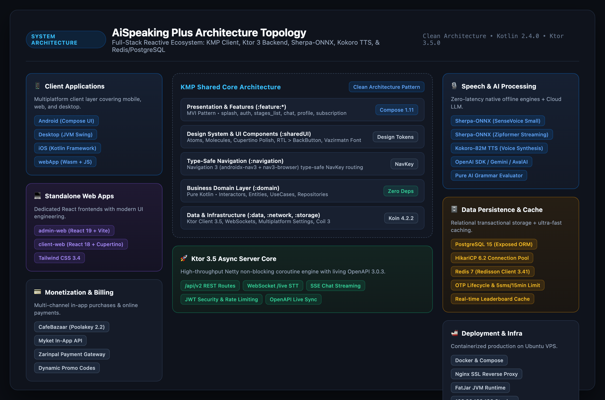
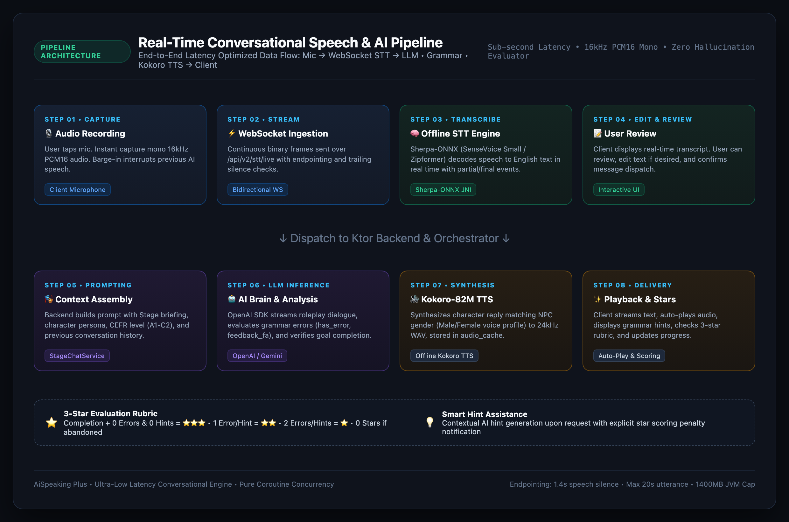
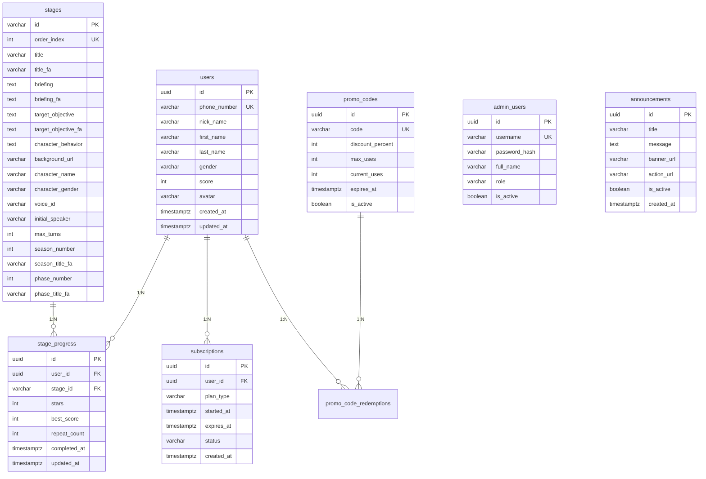

# 🎙️ AiSpeaking Plus — پلتفرم جامع آموزش مکالمه تعاملی انگلیسی (V2)

<p align="center">
  
</p>

<p align="center">
  
  
  
  
  
  
  
  
  
</p>

پروژه **AiSpeaking Plus (نسخه ۲)** یک اکوسیستم فول‌استک، چندسکویی (Multiplatform) و بدون تاخیر (Low-Latency) برای آموزش مکالمه زبان انگلیسی در بستر یک **سفر داستانی تعاملی (از مبدأ تهران به مقصد لندن)** است. این پلتفرم از ترکیب **Kotlin Multiplatform (KMP)** و **Compose Multiplatform (CMP)** در بخش کلاینت، سرور ناهمگام و پرسرعت **Ktor 3.5 (موتور Netty)** در بخش بک‌اند، موتورهای بومی پردازش صوت محلی **Sherpa-ONNX (SenseVoice & Zipformer)** و سنتز صدای **Kokoro-82M TTS** به همراه حافظه توزیع‌شده **Redis 7** و پایگاه داده رابطه‌ای **PostgreSQL 15** بهره می‌برد.

---

## 🛠️ ماتریس نسخه‌ها و پشته فناوری (Core Tool & Dependency Versions)

> [!IMPORTANT]
> تمامی نسخه‌ها و ابزارهای مندرج در جدول زیر مستقیماً از فایل‌های کانفیگ پروژه (`gradle/libs.versions.toml`, `package.json`, `Dockerfile`, `docker-compose.yml`) استخراج شده‌اند و مبنای توسعه و استقرار می‌باشند:

| لایه / بخش | ابزار / فناوری | نسخه دقیق | نقش فنی و توضیحات |
|:---|:---|:---:|:---|
| **زبان پایه و کلاینت** | Kotlin Multiplatform (KMP) | `2.4.0` | کدهای چندسکویی و اشتراکی کلاینت (Android, iOS, Desktop, Web) |
| **فریم‌ورک UI مشترک** | Compose Multiplatform (CMP) | `1.11.1` | رابط کاربری اعلانی مشترک با متریال ۳ (`material3 1.11.0-alpha07`) |
| **موتور سرور بک‌اند** | Ktor Server (Netty) | `3.5.0` | سرور ماژولار و ناهمگام با Coroutines، وب‌سوکت و OpenAPI زنده |
| **تزریق وابستگی (DI)** | Koin & Koin Compiler Plugin | `4.2.2` / `1.0.1` | تزریق وابستگی امن در زمان کامپایل (Compile-Time Safe DI) در کلاینت و سرور |
| **محیط اجرا (JVM/JDK)** | Eclipse Temurin OpenJDK | `21` | نسخه LTS جاوا برای بیلد و ران‌تایم کانتینر سرور (`eclipse-temurin:21-jre-jammy`) |
| **پایگاه داده رابطه‌ای** | PostgreSQL | `15+` | ذخیره‌سازی ماندگار کاربران، مراحل، خریدها و سوابق پیشرفت |
| **درایور و استخر اتصال** | PostgreSQL JDBC / HikariCP | `42.7.4` / `6.2.1` | اتصال بهینه به پایگاه داده با حداکثر ۱۵ کانکشن در استخر |
| **ابزار دسترسی داده** | JetBrains Exposed (DAO & DSL)| `0.57.0` | نگاشت رابطه‌ای و مایگریشن خودکار جداول (`SchemaUtils`) |
| **حافظه سریع و کش** | Redis / Redisson Client | `7+` / `3.41.0` | انبار داده کدهای OTP، مدیریت Rate Limit، کش لیدربورد و قفل‌ها |
| **تبدیل گفتار به متن (STT)**| Sherpa-ONNX (SenseVoice & Zipformer)| Native / JNI | پردازش محلی صوت کاربر با مدل‌های `SenseVoice-Small` و `Zipformer-en` (صوت 16kHz PCM16) |
| **تبدیل متن به گفتار (TTS)**| Sherpa-ONNX (Kokoro-82M) | Native / JNI | سنتز صدای طبیعی انگلیسی متناسب با جنسیت کاراکترها (`kokoro-en-v0_19` و چندزبانه) |
| **درگاه مدل‌های زبانی (AI)**| OpenAI Kotlin SDK & GenAI | `4.0.1` / `0.1.0` | ارتباط با مدل‌های زبانی (OpenAI, AvalAI, Gemini) با کانفیگ پویا در ردیس |
| **ناوبری کلاینت** | AndroidX Navigation 3 | `1.1.1` | سیستم ناوبری تایپ-سیف مدرن مبتنی بر `NavKey` با پشتیبانی وب (`nav3-browser 1.1.0`) |
| **لود تصویر و مدیا** | Coil 3 | `3.5.0` | لودینگ تصاویر و کش شبکه از طریق موتور Ktor 3 (`coil-network-ktor3`) |
| **پنل مدیریت (Admin)** | React 19 + TypeScript + Vite | `19.0.0` / `6.2.0` | وب‌اپ مدیریت مراحل، سناریوها، کاربران، پروموکدها، اعلانات و لابراتوار صدا |
| **کلاینت وب مدرن** | React 18 + Vite + Tailwind | `18.3.1` / `3.4.17` | وب‌کلاینت جایگزین مدرن با طراحی Liquid Glass و React Cupertino UI |
| **پرداخت درون‌برنامه‌ای** | CafeBazaar Poolakey / Myket | `2.2.0` / API | پرداخت درون‌برنامه‌ای بازار و مایکت با اعتبارسنجی سمت سرور |
| **درگاه پرداخت وب** | Zarinpal Gateway | REST v4 | اتصال به درگاه زرین‌پال برای اشتراک‌های کاربران وب |
| **پوش نوتیفیکیشن** | Firebase Admin SDK / BOM | `9.5.0` / `33.10.0` | ارسال پیام‌های عمومی و خصوصی از پنل ادمین به کاربران اندروید |
| **محیط کانتینری** | Docker & Docker Compose | Compose v2 | ارکستراسیون سرویس‌های `app`, `db`, `redis` روی پورت‌های لوکال |

---

## 📑 فهرست مطالب

1. [معماری سیستم و لایه‌بندی Clean Architecture](#-معماری-سیستم-و-لایه‌بندی-clean-architecture)
2. [ساختار ماژول‌های پروژه (Monorepo Breakdown)](#-ساختار-ماژول‌های-پروژه-monorepo-breakdown)
3. [خط لوله صوتی و پردازش هوش مصنوعی (Speech & AI Pipeline)](#-خط-لوله-صوتی-و-پردازش-هوش-مصنوعی-speech--ai-pipeline)
4. [جریان داستانی و منطق دسترسی (Core Business & Story Gating)](#-جریان-داستانی-و-منطق-دسترسی-core-business--story-gating)
5. [پایگاه داده و ساختار جداول (Database Schema)](#-پایگاه-داده-و-ساختار-جداول-database-schema)
6. [پنل‌های تحت وب (Admin Web & Client Web)](#-پنل‌های-تحت-وب-admin-web--client-web)
7. [مشخصات سرور لایو و دستورالعمل استقرار (Deployment Runbook)](#-مشخصات-سرور-لایو-و-دستورالعمل-استقرار-deployment-runbook)
8. [راه‌اندازی محیط توسعه محلی (Local Development)](#-راه‌اندازی-محیط-توسعه-محلی-local-development)
9. [قوانین اساسی و راهنمای توسعه برای ایجنت‌ها (Constitution)](#-قوانین-اساسی-و-راهنمای-توسعه-برای-ایجنت‌ها-constitution)

---

## 🏗 معماری سیستم و لایه‌بندی Clean Architecture

معماری کل پروژه در هر دو بخش کلاینت و سرور ۱۰۰٪ منطبق بر اصول **Clean Architecture** و استقلال لایه‌ها پیاده‌سازی شده است:

```
┌─────────────────────────────────────────────────────────────────────────┐
│                           CLIENT APPLICATIONS                           │
│  Android (:androidApp)  •  Desktop (:desktopApp)  •  Web Wasm (:webApp) │
│  iOS Framework (:iosApp) •  Admin Web (React 19) • Client Web (React 18)│
└────────────────────────────────────┬────────────────────────────────────┘
                                     │
┌────────────────────────────────────▼────────────────────────────────────┐
│                    KMP SHARED CLIENT LAYER (Kotlin)                     │
│  Presentation: :feature:* (MVI) & :sharedUI (Apple/Cupertino Tokens)   │
│  Navigation:   :navigation (Navigation 3 Type-safe BackStack)           │
│  Domain:       :domain (Pure Kotlin, Entities, UseCases, Repositories)  │
│  Data & Infra: :data, :network (Ktor Client 3.5), :storage (Settings)   │
└────────────────────────────────────┬────────────────────────────────────┘
                                     │  HTTP REST /api/v2 & WebSocket /live
┌────────────────────────────────────▼────────────────────────────────────┐
│                       KTOR 3.5 BACKEND SERVER                           │
│  - EngineMain (Netty, Port 8080)                                        │
│  - Core: Security (JWT Auth & Blacklist), CORS, WebSockets, OpenAPI     │
│  - Features: Stage, Progress, STT, TTS, User, Subscriptions, Admin      │
└──────────────┬─────────────────────────────┬────────────────────────────┘
               │                             │
┌──────────────▼─────────────┐ ┌─────────────▼────────────────────────────┐
│    LOCAL SPEECH & AI       │ │       PERSISTENCE & CACHE INFRA          │
│ • Sherpa-ONNX STT Engine   │ │ • PostgreSQL 15 (JetBrains Exposed ORM)  │
│   (SenseVoice & Zipformer) │ │   Users, Stages, Progress, Subscriptions │
│ • Kokoro-82M TTS Engine    │ │ • Redis 7 (Redisson 3.41)                │
│   (Gender Voice Synthesis) │ │   OTP Lifecycle, 5/15min Limit, Ranking  │
│ • Cloud LLM Gateway (OpenAI│ │ • Persistent Volumes (/app/audio_cache,  │
│   / Gemini / AvalAI)       │ │   /app/models, /app/native)              │
└────────────────────────────┘ └──────────────────────────────────────────┘
```

### اصول کلیدی لایه‌ها:
1. **لایه دامنه (`:domain`):** فاقد هرگونه وابستگی به کتابخانه‌های اندروید، Ktor، دیتابیس یا فریم‌ورک‌های رابط کاربری است. شامل Entityها، اینترفیس‌های مخازن داده و UseCaseهای خالص کاتلین است.
2. **لایه داده (`:data`):** نگاشت DTOهای شبکه به مدل‌های دامنه، اتصال به منابع محلی (`:storage`) و ریموت (`:network`) را مدیریت می‌کند.
3. **لایه رابط کاربری مشترک (`:sharedUI`):** حاوی توکن‌های طراحی، تایپوگرافی وزیرمتن، کامپوننت‌های اتمی و مولکولی، هندلینگ خطای سیستمی و پیاده‌سازی اصول RTL است.
4. **لایه سرور (`:server`):** ماژولار و Feature-Driven؛ کلیه تراکنش‌های دیتابیس و کارهای سنگین روی `Dispatchers.IO` دیسپچ می‌شوند تا هیچ ترد مسدودکننده‌ای در هسته Netty ایجاد نشود.

---

## 📁 ساختار ماژول‌های پروژه (Monorepo Breakdown)

```text
AISpeakingPlus/
├── .specify/                       # مستندات قانون اساسی، پلن پاکسازی و ابزارهای مهندسی
├── admin-web/                      # پنل مدیریت ادمین بر پایه React 19 + TypeScript + Vite
│   ├── src/pages/                  # صفحات: Stages, Users, VoiceLab, Promo, Announcements, Stats
│   └── vite.config.ts              # تنظیمات Vite با پورت 8082 و پروکسی API
├── client-web/                     # کلاینت وب مدرن بر پایه React 18 + Tailwind + Cupertino UI
│   ├── src/pages/                  # صفحات: Chat, Stages, Subscription, Profile, Login
│   └── vite.config.ts              # پورت 8083 با پروکسی به سرور بک‌اند
├── androidApp/                     # نقطه ورود اپلیکیشن اندروید (MainActivity, Firebase FCM)
├── desktopApp/                     # نقطه ورود اپ دسکتاپ بر بستر Compose Desktop و Swing
├── webApp/                         # نقطه ورود وب کلاینت با Compose Wasm و WebAudioBridge
├── iosApp/                         # بسته و فریم‌ورک اختصاصی خروجی برای iOS
├── feature/                        # ماژول‌های مستقل فیچر کلاینت (MVI Pattern)
│   ├── auth/                       # دریافت شماره، تایید OTP، کد تست بای‌پس
│   ├── chat/                       # اتاق چت صوتی و متنی، وب‌سوکت رکورد، پخش صدای NPC، گرامر
│   ├── main/                       # نوار ناوبری پایین صفحه (Stages, Leaderboard, Profile)
│   ├── profile/                    # ویرایش نام و آواتار، تعیین سطح، مشاهده اشتراک، خروج
│   ├── splash/                     # انیمیشن شروع و بررسی وضعیت احراز هویت اولیه
│   ├── stages_list/                # فهرست و نقشه داستانی مراحل، سرفصل‌ها و ستاره‌ها
│   └── subscription/               # پلن‌های عضویت، خرید کافه‌بازار/مایکت/زرین‌پال، پروموکد
├── domain/                         # مدل‌های تجاری خالص، UseCaseها و اینترفیس مخازن
├── data/                           # پیاده‌سازی Repositoryها، Mapperها و ارتباط با منبع داده
├── network/                        # کلاینت HTTP Ktor، وب‌سوکت‌ها، اینترسپتور توکن Bearer
├── storage/                        # ذخیره‌سازی محلی کلاینت بر پایه Multiplatform Settings
├── navigation/                     # ناوبری تایپ-سیف مبتنی بر AndroidX Navigation 3
├── sharedUI/                       # سیستم طراحی، پالت رنگ، تایپوگرافی وزیرمتن و RTL
├── server/                         # سرور بک‌اند بر پایه Ktor 3.5 (Netty)
│   ├── Dockerfile                  # تصویر تولیدی مبتنی بر eclipse-temurin:21-jre-jammy
│   ├── docker-compose.yml          # ارکستراسیون سرویس‌های app, db (Postgres), redis
│   └── src/main/kotlin/ir/speaking/
│       ├── Application.kt          # نقطه شروع، پیکربندی پلاگین‌ها و Netty
│       ├── core/                   # ماژول‌های زیرساخت: Databases, Security, Routing, Redis, DI
│       └── feature/                # فیچرهای سرور: stage, stt, tts, user, subscription, admin, ...
├── models/                         # مدل‌های آفلاین فشرده هوش مصنوعی
│   ├── kokoro-en-v0_19/            # مدل ONNX سنتز صدای انگلیسی Kokoro-82M
│   ├── kokoro-multi-lang-v1_0/     # مدل ONNX سنتز صدای چندزبانه Kokoro
│   └── sherpa-onnx-sense-voice...  # مدل STT چندزبانه SenseVoice Small برای تبدیل صوت
├── native/                         # کتابخانه‌های باینری C++ بومی (libonnxruntime, libsherpa-onnx)
├── screenshots/                    # اسکرین‌شات‌های واقعی از صفحات اپلیکیشن
├── doc/images/                     # دیاگرام‌های معماری و خط لوله داده تولیدشده با کیفیت بالا
└── start-all.sh                    # اسکریپت راه‌اندازی یکپارچه کلیه سرویس‌ها در محیط محلی
```

---

## 🔄 خط لوله صوتی و پردازش هوش مصنوعی (Speech & AI Pipeline)

یکی از مهم‌ترین بخش‌های اپلیکیشن، خط لوله تبادل زنده صوت با کمترین تاخیر (Low Latency Voice Pipeline) است:

<p align="center">
  
</p>

### چرخه گام‌به‌گام پردازش مکالمه:
1. **شروع ضبط با یک ضربه (Toggle Capture):** با تپ روی میکروفون، اتصال دوطرفه وب‌سوکت به اندپوینت `/api/v2/stt/live` برقرار می‌شود.
2. **قابلیت قطع فوری صدای کاراکتر (Barge-in / Interruption):** اگر هوش مصنوعی در حال صحبت باشد، لمس میکروفون بلافاصله صدای NPC را بی‌صدا (Mute) کرده و ضبط صدای کاربر را آغاز می‌کند.
3. **ارسال چانک‌های صوتی خام (Raw PCM16 Stream):** صدا به صورت فریم‌های باینری مونو با فرکانس 16,000 هرتز و سمپلینگ PCM 16-bit مستقیماً ارسال می‌شود.
4. **موتور STT محلی Sherpa-ONNX:** سرور با بهره‌گیری از **SenseVoice-Small** یا **Zipformer Streaming** متن گفتار کاربر را در زمان واقعی پیاده‌سازی کرده و رویدادهای `partial` و `final` را به کلاینت بازمی‌گرداند.
5. **امکان بازبینی و ویرایش متن (Text Review):** پس از توقف ضبط، کاربر می‌تواند متن انگلیسی پیاده‌شده را مشاهده و در صورت نیاز قبل از ارسال آن را ویرایش کند.
6. **پردازش در هسته هوش مصنوعی (StageChatService):** پرامپت هر مرحله بر اساس زمینه داستانی (Briefing)، نقش کاراکتر، تاریخچه چت و سطح زبانی کاربر (A1 تا C2) تجمیع و به LLM ارسال می‌شود.
7. **تحلیل گرامر صرفاً توسط مدل زبانی (Pure AI Grammar):** بررسی صحت ساختار جمله، استخراج اصلاحیه و توضیح فارسی ایراد مستقیماً توسط هوش مصنوعی انجام می‌شود (هیچ‌گونه Regex یا الگوریتم دستی در سرور دخیل نیست):
   - `hasGrammarError`: مشخص‌کننده وجود خطای گرامری.
   - `correctedSentence`: جمله تصحیح‌شده استاندارد.
   - `grammarFeedbackFa`: توضیح روان فارسی درباره چرایی اشتباه.
8. **بررسی خودکار اتمام مأموریت (`objectiveCompleted`):** هوش مصنوعی بر اساس اهداف مرحله تشخیص می‌دهد که آیا کاربر چالش مکالمه را پشت سر گذاشته است یا خیر.
9. **سنتز صدای متناسب با جنسیت کاراکتر (Gender-Based Kokoro TTS):** متن پاسخ NPC با صدای کاراکتر (زن یا مرد) به فایل صوتی WAV با سمپل‌ریت 24kHz تبدیل شده، در دایرکتوری `/app/audio_cache` کش می‌شود و آدرس آن برای پخش خودکار به کلاینت تحویل داده می‌شود.
10. **سیستم راهنما با جریمه امتیازی (💡 Hint System):** در صورت نیاز، کاربر می‌تواند دکمه راهنما را بزند؛ سیستم جمله پیشنهادی متناسب با شرایط گفتگو را ارائه می‌دهد اما یک جریمه نمره منفی برای کسب ۳ ستاره در نظر می‌گیرد.

---

## 🧭 جریان داستانی و منطق دسترسی (Core Business & Story Gating)

### ۱. ویدیوی داستانی آغازین (Intro Cinematic Video)
کاربر در اولین اجرای برنامه، با یک ویدیوی داستانی کوتاه و انیمیشنی مواجه می‌شود که ماجرای آغاز سفر قهرمان داستان از تهران به مقصد لندن را بازگو می‌کند. کاربر می‌تواند ویدیو را رد (Skip) کند یا بعداً در صفحه پروفایل مجدداً تماشا کند.

### ۲. سیستم دسترسی ۳ مرحله‌ای (3-Tier Access Gating)
دسترسی به محتوای اپلیکیشن بر اساس جدول زیر کنترل می‌شود:

| سطح مرحله | وضعیت دسترسی | احراز هویت | توضیحات |
|:---:|:---:|:---:|:---|
| **مرحله ۱** | **رایگان کامل (Guest Mode)** | بدون نیاز به لاگین یا شماره تلفن | کاربر بلافاصله وارد مکالمه مرحله ۱ می‌شود. امتیازات موقتاً در حافظه محلی ذخیره می‌شوند. |
| **مرحله ۲** | **نیازمند ثبت‌نام (Free Registered)** | ورود با شماره موبایل و پیامک OTP | برای ورود به مرحله ۲، مودال لاگین باز می‌شود. با ثبت شماره، پیشرفت مرحله ۱ به اکانت سرور متصل (Sync) می‌گردد. |
| **مرحله ۳ به بعد** | **اشتراک ویژه (Paywall)** | نیازمند اشتراک فعال (Active Plan) | مراحل بعد قفل بوده و نیازمند خرید اشتراک یا اعمال پروموکد معتبر هستند. |

### ۳. چرخه حیات کد یکبارمصرف (OTP) و مدیریت نرخ درخواست در Redis
- **اکانت تستی برای بیلدها و تست‌های خودکار (Bypass Account):**
  - شماره موبایل: `09152413498`
  - کد یکبارمصرف ثابت: `87799` (بدون نیاز به ارسال پیامک واقعی و بدون کسر هزینه)
- **کلیدهای Redis برای سایر شماره‌ها:**
  - `auth:otp:{mobile}`: حاوی کد ۵ رقمی تصادفی، شمارنده خطا و زمان انقضای ۱۲۰ ثانیه.
  - `auth:cooldown:{mobile}`: جلوگیری از ارسال مجدد پیامک در کمتر از ۶۰ ثانیه.
  - **محدودیت نرخ (Rate Limiting):** حداکثر **۵ پیامک در بازه ۱۵ دقیقه** برای هر شماره تلفن.
  - مسدودسازی موقت (بلاک ۵ دقیقه‌ای) در صورت ۳ بار ورود اشتباه متوالی کد.

### ۴. ماتریس ارزیابی و کسب ستاره‌ها (Evaluation Rubric)
عبور از مرحله و بازگشایی مرحله بعد نیازمند اتمام مکالمه و کسب حداقل ۱ ستاره است:

| ستاره | شرایط احراز | وضعیت مرحله |
|:---:|:---|:---:|
| ⭐⭐⭐ **(۳ ستاره)** | تکمیل موفق مأموریت + **۰ خطای گرامری** و **۰ بار استفاده از راهنما (Hint)** | باز شدن مرحله بعد + حداکثر امتیاز |
| ⭐⭐ **(۲ ستاره)** | تکمیل موفق مأموریت + **مجموعاً ۱ خطا یا ۱ بار استفاده از راهنما** | باز شدن مرحله بعد |
| ⭐ **(۱ ستاره)** | تکمیل موفق مأموریت + **مجموعاً ۲ خطا و استفاده از راهنما** | باز شدن مرحله بعد (حداقل قبولی) |
| ⭕ **(۰ ستاره)** | **عدم اتمام مکالمه (`objectiveCompleted = false`)** یا **۳ خطا و بیشتر** | عدم بازگشایی مرحله بعد (تکرار اجباری) |

> **قانون حفظ بالاترین رکورد (High Score Policy):** در صورت بازی مجدد یک مرحله، بالاترین امتیاز و بیشترین ستاره کسب‌شده کاربر همواره در دیتابیس حفظ می‌شود.

### ۵. لیدربورد زنده (Real-time Leaderboard)
- **سکوی برتر (Top 3 Podium):** نمایش ۳ زبان‌آموز برتر به همراه آواتار، مرحله فعلی و امتیاز.
- **رتبه‌های ۴ تا ۱۰:** فهرست پیمایشی برترین‌ها.
- **کارت پین‌شده کاربر جاری (Pinned Bar):** اگر کاربر خارج از ۱۰ نفر اول باشد، کارت مشخصات و رتبه دقیق او در پایین صفحه فیکس می‌شود.
- **محاسبه آنی امتیاز:** امتیاز کل برابر است با ترکیبی از تعداد مراحل تکمیل‌شده و جمع کل ستاره‌های دریافت‌شده.

### ۶. اشتراک‌ها و پرداخت چندسکویی
- **پلن‌های زمانی:** ۱ ماهه (۵۹,۰۰۰ تومن)، ۳ ماهه (۱۴۰,۰۰۰ تومن) و ۶ ماهه (۲۹۰,۰۰۰ تومن).
- **قانون تمدید تجمعی (Cumulative Extension):** خرید اشتراک جدید در طول دوره اشتراک فعال، مدت زمان جدید را به انتهای تاریخ انقضای قبلی اضافه می‌کند و اشتراک قبلی منقضی نمی‌شود.
- **درگاه‌ها:** کافه‌بازار (Poolakey) در اندروید، مایکت، و درگاه مستقیم زرین‌پال برای وب.

---

## 🗄 پایگاه داده و ساختار جداول (Database Schema)

پایگاه داده در سرور با فریم‌ورک **Exposed ORM** و مدیریت تراکنش‌های ناهمگام اداره می‌شود. جداول فعال سیستم عبارتند از:



---

## 💻 پنل‌های تحت وب (Admin Web & Client Web)

### ۱. پنل مدیریت ادمین (`admin-web`)
این پنل با **React 19**, **Vite 6** و **Tailwind CSS** در مسیر `admin-web/` قرار دارد و روی پورت `8082` اجرا می‌شود:
- **داشبورد و آمار:** شمارش کاربران فعال، جلسات چت، دقایق صوت تولیدشده و درآمد.
- **مدیریت جامع مراحل (Stages CRUD):** ویرایش عنوان‌ها، اهداف، پرامپت کاراکتر، شناسه صدای Kokoro، فصل‌ها و تصاویر پس‌زمینه.
- **لابراتوار صدا (Voice Lab):** تست آنلاین صداهای کاراکتر زن و مرد موتور Kokoro و مقایسه لهجه‌ها و سرعت‌های خوانش.
- **مدیریت کاربران و اشتراک‌ها:** مشاهده کاربران، جستجو بر اساس شماره موبایل، مسدودسازی، و اعطای اشتراک دستی.
- **مدیریت کدهای تخفیف (Promo Codes):** تعریف کد با سقف تعداد مصرف و درصد تخفیف.
- **مرکز اعلانات و پوش‌نوتیفیکیشن:** ارسال نوتیفیکیشن همگانی یا فردی از طریق Firebase FCM.
- **لاگ‌های امنیتی (Audit Logs):** ثبت کلیه اقدامات ادمین‌ها با IP و جزئیات تغییرات.

### ۲. وب‌کلاینت مدرن کاربر (`client-web`)
این پروژه در مسیر `client-web/` قرار دارد و با **React 18** و کامپوننت‌های مدرن **React Cupertino UI** و افکت شیشه‌ای **Liquid Glass** طراحی شده تا تجربه‌ای مشابه سیستم‌عامل iOS را در مرورگر وب ارائه دهد (پورت `8083`).

### ۳. وب‌اپ اصلی کاتلین (`webApp`)
خروجی کامپایل‌شده **Compose Multiplatform Wasm** به همراه فال‌بک خودکار JS برای مرورگرهای قدیمی با پل ارتباطی **WebAudioBridge** برای مدیریت میکروفون در وب.

---

## 🌐 مشخصات سرور لایو و دستورالعمل استقرار (Deployment Runbook)

### مشخصات سرور لایو:
- **آدرس سرور:** `193.93.169.198` (کاربر `ubuntu`)
- **دامنه کلاینت وب:** `https://staging.aispeaking.ir/app/`
- **دامنه اندپوینت‌های API:** `https://staging.aispeaking.ir/api/`
- **مسیر پروژه روی سرور:** `/home/ubuntu/AISpeakingPlus`
- **کانتینرهای داکر:** `server-app-1` (پورت `8080`), `server-db-1` (پورت `5432`), `server-redis-1` (پورت `6379`)

> [!CAUTION]
> **قانون طلایی استقرار:** هرگز کدی را مستقیماً روی سرور تغییر ندهید. چرخه مجاز:
> **تغییر لوکال ⬅️ بیلد و تست لوکال ⬅️ کامیت و Push به برنچ `develop` ⬅️ Pull روی سرور ⬅️ بیلد و ری‌استارت کانتینر ⬅️ تست E2E**

### الف) دیپلوی بخش سرور و بک‌اند (Ktor FatJar):
```bash
# ۱. اتصال به سرور و پول کردن آخرین تغییرات
ssh ubuntu@193.93.169.198
cd /home/ubuntu/AISpeakingPlus
git fetch origin && git pull origin develop

# ۲. بیلد FatJar سرور
./gradlew :server:buildFatJar -x test

# ۳. بازسازی ایمیج داکر و ری‌استارت سرویس
docker build -t ai-speaking:latest -f server/Dockerfile .
docker restart server-app-1

# ۴. اعتبارسنجی سلامت سرور
curl -I http://127.0.0.1:8080/health
docker logs --tail 50 server-app-1
```

### ب) دیپلوی بخش کلاینت وب (Compose Multiplatform Wasm + JS):
```bash
# ۱. تولید بیلد ترکیبی پروداکشن در محیط لوکال
./gradlew :webApp:composeCompatibilityBrowserDistribution

# ۲. انتقال امن فایل‌ها به سرور وب (بدون فلگ delete برای جلوگیری از ارور 404 سشن‌های فعال)
rsync -avz webApp/build/dist/composeWebCompatibility/productionExecutable/ ubuntu@193.93.169.198:/var/www/aispeaking.ir/html/app/

# ۳. در صورت نیاز به ریلود Nginx:
ssh ubuntu@193.93.169.198 "sudo systemctl reload nginx"
```

---

## 🚀 راه‌اندازی محیط توسعه محلی (Local Development)

### پیش‌نیازها:
- **JDK 21** (توصیه: Eclipse Temurin 21)
- **Node.js 20+** و **npm** (جهت اجرای `admin-web` و `client-web`)
- **Docker / OrbStack** (برای سرویس‌های دیتابیس Postgres و Redis)
- **Android Studio Ladybug+** یا **IntelliJ IDEA 2024.3+**

### روش ۱: اجرای یکپارچه با اسکریپت `start-all.sh` (پیشنهادی)
یک اسکریپت جامع در ریشه پروژه قرار دارد که کانتینرهای داکر، گیت‌وی هوش مصنوعی، سرور Ktor و پنل ادمین را هم‌زمان راه‌اندازی می‌کند:
```bash
chmod +x start-all.sh
./start-all.sh
```

### روش ۲: اجرای دستی ماژول‌ها

```bash
# ۱. بالا آوردن دیتابیس PostgreSQL و Redis
cd server
docker compose up -d db redis
cd ..

# ۲. اجرای سرور Ktor بک‌اند (پورت 8080)
./gradlew :server:run

# ۳. اجرای پنل مدیریت ادمین (پورت 8082)
cd admin-web
npm install
npm run dev

# ۴. اجرای وب‌کلاینت کاربری ری‌اکت (پورت 8083)
cd client-web
npm install
npm run dev

# ۵. اجرای وب‌اپ Compose Wasm (پورت 8081)
./gradlew :webApp:wasmJsBrowserDevelopmentRun
```

### جدول پورت‌های محیط محلی:
| سرویس / ماژول | پورت لوکال | توضیحات |
|:---|:---:|:---|
| **Ktor Backend API** | `8080` | اندپوینت‌های REST، مستندات `/openapi` و وب‌سوکت `/api/v2/stt/live` |
| **Compose Web (Wasm)** | `8081` | وب‌اپ کاربری چندسکویی کاتلین در مرورگر |
| **Admin Web (React 19)** | `8082` | پنل تحت وب مدیریت سناریوها و کاربران (`http://localhost:8082`) |
| **Client Web (React 18)**| `8083` | کلاینت وب سریع و سبک با رابط شیشه‌ای اپل (`http://localhost:8083`) |
| **PostgreSQL 15** | `5432` | دیتابیس `ai_speaking` (کاربر: `postgres`) |
| **Redis 7** | `6379` | کش توزیع‌شده کدهای OTP و قفل‌ها |
| **9router AI Gateway** | `20128` | گیت‌وی محلی هدایت درخواست‌های مدل‌های هوش مصنوعی (اختیاری) |

### اطلاعات پیش‌فرض ورود تستی:
- **حساب ادمین:** `admin@aispeaking.ir` / رمز عبور: `Admin@123456!`
- **حساب تستی کاربر عادی (Bypass OTP):** موبایل `09152413498` / کد تایید ثابت `87799`

---

## 📐 قوانین اساسی و راهنمای توسعه برای ایجنت‌ها (Constitution)

تمامی ایجنت‌های هوش مصنوعی و برنامه‌نویسانی که بر روی این ریپازیتوری کار می‌کنند، **ملزم به رعایت بی‌چون‌وچرای اصول زیر هستند**:

1. **استاندارد بازگشت در رابط کاربری فارسی (RTL Navigation):**
   - دکمه بازگشت (`AppBackButton`) در صفحات راست‌به‌چپ **همیشه در گوشه بالا-راست (Start anchor)** قرار می‌گیرد.
   - آیکون بازگشت (`ic_back`) **حتماً باید به سمت راست (`>`) اشاره کند**.
   - عنوان صفحات در نوار بالا (`TopAppBar`) باید همواره وسط‌چین (`TextAlign.Center`) باشد.
2. **عدم مسدودسازی ترد در سرور (Non-blocking Ktor Coroutines):**
   - هیچ‌گونه کد بلاک‌کننده (I/O دیسک یا شبکه) نباید در روت‌های Ktor اجرا شود؛ کلیه عملیات‌های سنگین باید با `withContext(Dispatchers.IO)` دیسپچ شوند.
3. **مستندسازی خودکار و سازگاری با OpenAPI 3.0.3:**
   - هر اندپوینت جدید یا تغییریافته در Ktor باید بلوک کامل `.describe { ... }` با شمای معتبر و نمونه Request/Response داشته باشد تا همگام‌سازی زنده (Live Sync) در **Apidog** و Swagger بدون خطا انجام شود.
4. **استفاده از اکانت بای‌پس در تست‌های خودکار:**
   - در تمام سناریوهای تستی Playwright و تست‌های دستی وب، حتماً از شماره `09152413498` با کد `87799` استفاده کنید تا اعتبارات پیامکی هدر نرود.
5. **عدم بازگرداندن فیچرهای منسوخ نسخه ۱:**
   - فیچرهایی نظیر جعبه لایتنر قدیمی، دسته‌بندی سناریوهای V1، ماژول کلمات و رقابت‌های سنتی از پروژه حذف شده‌اند و بازنویسی داستانی V2 بر پایه **مراحل، چالش داستانی، تحلیل گرامر بلادرنگ و سنتز صدای Kokoro** پیاده‌سازی شده است. هیچ کدی نباید بر پایه ساختار منسوخ قبلی افزوده شود.

---

<p align="center">
  <sub>طراحی و توسعه یافته با ❤️ برای ارتقای مهارت مکالمه انگلیسی زبان‌آموزان</sub>
</p>
