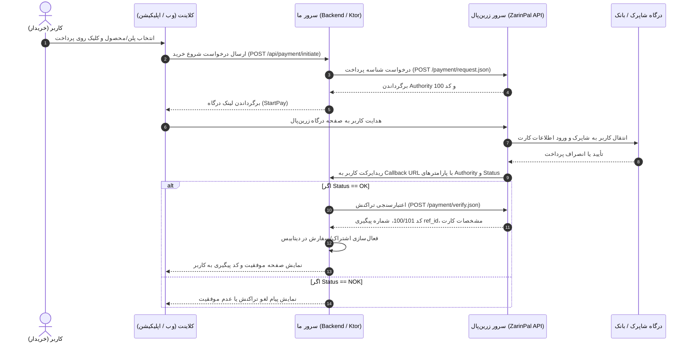

# راهنمای جامع پیاده‌سازی و اتصال به درگاه پرداخت زرین‌پال (ZarinPal v4 API)

این سند مرجع فنی و جامع برای تمامی ایجنت‌ها و توسعه‌دهندگانی است که قصد پیاده‌سازی، خطایابی یا توسعه درگاه پرداخت زرین‌پال را در این پروژه دارند. این مستندات مستقیماً از جدیدترین مستندات رسمی زرین‌پال (نسخه ۴) استخراج و تدوین شده است.

---

## فهرست مطالب
1. [مفاهیم اولیه و مشخصات فنی (Overview)](#۱-مفاهیم-اولیه-و-مشخصات-فنی-overview)
2. [محیط‌ها و آدرس‌های پایه (Base URLs)](#۲-محیط‌ها-و-آدرس‌های-پایه-base-urls)
3. [چرخه گام‌به‌گام پرداخت (Payment Flow)](#۳-چرخه-گام‌به‌گام-پرداخت-payment-flow)
4. [متد ۱: ایجاد درخواست پرداخت (Payment Request)](#۴-متد-۱-ایجاد-درخواست-پرداخت-payment-request)
5. [متد ۲: انتقال کاربر به درگاه (StartPay)](#۵-متد-۲-انتقال-کاربر-به-درگاه-startpay)
6. [متد ۳: مدیریت کال‌بک بازگشت (Callback Handling)](#۶-متد-۳-مدیریت-کال‌بک-بازگشت-callback-handling)
7. [متد ۴: اعتبارسنجی و تأیید پرداخت (Payment Verification)](#۷-متد-۴-اعتبارسنجی-و-تأیید-پرداخت-payment-verification)
8. [متد ۵: استرداد آنی وجه / بازگشت وجه (Reverse / Refund)](#۸-متد-۵-استرداد-آنی-وجه--بازگشت-وجه-reverse--refund)
9. [متدهای تکمیلی (Inquiry, unVerified, feeCalculation)](#۹-متدهای-تکمیلی-inquiry-unverified-feecalculation)
10. [جدول جامع کدهای وضعیت و کدهای خطا (Status Codes)](#۱۰-جدول-جامع-کدهای-وضعیت-و-کدهای-خطا-status-codes)
11. [نمونه پیاده‌سازی تمیز در Ktor / Kotlin](#۱۱-نمونه-پیاده‌سازی-تمیز-در-ktor--kotlin)
12. [نکات امنیتی و Best Practices](#۱۲-نکات-امنیتی-و-best-practices)

---

## ۱. مفاهیم اولیه و مشخصات فنی (Overview)

- **پروتکل:** تمام ارتباطات از طریق متد استاندارد `POST` و تحت پروتکل امن `HTTPS` انجام می‌شوند.
- **فرمت تبادل داده:** `JSON` (UTF-8).
- **نسخه وب‌سرویس:** `v4`
- **هدرهای الزامی (Request Headers):**
  ```http
  Content-Type: application/json
  Accept: application/json
  ```
- **شناسه مرجع (Authority):** رشته‌ای ۳۶ کاراکتری یکتا که توسط زرین‌پال برای هر تراکنش تولید می‌شود:
  - در محیط عملیاتی با حرف **`A`** آغاز می‌شود (مانند `A0000000000000000000000000000wwOGYpd`).
  - در محیط سندباکس با حرف **`S`** آغاز می‌شود.

---

## ۲. محیط‌ها و آدرس‌های پایه (Base URLs)

| محیط | Base URL وب‌سرویس | شروع شناسه Authority | مرچنت کد (Merchant ID) |
| :--- | :--- | :--- | :--- |
| **عملیاتی (Production)** | `https://payment.zarinpal.com/pg/v4/` | با حرف **`A`** (۳۶ کاراکتر) | کد ۳۶ کاراکتری یکتای پذیرنده از پنل زرین‌پال |
| **سندباکس (Sandbox)** | `https://sandbox.zarinpal.com/pg/v4/` | با حرف **`S`** (۳۶ کاراکتر) | شناسه دلخواه ۳۶ کاراکتری (مثلاً `00000000-0000-0000-0000-000000000000`) |

---

## ۳. چرخه گام‌به‌گام پرداخت (Payment Flow)



---

## ۴. متد ۱: ایجاد درخواست پرداخت (Payment Request)

از این اندپوینت برای شروع تراکنش و دریافت کد `authority` استفاده می‌شود.

- **متد:** `POST`
- **آدرس پروداکشن:** `https://payment.zarinpal.com/pg/v4/payment/request.json`
- **آدرس سندباکس:** `https://sandbox.zarinpal.com/pg/v4/payment/request.json`

### پارامترهای ارسالی (Request Body):
| فیلد | نوع داده | الزامی | توضیحات |
| :--- | :--- | :---: | :--- |
| `merchant_id` | String | بله | کد ۳۶ کاراکتری مرچنت پذیرنده |
| `amount` | Long / Int | بله | مبلغ تراکنش. حداقل ۱,۰۰۰ تومان (معادل ۱۰,۰۰۰ ریال) و حداکثر ۱۰۰,۰۰۰,۰۰۰ تومان |
| `description` | String | بله | توضیح پرداخت (حداکثر ۵۰۰ کاراکتر) |
| `callback_url` | String | بله | آدرس بازگشت خریدار پس از اتمام پرداخت (باید دامنه‌اش با درگاه ثبت‌شده در زرین‌پال یکسان باشد) |
| `currency` | String | خیر | واحد پولی: `IRR` (ریال - پیش‌فرض در صورت عدم ارسال) یا `IRT` (تومان - توصیه می‌شود) |
| `referrer_id` | String | خیر | شناسه معرف در سیستم همکاری در فروش |
| `metadata` | Object | خیر | اطلاعات تکمیلی تراکنش (شرح زیر) |
| `metadata.mobile` | String | خیر | شماره موبایل کاربر (جهت یادآوری کارت‌ها در درگاه زرین‌پال) |
| `metadata.email` | String | خیر | ایمیل خریدار |
| `metadata.order_id` | String | خیر | شماره فاکتور یا شناسه داخلی سفارش در سیستم شما |
| `metadata.card_pan` | String | خیر | در صورتی که بخواهید پرداخت **فقط با کارت مشخصی** انجام شود (۱۶ رقم) |
| `metadata.auto_verify` | Boolean | خیر | فعال‌سازی تایید خودکار (پیش‌فرض `false`) |
| `cart_data` | Object | خیر | جزییات آیتم‌های سبد خرید در صفحه میان‌پی زرین‌پال |

### نمونه ریکوئست cURL:
```bash
curl -X POST https://payment.zarinpal.com/pg/v4/payment/request.json \
  -H "Content-Type: application/json" \
  -H "Accept: application/json" \
  -d '{
    "merchant_id": "xxxxxxxx-xxxx-xxxx-xxxx-xxxxxxxxxxxx",
    "amount": 500000,
    "currency": "IRT",
    "description": "خرید اشتراک ماهانه هوش مصنوعی",
    "callback_url": "https://aispeaking.ir/api/payment/callback",
    "metadata": {
      "mobile": "09152413498",
      "order_id": "SUB-987654"
    }
  }'
```

### نمونه پاسخ موفق (`code: 100`):
```json
{
  "data": {
    "code": 100,
    "message": "Success",
    "authority": "A0000000000000000000000000000wwOGYpd",
    "fee_type": "Merchant",
    "fee": 100
  },
  "errors": []
}
```

### نمونه پاسخ ناموفق یا خطا در ورودی (`code: -9`):
```json
{
  "data": [],
  "errors": {
    "code": -9,
    "message": "Validation error",
    "validations": [
      { "amount": "The amount field must be at least 1000." }
    ]
  }
}
```

---

## ۵. متد ۲: انتقال کاربر به درگاه (StartPay)

پس از دریافت پاسخ موفق (`code == 100`) و رشته `authority`، کاربر را به آدرس زیر هدایت کنید:

- **آدرس پروداکشن:**
  ```text
  https://payment.zarinpal.com/pg/StartPay/{authority}
  ```
- **آدرس سندباکس:**
  ```text
  https://sandbox.zarinpal.com/pg/StartPay/{authority}
  ```

---

## ۶. متد ۳: مدیریت کال‌بک بازگشت (Callback Handling)

هنگامی که عملیات پرداخت در درگاه بانکی به پایان می‌رسد یا کاربر انصراف می‌دهد، زرین‌پال کاربر را با متد **`GET`** به آدرس `callback_url` تعیین‌شده در مرحله اول هدایت می‌کند:

```text
GET https://aispeaking.ir/api/payment/callback?Authority=A0000000000000000000000000000wwOGYpd&Status=OK
```

### پارامترهای ارسالی در Query String:
- **`Authority`**: همان شناسه ۳۶ کاراکتری صادر شده.
- **`Status`**: وضعیت اولیه بازگشت از بانک:
  - `OK`: پرداخت در بانک با موفقیت انجام شده است. **(ضروری است بلافاصله متد اعتبارسنجی Verify فراخوانی شود)**.
  - `NOK`: پرداخت ناموفق بوده، کاربر انصراف داده یا خطای بانکی رخ داده است. در این حالت به هیچ عنوان متد Verify را صدا نزنید.

---

## ۷. متد ۴: اعتبارسنجی و تأیید پرداخت (Payment Verification)

> [!CRITICAL]
> **اعتبارسنجی سمت سرور الزامی است:**
> تا زمانی که این متد فراخوانی نشود و پاسخ `code: 100` یا `code: 101` دریافت نشود، وجه به حساب پذیرنده واریز نخواهد شد و پس از مدتی به حساب کاربر برگشت می‌خورد.
> مبلغ (`amount`) را هرگز از کلاینت دریافت نکنید؛ بلکه حتماً بر اساس `Authority` مبلغ ذخیره‌شده اولیه را از دیتابیس خود فراخوانی کنید.

- **متد:** `POST`
- **آدرس پروداکشن:** `https://payment.zarinpal.com/pg/v4/payment/verify.json`
- **آدرس سندباکس:** `https://sandbox.zarinpal.com/pg/v4/payment/verify.json`

### پارامترهای ارسالی:
| فیلد | نوع داده | الزامی | توضیحات |
| :--- | :--- | :---: | :--- |
| `merchant_id` | String | بله | کد ۳۶ کاراکتری درگاه |
| `amount` | Long / Int | بله | مبلغ تراکنش (دقیقاً برابر با مبلغی که در مرحله Request ارسال شد) |
| `authority` | String | بله | شناسه Authority دریافتی از کال‌بک |

### نمونه ریکوئست cURL:
```bash
curl -X POST https://payment.zarinpal.com/pg/v4/payment/verify.json \
  -H "Content-Type: application/json" \
  -H "Accept: application/json" \
  -d '{
    "merchant_id": "xxxxxxxx-xxxx-xxxx-xxxx-xxxxxxxxxxxx",
    "amount": 500000,
    "authority": "A0000000000000000000000000000wwOGYpd"
  }'
```

### مقادیر کلیدی در پاسخ موفق:
- **`code: 100`**: تراکنش با موفقیت تأیید شد (اولین بار).
- **`code: 101`**: تراکنش قبلاً یک‌بار با موفقیت وریفای شده است (Idempotent / جلوگیری از تراکنش تکراری).
- **`ref_id`**: شماره پیگیری تراکنش بانکی شاپرک (باید در دیتابیس به همراه رکورد پرداخت ذخیره و به کاربر نمایش داده شود).
- **`card_pan`**: شماره کارت ماسک‌شده پرداخت‌کننده (مثلاً `603799******1234`).
- **`card_hash`**: هش SHA256 شماره کارت برای مقاصد احراز هویت مالی.
- **`fee`**: مقدار کارمزد کسر شده توسط زرین‌پال.
- **`fee_type`**: مشخص‌کننده اینکه کارمزد از پذیرنده (`Merchant`) کسر شده یا کاربر (`Payer`).

### نمونه پاسخ موفق:
```json
{
  "data": {
    "code": 100,
    "message": "Verified",
    "card_hash": "1EBE3EBEBE35C7EC0F8D6EE4F2F859107A87822CA179BC9528767EA7B5489B69",
    "card_pan": "502229******5995",
    "ref_id": 2018471,
    "fee_type": "Merchant",
    "fee": 4200
  },
  "errors": []
}
```

---

## ۸. متد ۵: استرداد آنی وجه / بازگشت وجه (Reverse / Refund)

زرین‌پال قابلیت بازگرداندن آنی وجه به کارت مشتری بدون کسر کارمزد را برای تراکنش‌های موفقی که کمتر از **۳۰ دقیقه** از وریفای آن‌ها گذشته است ارائه می‌دهد.

> [!WARNING]
> **پیش‌نیاز امنیتی متد Reverse:**
> برای استفاده از این متد، حتماً باید در پنل درگاه زرین‌پال، **IP سرور خود را ثبت کرده و گزینه محدودیت IP (Terminal IP limit) را فعال کرده باشید**؛ در غیر این‌صورت خطای `-62` رخ خواهد داد.

- **متد:** `POST`
- **آدرس پروداکشن:** `https://payment.zarinpal.com/pg/v4/payment/reverse.json`
- **آدرس سندباکس:** `https://sandbox.zarinpal.com/pg/v4/payment/reverse.json`

### پارامترهای ارسالی:
```json
{
  "merchant_id": "xxxxxxxx-xxxx-xxxx-xxxx-xxxxxxxxxxxx",
  "authority": "A0000000000000000000000000000wwOGYpd"
}
```

### پاسخ موفق:
```json
{
  "data": {
    "code": 100,
    "message": "Reversed"
  },
  "errors": []
}
```

### کدهای خطای اختصاصی Reverse:
- `-60`: عدم امکان بازگشت وجه توسط بانک.
- `-61`: تراکنش موفق نبوده یا قبلاً بازگشت داده شده است.
- `-62`: محدودیت IP ترمینال فعال نیست یا IP سرور در پنل ست نشده است.
- `-63`: مهلت مجاز ۳۰ دقیقه‌ای برای استرداد آنی به پایان رسیده است.

---

## ۹. متدهای تکمیلی (Inquiry, unVerified, feeCalculation)

### ۹.۱. استعلام وضعیت تراکنش (Inquiry)
برای اطلاع از وضعیت فعلی پرداخت بدون آنکه تراکنش وریفای شود:
- **آدرس:** `POST https://payment.zarinpal.com/pg/v4/payment/inquiry.json`
- **بدنه:** `{"merchant_id": "...", "authority": "..."}`
- **خروجی وضعیت:** فیلد `status` با مقادیر `PAID`، `VERIFIED` یا وضعیت‌های دیگر.

### ۹.۲. لیست تراکنش‌های وریفای‌نشده (unVerified)
برای شناسایی و تسویه تراکنش‌هایی که کاربر در بانک پرداخت کرده ولی به دلیل قطعی اینترنت کال‌بک نخورده است (Job دوره‌ای تسویه):
- **آدرس:** `POST https://payment.zarinpal.com/pg/v4/payment/unVerified.json`
- **بدنه:** `{"merchant_id": "..."}`
- **خروجی:** آرایه‌ای از لیست `authorities` پرداخت‌شده که معطل وریفای هستند.

### ۹.۳. محاسبه کارمزد تراکنش (feeCalculation)
جهت آگاهی از کارمزد دقیق قبل از ایجاد تراکنش:
- **آدرس:** `POST https://payment.zarinpal.com/pg/v4/payment/feeCalculation.json`
- **بدنه:** `{"merchant_id": "...", "amount": 100000, "currency": "IRT"}`
- **خروجی:** `fee`, `fee_type`, `suggested_amount`

---

## ۱۰. جدول جامع کدهای وضعیت و کدهای خطا (Status Codes)

| دسته‌بندی | کد | متن پیام لاتین | شرح فارسی و راه‌حل رفع مشکل |
| :--- | :--- | :--- | :--- |
| **موفقیت** | **100** | Success / Verified / Reversed | عملیات با موفقیت انجام شد. |
| **موفقیت** | **101** | Verified | تراکنش قبلاً با موفقیت تایید شده است (تراکنش تکراری). |
| **ورودی‌ها** | **-9** | Validation error | خطای اعتبارسنجی ورودی‌ها: خالی بودن مرچنت، خالی بودن callback_url، توضیحات بیش از ۵۰۰ کاراکتر، مبلغ نامعتبر. |
| **ترمینال** | **-10** | Terminal is not valid... | آی‌پی یا مرچنت‌کد پذیرنده صحیح نیست. |
| **ترمینال** | **-11** | Terminal is not active... | درگاه فعال نیست؛ تماس با پشتیبانی زرین‌پال الزامی است. |
| **ترمینال** | **-12** | Too many attempts... | تلاش بیش از حد مجاز در بازه زمانی کوتاه (Rate Limit). |
| **ترمینال** | **-13** | terminal limit reached | رسیدن به سقف تراکنش؛ نیاز به تایید مدارک در پنل. |
| **ترمینال** | **-14** | Callback URL domain mismatch | دامنه `callback_url` با دامنه تاییدشده در پنل درگاه مغایرت دارد. |
| **ترمینال** | **-15** | Terminal user is suspend | درگاه کاربری معلق شده است. |
| **ترمینال** | **-16** | Terminal user level is not valid | سطح تایید پذیرنده پایین‌تر از سطح نقره‌ای است. |
| **ترمینال** | **-17** | Terminal user level is not valid | محدودیت پذیرنده در سطح آبی. |
| **ترمینال** | **-18** | Referrer address mismatch | امکان استفاده از مرچنت کد اختصاصی بر روی این دامنه وجود ندارد. |
| **ترمینال** | **-19** | Terminal user transactions are banned | امکان ایجاد تراکنش برای این ترمینال مسدود شده است. |
| **درخواست** | **-40** | Invalid extra params | پارامترهای ارسالی در metadata نامعتبر است. |
| **درخواست** | **-41** | Maximum amount is 100,000,000 tomans | سقف مجاز پرداخت برای هر تراکنش حداکثر ۱۰۰ میلیون تومان است. |
| **اعتبارسنجی** | **-50** | Session is not valid, amounts values is not the same | مبلغ ارسال‌شده در وریفای با مبلغ تراکنش اولیه همخوانی ندارد. |
| **اعتبارسنجی** | **-51** | Session is not valid, session is not active paid try | پرداخت توسط کاربر انجام نشده یا ناموفق بوده است. |
| **اعتبارسنجی** | **-52** | Oops!! please contact our support team | خطای غیرمنتظره سیستمی بانکی. |
| **اعتبارسنجی** | **-53** | Session is not this merchant_id session | این تراکنش متعلق به مرچنت‌کد دیگری است. |
| **اعتبارسنجی** | **-54** | Invalid authority | شناسه Authority اشتباه یا نامعتبر است. |
| **اعتبارسنجی** | **-55** | Manual payment request not found | تراکنش مورد نظر یافت نشد. |
| **استرداد** | **-60** | Session can not be reversed with bank | امکان ریورس کردن تراکنش توسط بانک مقصد وجود ندارد. |
| **استرداد** | **-61** | Session is not in success status | تراکنش موفق نبوده یا قبلاً بازگشت داده شده است. |
| **استرداد** | **-62** | Terminal ip limit must be active | آی‌پی سرور در پنل درگاه ثبت نشده یا محدودیت فعال نیست. |
| **استرداد** | **-63** | Maximum time for reverse this session is expired | مهلت ۳۰ دقیقه‌ای استرداد آنی وجه منقضی شده است. |

---

## ۱۱. نمونه پیاده‌سازی تمیز در Ktor / Kotlin

باتوجه به اینکه پروژه **AI Speaking Plus** با فریم‌ورک Ktor و زبان کاتلین توسعه می‌یابد، در زیر نمونه کلاینت تمیز و تست‌پذیر پیاده‌سازی درگاه با Ktor Client آورده شده است:

### مدل‌های داده (Data Transfer Objects):
```kotlin
package ir.aispeaking.server.payment

import kotlinx.serialization.SerialName
import kotlinx.serialization.Serializable

@Serializable
data class ZarinPalRequestDto(
    @SerialName("merchant_id") val merchantId: String,
    val amount: Long,
    val currency: String = "IRT",
    val description: String,
    @SerialName("callback_url") val callbackUrl: String,
    val metadata: Map<String, String>? = null
)

@Serializable
data class ZarinPalVerifyDto(
    @SerialName("merchant_id") val merchantId: String,
    val amount: Long,
    val authority: String
)

@Serializable
data class ZarinPalResponseData(
    val code: Int,
    val message: String,
    val authority: String? = null,
    @SerialName("ref_id") val refId: Long? = null,
    @SerialName("card_pan") val cardPan: String? = null,
    @SerialName("card_hash") val cardHash: String? = null,
    val fee: Long? = null
)

@Serializable
data class ZarinPalResponse(
    val data: ZarinPalResponseData? = null,
    val errors: Map<String, kotlinx.serialization.json.JsonElement>? = null
)
```

### سرویس کلاینت زرین‌پال:
```kotlin
package ir.aispeaking.server.payment

import io.ktor.client.*
import io.ktor.client.call.*
import io.ktor.client.request.*
import io.ktor.http.*

class ZarinPalGatewayService(
    private val httpClient: HttpClient,
    private val merchantId: String,
    private val isSandbox: Boolean = false
) {
    private val baseUrl = if (isSandbox) {
        "https://sandbox.zarinpal.com/pg/v4/payment"
    } else {
        "https://payment.zarinpal.com/pg/v4/payment"
    }

    val startPayBaseUrl = if (isSandbox) {
        "https://sandbox.zarinpal.com/pg/StartPay/"
    } else {
        "https://payment.zarinpal.com/pg/StartPay/"
    }

    /**
     * گام ۱: درخواست توکن Authority و تولید لینک پرداخت
     */
    async fun requestPayment(
        amountInToman: Long,
        description: String,
        callbackUrl: String,
        mobile: String? = null,
        orderId: String? = null
    ): Result<Pair<String, String>> = runCatching {
        val metadata = buildMap {
            mobile?.let { put("mobile", it) }
            orderId?.let { put("order_id", it) }
        }

        val response = httpClient.post("$baseUrl/request.json") {
            contentType(ContentType.Application.Json)
            accept(ContentType.Application.Json)
            setBody(
                ZarinPalRequestDto(
                    merchantId = merchantId,
                    amount = amountInToman,
                    currency = "IRT",
                    description = description,
                    callbackUrl = callbackUrl,
                    metadata = metadata.ifEmpty { null }
                )
            )
        }.body<ZarinPalResponse>()

        val data = response.data ?: throw IllegalStateException("خطا در پاسخ زرین‌پال: ${response.errors}")
        if (data.code == 100 && !data.authority.isNullOrBlank()) {
            val authority = data.authority
            val paymentUrl = "$startPayBaseUrl$authority"
            Pair(authority, paymentUrl)
        } else {
            throw IllegalStateException("خطای درگاه زرین‌پال: کد وضعیت ${data.code}")
        }
    }

    /**
     * گام ۲: تایید و اعتبارسنجی نهایی پرداخت پس از کال‌بک
     */
    async fun verifyPayment(
        authority: String,
        amountInToman: Long
    ): Result<ZarinPalResponseData> = runCatching {
        val response = httpClient.post("$baseUrl/verify.json") {
            contentType(ContentType.Application.Json)
            accept(ContentType.Application.Json)
            setBody(
                ZarinPalVerifyDto(
                    merchantId = merchantId,
                    amount = amountInToman,
                    authority = authority
                )
            )
        }.body<ZarinPalResponse>()

        val data = response.data ?: throw IllegalStateException("پاسخ نامعتبر از زرین‌پال: ${response.errors}")
        if (data.code == 100 || data.code == 101) {
            data
        } else {
            throw IllegalStateException("عدم موفقیت در اعتبارسنجی تراکنش: کد ${data.code}")
        }
    }
}
```

---

## ۱۲. نکات امنیتی و Best Practices

1. **جلوگیری از حملات دستکاری مبلغ (Price Tampering):**
   - هیچ‌گاه پارامتر `amount` را در فراخوانی کال‌بک از فرانت‌اند دریافت نکنید.
   - هنگام ایجاد درخواست (`request.json`)، شناسه `authority`، مبلغ، شناسه کاربر و زمان را در جدول دیتابیس `transactions` به عنوان `PENDING` ذخیره کنید.
   - در زمان رسیدن کال‌بک، مبلغ را صرفاً از رکورد مربوطه در دیتابیس خود بخوانید و به متد `verify.json` ارسال نمایید.

2. **مدیریت رفتار تکراری و Idempotency:**
   - ممکن است کال‌بک دو بار صدا زده شود یا کاربر صفحه را رفرش کند.
   - دریافت `code: 101` یعنی تراکنش قبلاً تأیید شده است؛ در این حالت وضعیت سفارش را بدون کسر دوباره یا خطای مهلک، به عنوان پرداخت موفق در نظر بگیرید.

3. **لاگین و ذخیره‌سازی داده‌های رهگیری:**
   - حتماً `ref_id` و `card_pan` و هش کارت را در دیتابیس ثبت کنید تا در صورت نیاز به پشتیبانی یا پیگیری بانکی، قابل استناد باشد.

4. **دامنه Callback:**
   - دامنه مشخص‌شده در `callback_url` باید دقیقاً روی همان دامنه‌ای باشد که در پنل پذیرندگان زرین‌پال به ثبت رسیده و تایید شده است؛ در غیر این‌صورت خطای `-14` دریافت می‌کنید.

5. **تایم‌اوت‌ها و تلاش مجدد (Timeouts & Retries):**
   - برای ارتباط شبکه با زرین‌پال تایم‌اوت منطقی (مثلاً ۱۵ الی ۳۰ ثانیه) تنظیم کنید.
   - اگر در هنگام فراخوانی Verify تایم‌اوت رخ داد، وضعیت را سریعاً رد نکنید، بلکه می‌توانید از متد `inquiry.json` یا کرون‌جاب `unVerified.json` برای بازیابی وضعیت تراکنش استفاده کنید.
