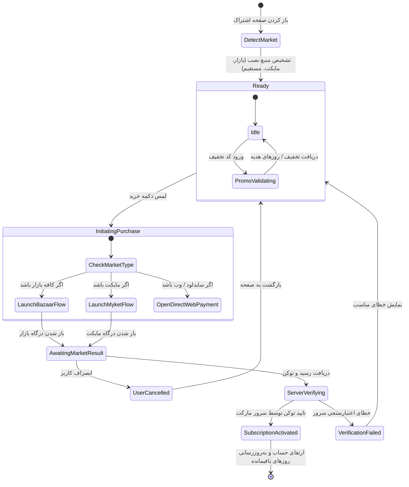

# Data Model: Multi-Market Payment & Subscription System

**Feature**: `006-multi-market-payment`  
**Date**: ۱۴۰۵/۰۷/۲۶ (2026-10-17)  
**Spec**: [spec.md](./spec.md) | **Plan**: [plan.md](./plan.md)

---

## ۱. مدل‌های پایگاه داده سرور (Server Database Tables & Entities)

### جدول تراکنش‌های پرداخت مارکت (`market_payment_transactions`)
این جدول تاریخچه دقیق، وضعیت تایید سرور-به-سرور و سوابق ضدتقلب را نگهداری می‌کند.

```sql
CREATE TABLE IF NOT EXISTS market_payment_transactions (
    id VARCHAR(64) PRIMARY KEY,                         -- UUID یکتای تراکنش
    user_id VARCHAR(64) NOT NULL REFERENCES users(id),  -- شناسه کاربر خریدار
    market VARCHAR(32) NOT NULL,                        -- 'CAFE_BAZAAR' یا 'MYKET' یا 'DIRECT_WEB'
    sku VARCHAR(64) NOT NULL,                           -- شناسه پلن یا محصول مثلاً 'plan-3m'
    purchase_token TEXT NOT NULL UNIQUE,                -- توکن یکتای رسید مارکت (برای جلوگیری از Replay Attack)
    developer_payload TEXT,                             -- پی‌لود ارسالی شامل userId جهت تطبیق امنیتی
    order_id VARCHAR(128),                              -- شناسه سفارش تولید شده توسط مارکت
    amount_paid_tomans BIGINT NOT NULL,                 -- مبلغ پرداختی نهایی به تومان
    promo_code VARCHAR(64),                             -- کد تخفیف مصرف‌شده (در صورت وجود)
    bonus_days INT DEFAULT 0,                           -- روزهای هدیه افزوده شده (مخصوص سناریوی مایکت)
    status VARCHAR(32) NOT NULL,                        -- 'PENDING', 'VERIFIED', 'FAILED', 'REFUNDED'
    raw_response JSONB,                                 -- پاسخ خام دریافتی از سرور مارکت
    created_at TIMESTAMP WITH TIME ZONE DEFAULT NOW(),
    updated_at TIMESTAMP WITH TIME ZONE DEFAULT NOW()
);

CREATE INDEX idx_market_tx_user ON market_payment_transactions(user_id);
CREATE INDEX idx_market_tx_token ON market_payment_transactions(purchase_token);
```

### وضعیت‌های مجاز تراکنش (`PaymentTransactionStatus`):
- `PENDING`: تراکنش از کلاینت دریافت شده و در حال استعلام از سرور مارکت است.
- `VERIFIED`: اصالت توکن توسط سرور بازار/مایکت تایید شد و روزهای اشتراک به کاربر اضافه گردید.
- `FAILED`: استعلام از سرور مارکت ناموفق بود (توکن جعلی یا نامعتبر).
- `REFUNDED`: تراکنش بعداً توسط مارکت لغو یا عودت داده شد.

---

## ۲. مدل‌های دامنه کلاینت (Client Domain & MVI State Models)

### ۲.۱. انام مارکت‌ها (`AppMarket`)
```kotlin
package ir.aispeaking.domain.model.payment

enum class AppMarket(val id: String, val titleFa: String) {
    CAFE_BAZAAR("CAFE_BAZAAR", "کافه بازار"),
    MYKET("MYKET", "مایکت"),
    DIRECT_WEB("DIRECT_WEB", "پرداخت مستقیم"),
    UNSUPPORTED("UNSUPPORTED", "پلتفرم پشتیبانی‌نشده")
}
```

### ۲.۲. وضعیت نتیجه خرید در کلاینت (`MarketPurchaseResult`)
```kotlin
package ir.aispeaking.domain.model.payment

sealed interface MarketPurchaseResult {
    data class Success(
        val purchaseToken: String,
        val orderId: String?,
        val sku: String,
        val developerPayload: String?,
        val market: AppMarket
    ) : MarketPurchaseResult

    data class UserCancelled(val message: String = "خرید توسط کاربر لغو شد") : MarketPurchaseResult
    data class Error(val errorCode: Int?, val message: String) : MarketPurchaseResult
}
```

### ۲.۳. به‌روزرسانی مدل MVI صفحه اشتراک (`SubscriptionUiState`)
```kotlin
data class SubscriptionUiState(
    val isLoading: Boolean = false,
    val plans: List<SubscriptionPlan> = emptyList(),
    val selectedPlanId: String = "plan-3m",
    val currentStatus: SubscriptionStatus? = null,
    val detectedMarket: AppMarket = AppMarket.DIRECT_WEB,
    
    // وضعیت کد تخفیف
    val promoCodeInput: String = "",
    val appliedDiscountPercent: Int = 0,
    val dynamicDiscountToken: String? = null, // ویژه کافه بازار
    val promoBonusDays: Int = 0,             // ویژه مایکت
    val promoFeedbackMessage: String? = null,
    val isPromoError: Boolean = false,
    
    // وضعیت خرید
    val isPurchasing: Boolean = false,
    val purchaseProgressMessage: String? = null,
    val errorMessage: String? = null
)
```

---

## ۳. چرخه حیات و ماشین وضعیت خرید (Purchase State Transitions)


