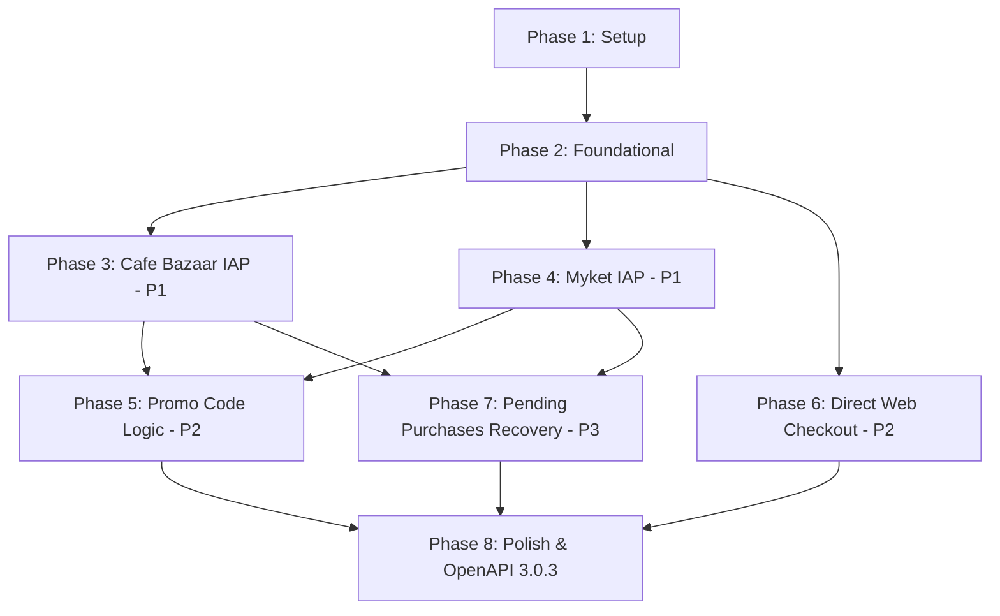

# Tasks: یکپارچه‌سازی سیستم پرداخت و تخفیف چندمارکته (بازار و مایکت)

**Feature**: `006-multi-market-payment`  
**Input**: [spec.md](./spec.md), [plan.md](./plan.md), [data-model.md](./data-model.md), [contracts/payment-api.md](./contracts/payment-api.md)

---

## Phase 1: Setup (Shared Infrastructure)

**Purpose**: آماده‌سازی زیرساخت ماژول‌ها، وابستگی‌های گریدل و متغیرهای پیکربندی مارکت‌ها

- [ ] T001 افزودن وابستگی کتابخانه پولکی (`ir.cafebazaar.poolakey:poolakey:2.2.0`) و ابزارهای موردنیاز به `gradle/libs.versions.toml` و `androidApp/build.gradle.kts`
- [ ] T002 [P] تنظیم مجوزها و تگ `<queries>` برای کافه بازار (`com.farsitel.bazaar`) و مایکت (`ir.mservices.market`) در فایل `androidApp/src/main/AndroidManifest.xml`
- [ ] T003 [P] تعریف کلیدها و متغیرهای پیکربندی API کافه بازار و مایکت در تنظیمات سرور `server/src/main/resources/application.conf`

---

## Phase 2: Foundational (Blocking Prerequisites)

**Purpose**: ایجاد جداول پایگاه داده سرور، مدل‌های دامنه مشترک و اینترفیس‌های تشخیص مارکت

**⚠️ CRITICAL**: تمامی داستان‌های کاربر به اتمام این فاز وابسته هستند.

- [ ] T004 ایجاد جدول تراکنش‌های پرداخت مارکت `market_payment_transactions` در ساختار Exposed سرور `server/src/main/kotlin/ir/speaking/feature/subscription/table/MarketPaymentTable.kt`
- [ ] T005 [P] تعریف مدل انام `AppMarket` و مدل نتیجه تراکنش `MarketPurchaseResult` در لایه مشترک دامنه `domain/src/commonMain/kotlin/ir/aispeaking/domain/model/payment/AppMarket.kt`
- [ ] T006 [P] ایجاد اینترفیس `PlatformMarketDetector` در لایه دامنه `domain/src/commonMain/kotlin/ir/aispeaking/domain/repository/PlatformMarketDetector.kt`
- [ ] T007 پیاده‌سازی بومی `AndroidMarketDetector` در اندروید بر پایه `packageManager.getInstallerPackageName` در `data/src/androidMain/kotlin/ir/aispeaking/data/payment/AndroidMarketDetector.kt`
- [ ] T008 [P] پیاده‌سازی `DefaultMarketDetector` برای سایر پلتفرم‌ها (دسکتاپ، وب و fallback) در `data/src/commonMain/kotlin/ir/aispeaking/data/payment/DefaultMarketDetector.kt`
- [ ] T009 ایجاد اینترفیس درایور پرداخت کلاینت `MarketBillingGateway` در لایه دامنه `domain/src/commonMain/kotlin/ir/aispeaking/domain/gateway/MarketBillingGateway.kt`
- [ ] T010 رجیستر کردن دتکتور و درایورهای پایه در ماژول‌های Koin کلاینت و سرور

**Checkpoint**: زیرساخت مشترک، دیتابیس و قراردادهای تشخیص محیط آماده است.

---

## Phase 3: User Story 1 - خرید اشتراک از طریق کافه بازار در اندروید (Priority: P1) 🎯 MVP

**Goal**: پیاده‌سازی اتصال به درگاه کافه بازار با پولکی، ارسال رسید به سرور و فعال‌سازی اشتراک

**Independent Test**: روی دستگاه یا شبیه‌ساز با بازار نصب‌شده، لمس دکمه خرید در صفحه اشتراک، نمایش دیالوگ خرید بازار، و فعال‌سازی اشتراک پس از پرداخت.

### Implementation for User Story 1
- [ ] T011 [US1] پیاده‌سازی درایور کلاینت بازار `BazaarBillingDriver` با کتابخانه Poolakey در `androidApp/src/main/kotlin/ir/aispeaking/androidApp/payment/BazaarBillingDriver.kt`
- [ ] T012 [P] [US1] پیاده‌سازی `MarketVerificationService` در سرور جهت استعلام رسید از API رسمی کافه بازار (`pardakht.cafebazaar.ir/devapi/v2`) در `server/src/main/kotlin/ir/speaking/feature/subscription/service/MarketVerificationService.kt`
- [ ] T013 [US1] ایجاد اندپوینت امن `POST /api/v2/subscriptions/verify-market-purchase` با متادیتای کامل Ktor OpenAPI سازگار با 3.0.3 در `server/src/main/kotlin/ir/speaking/feature/subscription/routing/subscriptionRouting.kt`
- [ ] T014 [US1] پیاده‌سازی متد `verifyMarketPurchase` در `SubscriptionRepo` سرور جهت افزودن روزهای پلن به کاربر و ذخیره توکن در `market_payment_transactions` (با جلوگیری از Replay Attack)
- [ ] T015 [US1] اتصال فرایند خرید بازار در `SubscriptionViewModel` و `SubscriptionScreen` در `feature/subscription/src/commonMain/kotlin/ir/aispeaking/subscription/SubscriptionViewModel.kt`

**Checkpoint**: خرید و تایید رسمی اشتراک از طریق کافه بازار کاملاً کار می‌کند.

---

## Phase 4: User Story 2 - خرید اشتراک از طریق مایکت در اندروید (Priority: P1)

**Goal**: پیاده‌سازی اتصال به پرداخت درون‌برنامه‌ای مایکت بر پایه پروتکل استاندارد IAB V3 و تایید سرور

**Independent Test**: روی دستگاه با مایکت، انتخاب پلن، باز شدن دیالوگ پرداخت مایکت و تایید رسید توسط REST API سرور مایکت.

### Implementation for User Story 2
- [ ] T016 [US2] اضافه کردن فایل‌های AIDL و هلپر ارتباطی `MyketIabHelper` به پروژه اندروید در `androidApp/src/main/kotlin/ir/aispeaking/androidApp/payment/myket/`
- [ ] T017 [US2] پیاده‌سازی درایور کلاینت مایکت `MyketBillingDriver` و اتصال به سرویس `ir.mservices.market.InAppBillingService.BIND`
- [ ] T018 [P] [US2] افزودن متد استعلام خرید مایکت (`developer.myket.ir/api/applications/...`) به `MarketVerificationService` در سرور
- [ ] T019 [US2] اتصال درایور مایکت به فکتوری `MarketBillingGateway` جهت سوییچ خودکار در زمان تشخیص نصاب مایکت

**Checkpoint**: خرید و تایید رسمی از طریق هر دو مارکت اصلی بازار و مایکت کاملاً مستقل فعال است.

---

## Phase 5: User Story 3 - اعمال کد تخفیف با پشتیبانی مارکت‌ها (Priority: P2)

**Goal**: اعمال تخفیف پویا در کافه بازار، و اعطای روزهای هدیه مازاد در مایکت با پیام دوستانه فارسی

**Independent Test**: تست ورود کد تخفیف در نسخه بازار (کاهش قیمت ریالی با Dynamic Discount) و در نسخه مایکت (نمایش روزهای هدیه و ثابت ماندن قیمت فاکتور).

### Implementation for User Story 3
- [ ] T020 [P] [US3] پیاده‌سازی تولید توکن امضاشده JWT تخفیف پویا (`DynamicDiscountService`) طبق الگوریتم رسمی کافه بازار در `server/src/main/kotlin/ir/speaking/feature/subscription/service/DynamicDiscountService.kt`
- [ ] T021 [US3] به‌روزرسانی اندپوینت `POST /api/v2/subscriptions/validate-promo` جهت دریافت فیلد `market` و بازگرداندن توکن تخفیف برای بازار یا فیلد `bonusDays` و پیام توضیحی برای مایکت
- [ ] T022 [US3] به‌روزرسانی `SubscriptionUiState` و متد `applyPromoCode` در `SubscriptionViewModel` برای دریافت و نگهداری توکن تخفیف پویا و روزهای هدیه
- [ ] T023 [US3] نمایش پیام شفاف به کاربر در صورت اعمال تخفیف در مایکت («معادل درصد تخفیف، روزهای هدیه به اشتراک شما اضافه خواهد شد») بدون نام بردن از سایر مارکت‌ها در کامپوننت `feature/subscription/src/commonMain/kotlin/ir/aispeaking/subscription/component/PromoCodeInputRow.kt`
- [ ] T024 [US3] پاس دادن توکن تخفیف پویا به `purchaseProduct` در درایور پولکی بازار

**Checkpoint**: کدهای تخفیف متناسب با قوانین اختصاصی هر مارکت و بدون نقض قوانین انتشار کار می‌کنند.

---

## Phase 6: User Story 4 - تشخیص پلتفرم و هدایت نسخه‌های سایدلود به پرداخت وب (Priority: P2)

**Goal**: هدایت خودکار برنامه‌های نصب‌شده مستقیم (APK سایدلود) و محیط‌های وب/دسکتاپ به درگاه مستقیم بانکی

**Independent Test**: نصب APK بدون نصاب مارکت، فشردن دکمه خرید، و هدایت به درگاه پرداخت مستقیم تحت وب.

### Implementation for User Story 4
- [ ] T025 [P] [US4] پیاده‌سازی اندپوینت `POST /api/v2/subscriptions/direct-checkout` در سرور جهت ایجاد لینک پرداخت بانکی (شاپرک/زیبال/زرین‌پال) برای نسخه‌های مستقیم در `subscriptionRouting.kt`
- [ ] T026 [US4] اتصال حالت `AppMarket.DIRECT_WEB` در `SubscriptionViewModel` برای باز کردن درگاه پرداخت در مرورگر سیستم (`PlatformUriHandler`)
- [ ] T027 [US4] مدیریت بازگشت موفق از درگاه وب (Deep Link به اپلیکیشن) و به‌روزرسانی خودکار وضعیت اشتراک در صفحه اصلی و پروفایل

**Checkpoint**: سناریوی نصب مستقیم و غیرمارکتی بدون وابستگی به اپلیکیشن‌های مارکت کار می‌کند.

---

## Phase 7: User Story 5 - بازیابی خریدهای معلق و همگام‌سازی خودکار (Priority: P3)

**Goal**: استعلام خودکار خریدهای انجام‌شده و ارسال به سرور حین ورود کاربر یا باز کردن صفحه اشتراک

**Independent Test**: انجام خرید و قطع اتصال اینترنت قبل از ارسال به سرور، سپس باز کردن مجدد صفحه اشتراک و بررسی تایید خودکار و بی‌سر و صدای خرید.

### Implementation for User Story 5
- [ ] T028 [US5] پیاده‌سازی متد `queryUnconsumedPurchases` در درایورهای بازار و مایکت در `androidApp`
- [ ] T029 [US5] افزودن فراخوانی بازیابی خریدهای معلق در زمان راه‌اندازی `SubscriptionViewModel.loadData()`
- [ ] T030 [US5] پیاده‌سازی بررسی هوشمند در سرور: در صورت تایید قبلی، بازگرداندن وضعیت موفق بدون تغییر مضاعف در تاریخ انقضا

---

## Phase 8: Polish & Cross-Cutting Concerns

**Purpose**: پاکسازی، بررسی سازگاری OpenAPI با Apidog و اجرای تست‌های سریع

- [ ] T031 بررسی و راستی‌آزمایی خروجی اندپوینت `/openapi` و `/openapi.json` در Ktor جهت انطباق ۱۰۰٪ با OpenAPI 3.0.3 و عدم خطای Type Array در Apidog
- [ ] T032 [P] بررسی رعایت استانداردهای راست‌به‌چپ (RTL)، جایگذاری دکمه بازگشت در سمت راست و وسط‌چین بودن عناوین طبق قانون اساسی پروژه
- [ ] T033 اجرای سناریوهای آزمون ثبت‌شده در `specs/006-multi-market-payment/quickstart.md`
- [ ] T034 تست بیلد نهایی `androidApp` و مطمئن شدن از عدم وجود اخطار ProGuard/R8 برای کتابخانه‌های پولکی و مایکت

---

## Dependencies & Execution Order

### Implementation Strategy
1. **MVP First (Phase 1, 2, 3)**: راه‌اندازی زیرساخت، دیتابیس، تشخیص نصاب و پرداخت کامل کافه بازار.
2. **مارکت دوم (Phase 4)**: اضافه کردن درایور مایکت بر پایه همان ساختار مشترک.
3. **تخفیف‌ها و سایدلود (Phase 5, 6)**: تکمیل سناریوهای تخفیف پویا، روزهای هدیه مایکت و پرداخت مستقیم وب.
4. **تاب‌آوری و نهایی‌سازی (Phase 7, 8)**: بازیابی خریدهای معلق و تست OpenAPI در Apidog.
